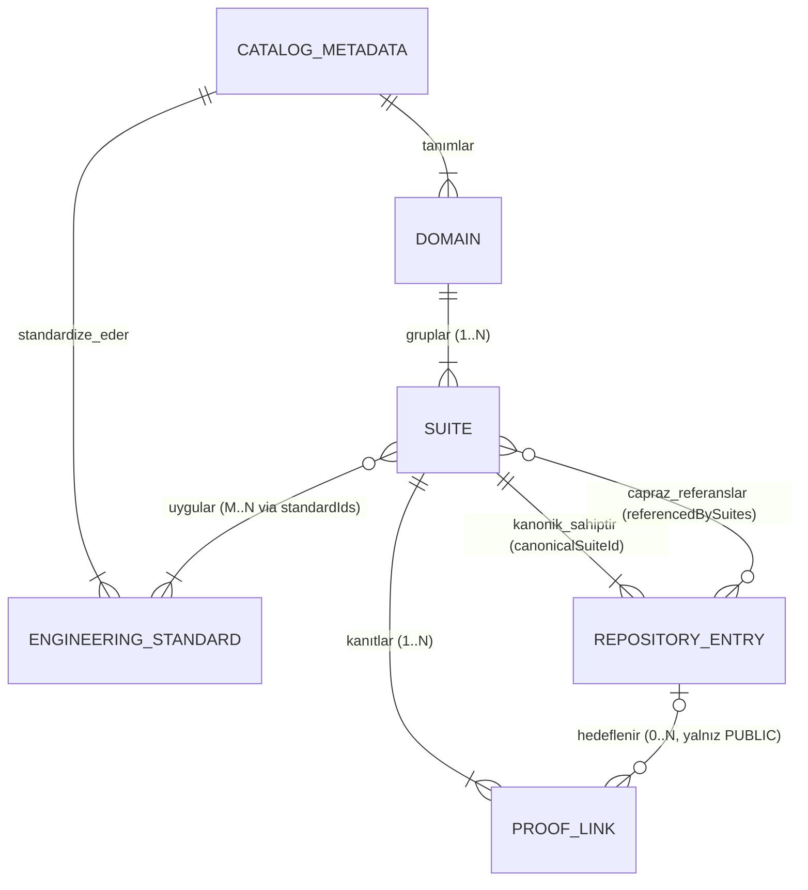
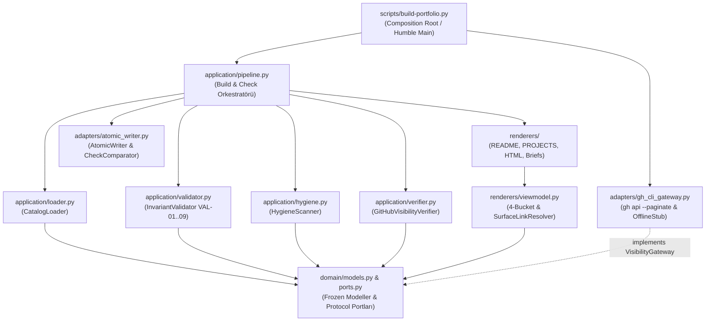
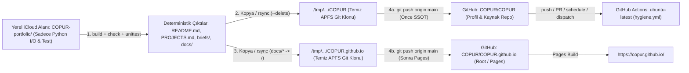

# COPUR-portfolio — TOGAF ADM BDAT İteratif İyileştirme Backlog'u ve Uygulama Planı

> **Mimari Metodoloji:** TOGAF ADM (Faz A → Faz B → Faz C-Veri → Faz C-Uygulama → Faz D/E/F/G) ardışık BDAT ajan döngüsü  
> **Katılan Uzman Ajanlar:** `business-architect` → `data-architect` → `application-architect` → `technology-architect`  
> **Kapsam:** `/Users/alicopur/Documents/GitHub/COPUR-portfolio/` (`COPUR/COPUR` profil deposu ve `https://copur.github.io/` kök vitrini)  
> **Doğrulanmış Canlı Envanter Notu (171 Repo):** Faz B→C geçişinde yapılan canlı `gh repo list COPUR --limit 500` doğrulamasıyla `EV_PNC_docs` (`PUBLIC`), `EV_PnC_Consent_docs` (`PUBLIC`), `PreFlight_PDI` (`PUBLIC`), `MasruFi_Framework` (`PRIVATE`) ve `EV Geek Stats` (`IN_DESIGN`) statüleri kesinleştirilmiştir.

---

## Yönetici Özeti & SWOT Zayıflık / Tehdit Giderme Backlog Matrisi

Aşağıdaki tablo, `program-manager` SWOT analizinde tespit edilen zayıf yönleri (**W1–W5**) ve tehditleri (**T1–T3**) tek tek TOGAF ADM fazlarına, backlog kalemlerine (**BG-01..BG-10**), veri/mimari değişmezlere (**VAL-01..VAL-09**, **FF-01..FF-06**) ve uygulama dalgalarına (**Dalga 1–3**) bağlar:

| Backlog ID | Öncelik | Giderilen SWOT (W/T) | Sahip TOGAF Fazı | Hedef Dosyalar / Bileşenler | Uygulama Dalgası & Kabul Kapısı |
|---|---|---|---|---|---|
| **BG-01** | **P0** | **W1, T2** | Faz B + Faz C (Veri) | `catalog/portfolio-catalog.json`, `README.md`, `PROJECTS.md`, `docs/index.html` | Dalga 1–2 (`VAL-03`, `VAL-04`, `GATE-01/02`) |
| **BG-02** | **P0** | **W1** | Faz B + Faz C (Uygulama) | `PROJECTS.md`, `docs/index.html`, `README.md` (4×10 taksonomi; Kart 9→Suite 9 & 10 ayrımı) | Dalga 1–2 (`VAL-01`, `VAL-02`, `GATE-02`) |
| **BG-03** | **P0** | **W1, W4** | Faz D (Teknoloji) | `scripts/publish-portfolio.sh`, `README.md`, `COPUR/COPUR.github.io` (`https://copur.github.io/`) | Dalga 3 (`GATE-06`, `GATE-07`) |
| **BG-04** | **P0** | **W2, T1** | Faz B + Faz C (Uygulama) | `catalog/portfolio-catalog.json` (`proofLinks[]`), `briefs/*.md`, `docs/briefs/*.html` | Dalga 2 (`VAL-07`, `GATE-01/02`) |
| **BG-05** | **P1** | **W2, T1** | Faz B | `OPF-Agentive-Platform` ADR/benchmark referansı, `PROJECTS.md`, `docs/index.html` | Dalga 2 (`FF-01`, `GATE-01`) |
| **BG-06** | **P1** | **W3, T1** | Faz B + Faz C (Veri/Uygulama) | `MasruFi_Framework` (`PRIVATE`), `briefs/*.md`, `docs/briefs/*.html` (redakte C4/ADR özetleri) | Dalga 1–2 (`VAL-04`, `VAL-05`, `FF-03`) |
| **BG-07** | **P1** | **W3, W5** | Faz B + Faz C (Uygulama) | `docs/index.html`, `PROJECTS.md`, `README.md` (4 katmanlı olgunluk rozetleri) | Dalga 2 (`VAL-08`, `GATE-02`) |
| **BG-08** | **P1** | **W4, T3** | Faz D (Teknoloji) | `scripts/publish-portfolio.sh` (`--dry-run`, `-m`, `/tmp` APFS çift-repo staging) | Dalga 3 (`FF-06`, `GATE-06`, `GATE-07`) |
| **BG-09** | **P1** | **W5** | Faz C (Uygulama) | `docs/index.html` (4 Domain filtresi, olgunluk seçici, Standartlar Matrisi, SEO/OG meta, sıfır `innerHTML`) | Dalga 2 (`FF-04`, `GATE-03`) |
| **BG-10** | **P2** | **T2, W4** | Faz D + Faz G | `.github/workflows/hygiene.yml`, `scripts/build-portfolio.py`, `tests/test_*.py` (`gh api --paginate`) | Dalga 1–3 (`FF-05`, `GATE-03/04/05`) |

---


---

# TOGAF ADM Faz A (Mimari Vizyon) ve Faz B (İş Mimarisi) — `COPUR-portfolio` BDAT İterasyon 1

> **Kapsam ve Kaynak Doğrulaması:** Bu analiz doğrudan `/Users/alicopur/Documents/GitHub/COPUR-portfolio/` altındaki `README.md`, `PROJECTS.md`, `docs/index.html`, `scripts/publish-portfolio.sh` ve `.github/workflows/hygiene.yml` dosyalarındaki gözlemlenen yapılara dayanır. Mevcut kod/dosyalarda hiçbir değişiklik yapılmamıştır. Gizlilik ve yayın hijyeni kuralları gereği hariç tutulan deneyim-yılı ifadeleri, gizli anahtar desenleri ve özel kişi/kurum tanımlayıcıları metin içinde yer almaz; yalnızca soyut hijyen politikası olarak referanslanır.

---

## 1. TOGAF ADM Faz A — Mimari Vizyon (Architecture Vision)

### 1.1 Hedef Mimari Vizyonu
`COPUR-portfolio` ekosistemini, üç ayrı dosyada (`README.md`, `PROJECTS.md`, `docs/index.html`) elle güncellenen ve zamanla yapısal olarak birbirinden kopan statik vitrin belgelerinden çıkararak; **tek doğruluk kaynağından (Single Source of Truth — SSOT) beslenen, kanıt-bağlantılı (evidence-linked), sıfır-sapmalı (zero-drift) ve denetlenebilir bir Kurumsal Ürün Portföyü Mimarisine** dönüştürmek.

Bu vizyon üç iş ilkesi üzerine oturur:
1. **Çıktı Değil Doğrulanabilir Sonuç (Outcomes over Output — `gothelf-lean-ux → ch03`):** Portföy, yalnızca repo listesi sunan bir katalog değil; her mimari iddiayı çalıştırılabilir demo, sözleşme şeması, C4/UML diyagramı veya ADR/test kanıtıyla destekleyen bir yönetici güven arayüzüdür.
2. **Sınırlı Bağlam ve Ortak Dil Disiplini (Bounded Contexts & Ubiquitous Language — `evans-ddd → ch02, ch14`):** Birbiriyle ilgisiz alanlar (ör. otomotiv CAN telemetrisi ile çok kiracılı serverless medya platformu) aynı ürün kartında birleştirilemez; her iş alanı kendi sponsoruna, yaşam döngüsüne ve kanonik repo envanterine sahip ayrı bir **Ürün Süiti** olarak tanımlanır.
3. **Otomasyonla Yönetişim (Govern by Automation — `software-architecture → ch01a, ch02a`):** Dokümanlar arası tutarlılık, gizlilik/hijyen politikaları, canlı URL doğrulaması ve GitHub Pages senkronizasyonu manuel disipline değil CI ve yayın boru hattındaki otomatik uygunluk fonksiyonlarına (fitness functions) bağlanır.

### 1.2 Paydaş Haritası ve Değer Önerisi

| Paydaş Grubu | Temel Endişe / Risk Algısı | Hedeflenen Değer Önerisi | Başarı Sinyali (Beklenen Kanıt) |
|---|---|---|---|
| **Tier-1 Banka / Finans Kurumu CTO & Kurumsal Mimari Kurulu (EAB)** | Yapay zeka ajanlarının halüsinasyon riski, veri yerleşimi (CBUAE 3/2025, PCI-DSS v4), denetlenebilirlik | *Deterministic Sandwich (`Agent = Model + Harness`)*, yerinden yönetim/on-prem araç güvenlik duvarı (`jeff`) ve FinTechBankX/Camunda 8.10 kalıplarının şeffaf mimari incelemesi | Kurumsal Standartlar matrisi, şema/Zod doğrulama özeti, `demo-camunda-k8s` tek komutluk çalışma kanıtı |
| **Teknik Due Diligence / Yatırımcı / Denetçi** | Özel depolardaki projelerin ve `>80% pgvector` gibi güçlü metriklerin "vaporware / aşırı iddia" algısı yaratması (**T1, W2, W3**) | Özel fikri mülkiyeti açmadan her iddia için derin linkli kanıt paketleri (quickstart, sözleşme testi, mimari özet, ADR) ve net **Olgunluk Katmanı** etiketi | Hiçbir yüksek seviyeli teknik iddianın kanıtsız veya etiketsiz kalmaması |
| **EV PnC Merkezi Düzenleyici Kurum (Sponsor 1 — Trust Anchor)** | Tarafsız rıza otoritesinin ticari cüzdan/sadakat katmanlarıyla karıştırılmaması | **Consent EV PnC** (Süit 7) için bağımsız düzenleyici yönetişim sınırları, tek kaynak OpenAPI/AsyncAPI/JSON Schema sözleşmeleri ve tüketici güdümlü doğrulama (`EV_PnC_Consent_testkit`) | Düzenleyici rıza otoritesi ile ticari cüzdanların görsel ve yapısal olarak net ayrışması |
| **Fintech / CPO / eMSP İş Ortakları (Sponsor 2 — Ekosistem)** | Hızlı beyaz etiketli (white-label) EV cüzdan, sadakat ve OCPI dolaşım (roaming) entegrasyonu | **Wallet PnC EV** (Süit 8) için uçtan uca hub ağ geçidi, OCPI adaptörleri, simülatör ve pilot analitik bileşenlerinin net ürünleşmesi | Sözleşme reposu (`EV_PNC_hub-contracts`), `EV_PNC_simulator` ve altyapı modüllerine doğrudan erişim |
| **Dijital Medya / Event-Driven SaaS Mühendislik Liderleri** | Kart 9 içinde gömülü kalan serverless platformun fark edilmemesi (**W1**) | **Süit 10** olarak ayrıştırılmış, ADR-yönetimli Go/AWS Serverless çok kiracılı mimari ve idempotent iş akışı hikâyesi | Bağımsız süit görünürlüğü ve sanitize edilmiş ADR/idempotency akış özeti |
| **Portföy Sahibi / Sürüm Operatörü** | iCloud kilit hataları, sabitlenmiş commit mesajları, eksik `--dry-run`, `COPUR.github.io` senkron kopukluğu (**W4, T2, T3**) | Tek kaynaktan otomatik üretim, `--dry-run` önizleme, `/tmp` üzerinde kilit-bağımsız git push ve sayfalamalı link doğrulaması | Sıfır manuel çapraz-dosya düzeltmesi; hatasız tek akışlı yayın |

### 1.3 Ölçülebilir KPI'lar ve Mimari Uygunluk Fonksiyonları (Baseline → Target)

| KPI ID | KPI Tanımı | Mevcut Baz Değer (Gözlenen) | Hedef Değer (BDAT Döngü Sonu) | Doğrulama / Fitness Function Mekanizması |
|---|---|---|---|---|
| **KPI-1** | **Çapraz-Doküman Yapısal Tutarlılık Oranı** (`README.md`, `PROJECTS.md`, `docs/index.html`) | **Düşük (Sapmalı):** 4 Süit vs 9 Kart; Kart 9 iki ilgisiz alanı birleştiriyor; `Product 3.2` iki kez tekrarlanıyor; `redbank-agentive-framework` mükerrer | **%100 Tutarlılık:** Tüm yüzeylerde kanonik **4 Yönetici Alanı / 10 Ürün Süiti** ve **0** mükerrer/yanlış numara | Faz C SSOT manifestinden otomatik üretim + CI parity kontrolü |
| **KPI-2** | **Kanonik Repo Envanteri Kapsama ve Eşleşme Oranı** | **Eksik / Dağınık:** `loan-lifecycle-core` ve `accounts-ledger-service` yalnızca `docs/index.html`'de; `fintechbankx-platform-delivery-iac-cicd-templates` yalnızca `PROJECTS.md`'de; `EV_PNC_docs` belirsiz | **%100 Eşleşme:** Aktif tüm public/private repolar tek manifestte ve üç yüzeyde tutarlı; `EV_PNC_docs` durumu kesinleşmiş | Otomatik envanter diff kontrolü (`--paginate` destekli `gh repo list`) |
| **KPI-3** | **Kanıt Bağlantısı (Proof-Link) Kapsama Oranı** | **%0 Derin Kanıt:** Yalnızca repo kök URL'leri mevcut; `>80% pgvector`, tek komutluk K8s, sözleşme testleri için doğrudan derin link yok | **%100 Süit Kapsamı (10/10 Süit):** Her süitte en az 1 doğrulanabilir derin kanıt linki (quickstart / sözleşme / testkit / diyagram veya sanitize edilmiş ADR özeti) | Kanıt linki şema zorunluluğu + HTTP/anchor doğrulama betiği |
| **KPI-4** | **Olgunluk & Görünürlük Etiketleme Tamlığı** | **Eksik:** `MasruFi` için repo ve olgunluk etiketi yok; HTML kartlarında yapılandırılmış olgunluk rozeti yok | **%100 Etiketlenmiş:** 10/10 süit ve `MasruFi` dahil tüm alt ürünler 4 kanonik olgunluk katmanından birine atanmış | SSOT şemasında `maturity_tier` ve `visibility` zorunlu alan doğrulaması |
| **KPI-5** | **Vitrin UI & Keşfedilebilirlik Tamlığı (`docs/index.html`)** | **Statik / Eksik:** Domain filtresi yok, SEO/OpenGraph meta etiketi yok, `Enterprise Engineering Standards` tablosu HTML'de yok | **Tam Uyum:** 4 domain filtresi, olgunluk rozetleri, Standartlar tablosu ve eksiksiz `<meta description>` + `og:*` etiketleri | HTML yapı/meta kontrolü ve Lighthouse/DOM doğrulaması |
| **KPI-6** | **Yayın Boru Hattı Güvenilirliği ve Hijyen Geçişi** | **Kırılgan:** Sabit commit mesajı, `--dry-run` yok, `--limit 200` sınırı, yanlış Pages URL (`copur.github.io/COPUR/`), `COPUR.github.io` senkronu yok | **%100 Güvenli Yayın:** `--dry-run` desteği, `/tmp` klonunda güvenli push, `--paginate` repo kontrolü, doğru root URL (`https://copur.github.io/`) ve çift repo senkronu | `publish-portfolio.sh --dry-run` + `.github/workflows/hygiene.yml` genişletilmiş kapısı |

### 1.4 Önceliklendirilmiş İyileştirme İş Listesi (`BG-01` .. `BG-10`)

| İş Kalemi | Öncelik | Giderilen Zayıflık / Tehdit | İş Açıklaması ve Beklenen İş Çıktısı (Outcome) | Hedef Artifaktlar |
|---|---|---|---|---|
| **BG-01** | **P0 (Kritik)** | **W1, T2** | **Tek Doğruluk Kaynağı (SSOT) ve Kanonik Repo Envanteri Uzlaştırması:** `loan-lifecycle-core`, `accounts-ledger-service`, `fintechbankx-platform-delivery-iac-cicd-templates`, `ai-agent-protocols`, `fintechbankx-governance-architecture-enablement-adr-runbooks` ve `EV_PNC_docs` dahil tüm public/private repoların tek kanonik sahiplik kuralına bağlanması. *Çıktı:* Üç doküman arasındaki sessiz envanter kaymalarının sıfırlanması. | Faz C kanonik manifesti (`portfolio.yaml`/`json`), `README.md`, `PROJECTS.md`, `docs/index.html` |
| **BG-02** | **P0 (Kritik)** | **W1** | **Kart 9 Domain Ayrıştırması ve Katalog Kusurlarının Giderilmesi:** Kart 9'un **Süit 9 (EV Telemetry, CAN & Driver Companion)** ve **Süit 10 (Multi-Tenant Serverless News & Observability Platform)** olarak bölünmesi; `PROJECTS.md`'deki çift `Product 3.2` numaralama hatasının ve mükerrer `redbank-agentive-framework` girişinin düzeltilmesi. *Çıktı:* Net alan sınırları ve hatasız katalog bütünlüğü. | `PROJECTS.md`, `docs/index.html`, `README.md` |
| **BG-03** | **P0 (Kritik)** | **W1, W4** | **Canlı GitHub Pages URL Hizalaması:** `scripts/publish-portfolio.sh` içindeki `https://copur.github.io/COPUR/` referansının canlı kök alan adı `https://copur.github.io/` ile hizalanması ve `COPUR/COPUR.github.io` yayın hedefinin tanımlanması. *Çıktı:* Müşteri ve denetçilerin kırık veya yanlış alt-yol URL'lere yönlendirilmesinin önlenmesi. | `scripts/publish-portfolio.sh`, `README.md`, `COPUR/COPUR.github.io` hedefi |
| **BG-04** | **P0 (Kritik)** | **W2, T1** | **Süit Bazlı Kanıt Paketi & Derin Link Matrisi:** Her süitin salt repo kök linki yerine doğrudan quickstart, Helm/K8s komutu, sözleşme şeması, `testkit` veya C4/UML diyagramı derin linki yayınlaması. *Çıktı:* Teknik due diligence incelemelerinde doğrulanabilirlik ve güven artışı. | SSOT `evidence_links` alanı, `README.md`, `PROJECTS.md`, `docs/index.html` |
| **BG-05** | **P1 (Yüksek)** | **W2, T1** | **Sayısal ve Güçlü Mimari İddiaların Metodoloji ile Bağlanması:** `>80% pgvector` anlamsal önbellek baypası, tek komutluk K8s kurulumu ve tüketici güdümlü sözleşme testleri iddialarının doğrudan ölçüm/doküman/ADR derin linkine bağlanması; kamu kanıtı henüz yoksa iddianın niteliksel ifadeyle sınırlandırılması. *Çıktı:* "Aşırı iddia / vaporware" riskinin ortadan kaldırılması. | `PROJECTS.md`, `README.md`, `docs/index.html`, `OPF-Agentive-Platform` doküman linkleri |
| **BG-06** | **P1 (Yüksek)** | **W3, T1** | **`MasruFi` Konumlandırması ve Özel Amiral Gemileri İçin Sanitize Özetler:** `MasruFi` için açık olgunluk/görünürlük statüsü ve repo/modül bağının netleştirilmesi; `EA-Agentive-Platform-v3`, `X_Bank`, `RedBank`, `OPF V3/V4`, `book-to-skill` ve `daily-ev-news-serverless-go` için özel kodu açmadan sanitize mimari özetlerinin yayımlanması. *Çıktı:* Kapalı repoların mimari derinliğinin güvenli biçimde kanıtlanması. | Faz B/C `MasruFi` kaydı, kamuya açık mimari özet / C4 diyagram linkleri |
| **BG-07** | **P1 (Yüksek)** | **W3, W5** | **4 Katmanlı Ürün Olgunluk Modeli (Maturity Tier) Uygulanması:** Tüm 10 süite ve alt ürünlere `Runnable K8s / CLI Demo`, `Public Reference Baseline`, `Contract-First Ecosystem` ve `Governed Private Enterprise Baseline` rozetlerinin atanması. *Çıktı:* Yönetici ve mühendislik alıcılarının her ürünün erişilebilirlik düzeyini anında kavraması. | `docs/index.html`, `PROJECTS.md`, `README.md` |
| **BG-08** | **P1 (Yüksek)** | **W4, T3** | **Yayın Betiği Dayanıklılığı ve iCloud Kilit Koruması:** `scripts/publish-portfolio.sh` içine `--dry-run` bayrağı, parametrik/anlamlı commit mesajı desteği, `/tmp` üzerinde temiz geçici git klonu üzerinden push (`mmap` / `index.lock` timeout koruması) ve `COPUR/COPUR.github.io` otomatik senkronu eklenmesi. *Çıktı:* Sıfır kilit hatası, temiz git tarihçesi ve tek adımlı çift hedef yayını. | `scripts/publish-portfolio.sh` |
| **BG-09** | **P1 (Yüksek)** | **W5** | **Vitrin UI/UX ve Keşfedilebilirlik Yenilemesi (`docs/index.html`):** 4 Yönetici Alanı filtreleme çubuğu, olgunluk rozetleri, `README.md`'deki *Enterprise Engineering Standards Across All Products* tablosunun HTML'e taşınması ve SEO/OpenGraph/Twitter meta etiketlerinin eklenmesi. *Çıktı:* İlk bakışta gezilebilir, paylaşılabilir ve standartları görünür interaktif vitrin. | `docs/index.html` |
| **BG-10** | **P2 (Orta-Yüksek)** | **T2, W4** | **Otomatik Link, Sayfalama ve Çapraz-Tutarlılık Kapısı:** `gh repo list` çağrısındaki `--limit 200` sınırının `--paginate` ile değiştirilmesi; hem yayın betiğine hem `.github/workflows/hygiene.yml` içine çapraz-dosya tutarlılık, hijyen ve derin link kontrolünün eklenmesi. *Çıktı:* Portföy büyüdükçe sessiz link çürümesinin ve katalog sapmasının yapısal olarak engellenmesi. | `.github/workflows/hygiene.yml`, `scripts/publish-portfolio.sh` |

---

## 2. TOGAF ADM Faz B — İş Mimarisi (Business Architecture)

### 2.1 Kanonik 4 Yönetici Alanı (Executive Domains) ve 10 Ürün Süiti Taksonomisi

Evrimsel DDD ilkeleri (`evans-ddd → ch14, ch15`, `microservices-and-ddd → 07a`) uyarınca her ürün süiti tek bir **Kanonik Yönetici Alanına (Bounded Executive Domain)** atanır; iki dosya arasında savrulan repolar tek bir kanonik eve bağlanır (ikincil kullanım alanları yalnızca "çapraz bağımlılık / referans" olarak işaretlenir):

- **Kanonik Sahiplik Düzeltmeleri (W1 Kapanışı):**
  1. `ai-agent-protocols`: `docs/index.html` Kart 1 (OPF) içinden çıkarılıp **Domain 1 / Süit 1** altına alınır; Süit 3 (OPF) yalnızca tüketici referansı verir.
  2. `fintechbankx-governance-architecture-enablement-adr-runbooks`: Tüm `fintechbankx-governance-*` API ve yönetişim kataloglarıyla bütünlük içinde **Domain 2 / Süit 6** altında konumlandırılır; Domain 1 / Süit 1'den mimari pratik referansı verilir.
  3. `fintechbankx-lendingpayments-loan-lifecycle-core` ve `neo-fintechbankx-corebanking-accounts-ledger-service`: Yalnızca `docs/index.html`'de kalmaktan çıkarılıp **Domain 2 / Süit 5** altında üç dosyada da zorunlu olarak yer alır.
  4. `fintechbankx-platform-delivery-iac-cicd-templates`: Yalnızca `PROJECTS.md`'de kalmaktan çıkarılıp **Domain 2 / Süit 6** altında üç dosyada da yer alır.
  5. `redbank-agentive-framework`: `PROJECTS.md` Satır 10'daki mükerrer kayıt tekilleştirilir (**Süit 1**).
  6. `PROJECTS.md`'deki çift `Product 3.2` numaralama hatası, **Süit 1..10** kanonik kimlikleriyle tamamen ortadan kaldırılır.
  7. Kart 9 temiz biçimde **Süit 9 (Domain 3)** ve **Süit 10 (Domain 4)** olarak ayrıştırılır.
  8. `EV_PNC_docs` vs `EV_PnC_Consent_docs` ayrımı: İncelenen üç dosyada yalnızca `EV_PnC_Consent_docs` (Süit 7) gözlemlenmiştir; `EV_PNC_docs` adının GitHub organizasyonunda mevcut olup olmadığı Faz C envanter doğrulamasında kontrol edilip varsa **Süit 8**'e bağlanacak, yoksa referans dışı bırakılacaktır.

#### Kanonik 4 × 10 Taksonomi Matrisi

| Yönetici Alanı (Domain) | Kanonik Süit | Hedef Müşteri / Sponsor | İş Yeteneği (Business Capability) ve Ortak Dil (Ubiquitous Language) | Kanonik Public Repolar | Kanonik Private / İn-Design Bileşenler |
|---|---|---|---|---|---|
| **D1. Agentic AI Architecture & Governance** | **Süit 1: Agentive Enterprise Architecture, Governance & Cloud Controls** | Tier-1 Finans Kurumları, Kurumsal Mimari Kurulları (EAB), Düzenlemeye Tabi Mühendislik Ekipleri | TOGAF ADM & BDAT uyumlu çoklu ajan mimari tasarımı; *Deterministic Sandwich (`Agent = Model + Harness`)*, Zod/JSON şema kısıtlaması, DPoP ajan ağ geçidi, Security SLM ile akış DLP, CBUAE 3/2025 & PCI-DSS v4 uyumu, Makine-okunur Mimari-as-Code ve çoklu protokol birlikte çalışabilirlik (Google ADK, MCP, A2A, Quarkus, LangChain4j) | `ai-governance-framework`, `architecture-as-code`, `common-cloud-controls`, `ai-agent-protocols` | `EA-Agentive-Platform-v3`, `X_Bank-Agentive-Architecture-Framework`, `AgentiveArchitectureFW_v3`, `redbank-agentive-framework`, `redbank-agentive-enterprise-architecture`, `fintechbankx-governance-architecture-enablement-enterprise-architecture` |
| **D1. Agentic AI Architecture & Governance** | **Süit 2: Jeff & Book-to-Skill — On-Prem AI Tool-Call Firewall & Knowledge Synthesis** | Veri yerleşimi ve maliyet kontrolü zorunlu olan kurumsal mühendislik ekipleri | Harici ücretli API'lere kod/prompt çıkarmadan `PreToolUse` kancalarıyla araç çağrısı denetimi (`jev` System One API uyumlu `GLiFormer` 400M + yerel Qwen / LM Studio yükseltmesi); teknik kitap bilgisinin yeniden kullanılabilir ajan becerilerine otomatik sentezlenmesi | `jeff` | `book-to-skill`, `book-skills` |
| **D2. Agentic Open Finance & Core Banking** | **Süit 3: OPF — Agentive Open Finance (BaaS) Platform** | Açık Finans (Open Finance) Ekosistemleri, BaaS Sağlayıcıları, Geleneksel Çekirdek Bankalar | Açık Finans kanalları ile eski çekirdek bankacılık kısıtları arasında *Agentive Translation Layer*; Temporal-orkestrasyonlu kalıcı otonom ajanlar, Model Cascades (MoE) ile SLM yönlendirme ve `pgvector` anlamsal önbellekleme | `OPF-Agentive-Platform` *(V2 Public)* | `OPF_Agentive_Platform_V4`, `OPF-Agentive-Platform-V3` |
| **D2. Agentic Open Finance & Core Banking** | **Süit 4: Instant Payment Exception & BPO Orchestrator** | Tier-1 Bankalar, Ödeme Hizmeti Sağlayıcıları (PSP), Anlık Ödeme Operasyonları (TR BKM FAST) | Belirsiz/bekleyen (`PDNG`) anlık ödeme istisnalarının şemaya tekrar gönderilmeden deterministic yönetimi; Camunda 8.10 BPMN/DMN, `OutputVariables` çalışma zamanı PII/tutar sızıntı bariyeri, `x-idempotency-key` ve Keycloak OIDC sağlayıcı izolasyonu | `demo-camunda-k8s`, `neo-fintechbankx-bpo-process-orchestration`, `camunda8-banking-poc` | — |
| **D2. Agentic Open Finance & Core Banking** | **Süit 5: FinTechBankX Core Lending, Ledger, KYC & MasruFi** | Perakende/Kurumsal Bankalar, Dijital & İslami / Katılım Bankaları | DDD ve Hexagonal Mimari ile kredi yaşam döngüsü, hesap/defter (ledger) servisleri, müşteri KYC profili; ayrıca **MasruFi** alt motoruyla İslami finans sözleşmeleri (**Istisna, Ijarah, Qard Hassan**) ve kripto-bankacılık primitifleri | `fintechbankx-lendingpayments-loan-lifecycle-core`, `neo-fintechbankx-corebanking-accounts-ledger-service`, `fintechbankx-customer-profile-kyc-core` | `enterprise-loan-management-system`, **`MasruFi`** *(açık repo bağı & statü doğrulama kapısına tabi — bkz. §2.2)* |
| **D2. Agentic Open Finance & Core Banking** | **Süit 6: FinTechBankX Cloud Platform, IaC & API Governance** | Platform Mühendisliği Ekipleri, API Yönetişim Loncaları (Guilds) | Keycloak/LDAP IAM, Terraform IaC modülleri, CI/CD şablonları, Service Mesh güvenliği, Kafka olay akışı, ADR çalıştırma kılavuzları ve merkezi OpenAPI/AsyncAPI/Schema Registry sözleşme katalogları | `fintechbankx-platform-identity-iam-keycloak-ldap`, `fintechbankx-platform-delivery-iac-terraform-modules`, `fintechbankx-platform-delivery-iac-cicd-templates`, `fintechbankx-platform-mesh-security-service-mesh`, `fintechbankx-platform-event-streaming-kafka`, `fintechbankx-governance-api-contracts-openapi-catalog`, `fintechbankx-governance-api-contracts-asyncapi-catalog`, `fintechbankx-governance-api-contracts-schema-registry`, `fintechbankx-governance-architecture-enablement-adr-runbooks` | `fintechbankx-platform-observability-sre-operations` |
| **D3. EV Mobility — Consent, Wallet & Telemetry** | **Süit 7: Consent EV PnC — Centralized Regulator Consent Authority** | **Sponsor: Merkezi Düzenleyici Kurum / Devlet (Tarafsız Güven Çapası)** | Tüm ekosistemden bağımsız, tarafsız Plug & Charge rıza kayıt defteri: rıza katalogları, bildirimler, onaylar (grants), makbuzlar, güvenceler, veri sahibi hakları, karar mekanizması (decisioning) ve ekosistem çapında iptal (revocation) yayılımı | `EV_PnC_Consent_contracts`, `EV_PnC_Consent_registry`, `EV_PnC_Consent_decision`, `EV_PnC_Consent_testkit`, `EV_PnC_Consent_docs` | — |
| **D3. EV Mobility — Consent, Wallet & Telemetry** | **Süit 8: Wallet PnC EV — Fintech & CPO Wallet + Loyalty Platform** | **Sponsor: Ekosistem Paydaşları (Fintech'ler, Şarj Ağı İşletmecileri / CPO'lar, eMSP'ler)** | Düzenleyiciden ayrı olarak ticari/paydaş sponsorlu markalı EV cüzdan ve sadakat platformu: hub ağ geçidi, sözleşme paketi, OCPI eMSP dolaşım adaptörleri, telemetri, pilot analitiği, simülatör ve altyapı modülleri | `EV_PNC_hub-gateway`, `EV_PNC_hub-contracts`, `EV_PNC_ocpi-emsp`, `EV_PNC_ocpi-model`, `EV_PNC_telemetry`, `EV_PNC_pilot-analytics`, `EV_PNC_simulator`, `EV_PNC_infra-modules` *(Faz C kapısı: `EV_PNC_docs` varlık kontrolü)* | — |
| **D3. EV Mobility — Consent, Wallet & Telemetry** | **Süit 9: EV Telemetry, CAN & Driver Companion** *(Eski Kart 9 – Bölüm A)* | Otomotiv Ar-Ge Ekipleri, Araç İçi Tanılama ve Sürücü Deneyimi Ürünleri | CAN veri yolu inceleme ve açık/FSD CAN modifikasyon araçları, çevrimdışı tezgâh (bench) simülasyonu, teslimat öncesi muayene (`PreFlight_PDI`) ve rota/hava durumu/50 km CPO keşifli Tesla Fleet Telemetry iPhone uygulaması (*EV Geek Stats*) | `tesla-can-mod`, `tesla-fsd-can-mod`, `tesla-open-can-mod` | `tesla-can-explorer-testing-only`, `PreFlight_PDI`, `EV Geek Stats` |
| **D4. Serverless Content & Operational Intelligence** | **Süit 10: Multi-Tenant Serverless News & Observability Platform** *(Eski Kart 9 – Bölüm B)* | Dijital Yayıncılık Platformları, Event-Driven SaaS Ekipleri | ADR-yönetimli Go/AWS Serverless çok kiracılı haber toplama ve idempotent yeniden oynatma korumalı iş akışı platformu; yerel Node.js 20+ ajanları ve bağımsız konuşlandırılabilen Prisma/Docker gösterge paneli mikroservisi | — | `daily-ev-news-serverless-go`, `daily-ev-news-agent`, `daily-news-agent`, `dashboard-service` |

#### Domain 3 Sponsorluk ve Bağlam Sınırı (Context Boundary) Notu
`evans-ddd → ch14` gereği **Süit 7** ile **Süit 8** arasındaki sınır teknik değil **kurumsal ve yasal sponsorluk** sınırıdır ve dokümanlarda birbirinin devamı/alt modülü gibi gösterilemez:
- **Consent EV PnC (Süit 7):** Düzenleyici otorite (*Centralized Regulator / Government Neutral Trust Anchor*) adına tek hakikat kaynağı olarak rıza ve veri sahibi haklarını yönetir; ticari ödeme/sadakat mantığı içermez.
- **Wallet PnC EV (Süit 8):** Fintech, CPO ve eMSP'lerin ticari cüzdan, sadakat puanı ve OCPI dolaşım (roaming) rekabetini destekleyen paydaş platformudur; rıza kararlarını düzenleyici otorite sözleşmeleriyle tüketir (*Customer/Supplier* veya *Open Host Service + Published Language* ilişkisi).

---

### 2.2 Ürün Olgunluk Katmanı Modeli (Product Maturity Tier Model)

Her ürün süitinin (ve karma görünürlüklü süitlerde alt bileşenlerin) dış paydaşlara karşı net bir "erişilebilirlik ve doğrulanabilirlik vaadi" sunması için 4 kanonik olgunluk katmanı tanımlanır:

| Olgunluk Katmanı | İş Tanımı ve Paydaş Vaadi | Dışarıya Açılan Minimum Kanıt Standardı | Kapsanan Süitler / Bileşenler |
|---|---|---|---|
| **1. `Runnable K8s / CLI Demo`** | Dış bir mühendis veya teknik değerlendirici yerel ortamda ya da Kubernetes/Helm üzerinde çalışan bir örneği doğrudan ayağa kaldırıp uçtan uca akışı gözlemleyebilir. | Tek komutluk çalıştırma talimatı (`README`/quickstart derin linki), Helm/Docker veya CLI parametreleri, çalışan koruma bariyeri (`PreToolUse` / `OutputVariables`) test çıktısı özeti. | • **Süit 2 (Kamuya Açık Çekirdek):** `jeff`<br>• **Süit 4 (Tam Süit):** `demo-camunda-k8s`, `camunda8-banking-poc`, `neo-fintechbankx-bpo-process-orchestration` |
| **2. `Public Reference Baseline`** | Çok modüllü, üretime yönelik referans mimariler, IaC/Mesh/Kafka şablonları, API katalogları ve açık Ar-Ge kod tabanları; doğrudan kod ve yapısal kalite incelemesine açıktır. | Mimari modül haritası, OpenAPI/AsyncAPI/Terraform/Kafka şema linkleri, temel yapılandırma/derleme doğrulaması ve alt-modül sorumluluk sınırları. | • **Süit 1 (Yönetişim/Protokol Katmanı):** `ai-governance-framework`, `architecture-as-code`, `common-cloud-controls`, `ai-agent-protocols`<br>• **Süit 3 (V2 Kamuya Açık Katman):** `OPF-Agentive-Platform`<br>• **Süit 5 (Kamuya Açık Çekirdek):** `loan-lifecycle-core`, `accounts-ledger-service`, `kyc-core`<br>• **Süit 6 (Kamuya Açık Platform):** 9 public `fintechbankx-*` reposu<br>• **Süit 9 (Açık CAN Araçları):** `tesla-can-mod`, `tesla-fsd-can-mod`, `tesla-open-can-mod` |
| **3. `Contract-First Ecosystem`** | Birden fazla bağımsız servisi tek bir yetkili sözleşme deposu (OpenAPI, AsyncAPI, JSON Schema) etrafında birleştiren, otomatik SDK ve tüketici güdümlü sözleşme testleriyle yönetilen dağıtık ekosistemler. | Kanonik sözleşme reposu derin linki, sözleşme doğrulama (`testkit` / `simulator`) çalıştırma kanıtı, konteks haritası ve sponsorluk sınırı dokümanı. | • **Süit 7 (Tam Süit):** `Consent EV PnC` (5 public repo)<br>• **Süit 8 (Tam Süit):** `Wallet PnC EV` (8 public repo) |
| **4. `Governed Private Enterprise Baseline`** | Müşteri gizliliği, fikri mülkiyet veya regülasyon (CBUAE 3/2025, PCI-DSS v4) nedeniyle kaynak kodu özel depolarda korunan kurumsal üretim tabanları veya kapalı Ar-Ge ürünleri. | Kaynak kod sızdırmadan yayınlanan **Sanitize Mimari Kanıt Paketi**: C4 diyagramı, anonimleştirilmiş JSON/Zod sözleşme örneği, ADR özeti ve açık statü etiketi. | • **Süit 1 (Amiral Gemileri):** `EA-Agentive-Platform-v3`, `X_Bank-Agentive-Architecture-Framework`, `AgentiveArchitectureFW_v3`, `redbank-agentive-framework`, `redbank-agentive-enterprise-architecture`, `fintechbankx-governance-architecture-enablement-enterprise-architecture`<br>• **Süit 2 (Özel Bilgi Boru Hattı):** `book-to-skill`, `book-skills`<br>• **Süit 3 (Regüle Sürümler):** `OPF_Agentive_Platform_V4`, `OPF-Agentive-Platform-V3`<br>• **Süit 5 (Özel Kurumsal & MasruFi):** `enterprise-loan-management-system`, **`MasruFi`**<br>• **Süit 6 (Özel Gözlemlenebilirlik):** `fintechbankx-platform-observability-sre-operations`<br>• **Süit 9 (Özel/Tasarım Aşaması):** `tesla-can-explorer-testing-only`, `PreFlight_PDI`, `EV Geek Stats`<br>• **Süit 10 (Tam Süit):** `daily-ev-news-serverless-go`, `daily-ev-news-agent`, `daily-news-agent`, `dashboard-service` |

#### `MasruFi` İçin Özel W3 Kapanış ve Konumlandırma Kuralı
- **Mevcut Kusur:** `MasruFi` (Istisna, Ijarah, Qard Hassan + kripto-bankacılık primitifleri; DDD + Hexagonal) üç dokümanda da repo linki ve olgunluk statüsü olmadan yer almaktadır (`docs/index.html` Kart 5 içinde yalnızca parantez içi metin olarak geçer).
- **Faz B İş Kararı:** `MasruFi`, Süit 5 altında **Alt-Ürün 5B** olarak **`Governed Private Enterprise Baseline`** katmanına yerleştirilir ve yanında açıkça **`[Private / Repo-Mapping Pending]`** statü rozeti taşır.
- **Faz C Tamamlama Kapısı:** `data-architect` / `program-manager` doğrulamasında iki sonuçtan biri kesinleştirilir: (a) `COPUR` altında özel veya açık bir `MasruFi` repo slug'ı varsa manifeste işlenir; (b) ayrı bir repo yerine kurumsal çekirdek tabanlardan birinin içinde modül olarak yaşıyorsa o ev sahibi bağlam ve açık ADR/domain modeli özeti bağlanır. Sahipsiz/linklenmemiş "hayalet ürün" olarak bırakılmaz.

---

### 2.3 Yönetici Kanıtı ve "Vaporware" Karşıtı Doğrulama Stratejisi (Executive Proof & Anti-Vaporware Strategy)

Dış paydaşların **T1 (Vaporware / Aşırı İddia)** şüphesini ortadan kaldırmak için her süit en az bir **"Kamuya Açık Doğrulanabilir Kanıt Paketi"** sunar. Özel depolarda kod açılmaz; bunun yerine arayüz sözleşmeleri, güvenlik sınırları ve mimari karar kayıtları dışsallaştırılır (`gothelf-lean-ux → ch02` "Externalizing Your Work"):

| Süit | Birincil Kanıt Stratejisi | Somut Kamuya Açık Kanıt Öğeleri (Kod Sızdırmadan) | "Aşırı İddia" Önleme Bariyeri (Anti-Overclaim Guardrail) |
|---|---|---|---|
| **Süit 1 (Agentive EA)** | **Sözleşme + Mimari Özet Paketi** | `architecture-as-code`, `ai-governance-framework`, `common-cloud-controls` ve `ai-agent-protocols` içindeki makine-okunur şemalara derin linkler; *Deterministic Sandwich* (5 yönetişim + 7 domain ajanı, Zod/JSON çıkışı → Java/TS harness) için sanitize edilmiş C4 Bağlam/Konteyner diyagramı. | Özel banka/kurum isimlerine dair hiçbir dahili detay yayımlanmaz; regülasyon uyumu "uyumlu hedeflenen kontrol kataloğu (CBUAE 3/2025 & PCI-DSS v4)" olarak tanımlanır ve `common-cloud-controls` eşlemesine bağlanır. |
| **Süit 2 (Jeff & Book-to-Skill)** | **Çalıştırılabilir CLI/API + Politika Kancası Kanıtı** | `COPUR/jeff` içinde `PreToolUse` kanca yapılandırması, `uv` kurulum/çalıştırma komutu ve `GLiFormer` (400M) → yerel Qwen yönlendirme akış dokümanı derin linki; `book-to-skill` için örnek bir anonimleştirilmiş beceri çıktı şablonu özeti. | `jeff` tek başına çalıştırılabilir kanıt taşır; `book-to-skill` özel repo etiketiyle ayrılır, sanki açık kaynak CLI imiş gibi sunulmaz. |
| **Süit 3 (OPF BaaS)** | **Referans Kod + Kıyaslama (Benchmark) Kalifikasyonu** | `OPF-Agentive-Platform` (V2) üzerindeki Temporal iş akışı ve yönlendirme katmanı derin linkleri; V3/V4 için versiyonlar arası yetenek farkı (delta) matrisi. | **`>80% pgvector` anlamsal önbellek baypası iddiası:** Ya `OPF-Agentive-Platform` içinde ölçüm senaryosu/veri kümesi/ADR derin linkine bağlanır **ya da** kamuya açık ölçüm raporu yayınlanana kadar kamuya açık vitrinde niteliksel hedef ifade (*"tekrarlayan niyetlerde yüksek oranlı LLM baypası için `pgvector` anlamsal önbellekleme"*) olarak yumuşatılır. |
| **Süit 4 (Instant Payment BPO)** | **Tek Komutluk K8s Demo + Güvenlik Bariyeri Kanıtı** | `demo-camunda-k8s` içindeki tek komutluk K8s/Helm kurulum bölümüne doğrudan `#anchor` linki; `OutputVariables` PII engelleme kuralı, `x-idempotency-key` ve Keycloak 26.7 OIDC izolasyonu test/yapılandırma referansı. | İddia edilen tek komutluk kurulum ve PII koruması doğrudan çalıştırılabilir kaynak dosya ve test yoluyla desteklenir. |
| **Süit 5 (FinTechBankX Core & MasruFi)** | **DDD Sınırlı Bağlam Haritası + Sözleşme Özeti** | `loan-lifecycle-core`, `accounts-ledger-service` ve `kyc-core` için servis/API doküman derin linkleri; **MasruFi** için Istisna/Ijarah/Qard Hassan yaşam döngüsünü gösteren DDD agregat/durum makinesi özeti ve repo statü rozeti. | `MasruFi` için özel repo doğrulaması tamamlanana kadar üretim kodu vaadi verilmez; "Hexagonal/DDD domain modeli" olarak net statüyle sunulur. |
| **Süit 6 (FinTechBankX Cloud Platform)** | **Katalog & IaC Modül Kanıtı** | OpenAPI (`openapi-catalog`), AsyncAPI (`asyncapi-catalog`), Schema Registry (`schema-registry`), Terraform modülleri, CI/CD şablonları ve ADR runbook derin linkleri. | Tüm `fintechbankx-*` public modüllerinin aynı platform tabanına ait olduğu, gözlemlenebilirlik (`observability-sre-operations`) parçasının özel tutulduğu açıkça ayrılır. |
| **Süit 7 (Consent EV PnC)** | **Düzenleyici Sözleşme + Testkit Kanıtı** | `EV_PnC_Consent_contracts` (OpenAPI/AsyncAPI/JSON Schema) ve `EV_PnC_Consent_testkit` çalıştırma/doğrulama kılavuzuna derin link; `EV_PnC_Consent_docs` içindeki düzenleyici mimari/akış belgeleri. | Tüketici güdümlü sözleşme testleri iddiası doğrudan `EV_PnC_Consent_testkit` ve `EV_PnC_Consent_contracts` kanıtına bağlanır. |
| **Süit 8 (Wallet PnC EV)** | **Hub Sözleşme + Simülatör + OCPI Kanıtı** | `EV_PNC_hub-contracts`, `EV_PNC_simulator` ve `EV_PNC_ocpi-model` / `EV_PNC_ocpi-emsp` içindeki hub/roaming senaryolarına derin link; `EV_PNC_pilot-analytics` ve `EV_PNC_infra-modules` dağıtım özeti. | Süit 7 (Düzenleyici) ile sponsorluk ve veri sahipliği sınırı net gösterilir; `EV_PNC_docs` yalnızca varlığı doğrulanırsa bağlanır. |
| **Süit 9 (EV Telemetry & CAN)** | **Açık CAN Modları + Sanitize Tasarım Özeti** | `tesla-can-mod`, `tesla-fsd-can-mod`, `tesla-open-can-mod` doküman/örnek derin linkleri; `tesla-can-explorer-testing-only`, `PreFlight_PDI` ve *EV Geek Stats* için özel/tasarım-aşamasında statü kartları. | Açık CAN modları ile kapalı/tasarım aşamasındaki uygulamalar tek havuzda karıştırılmaz; donanım/tezgâh simülasyonu çevrimdışı kapsamıyla sınırlandırılır. |
| **Süit 10 (Serverless News & Observability)** | **Sanitize ADR + Topoloji Diyagramı** | Özel repolardaki Go/AWS Serverless çok kiracılı topoloji, idempotent tekrar oynatma koruması ve Prisma/Docker mikroservis ayrımını gösteren kamuya açık C4/sequence diyagramı ve sanitize ADR özeti. | İstemci/içerik ayrıntısı sızdırmadan mimari olgunluk kanıtlanır; public repo bağlantısı varmış izlenimi verilmez. |

---

## 3. Faz C (`data-architect`) İçin Devir Sözleşmesi (Handoff Contract)

Faz C veri mimarisi tasarımında aşağıdaki iş kuralları kanonik şemaya zorunlu kısıtlar (constraints) olarak dönüştürülmelidir:

1. **Kanonik Tek Doğruluk Kaynağı (SSOT) Varlık Hiyerarşisi:**
   - `Domain (1..4)` → `Suite (1..10)` → `Component / Repository (0..N)` + `EvidenceLink (1..N)` + `EngineeringStandard (4)`
   - Hiçbir repo iki farklı süitte `canonical_owner` olarak yer alamaz (yalnızca tek `suite_id` + opsiyonel `referenced_by_suites[]`).
2. **Zorunlu Enum Kısıtları:**
   - `domain_id`: `D1_AGENTIC_AI` | `D2_OPEN_FINANCE_CORE` | `D3_EV_MOBILITY` | `D4_SERVERLESS_INTELLIGENCE`
   - `maturity_tier`: `RUNNABLE_K8S_CLI_DEMO` | `PUBLIC_REFERENCE_BASELINE` | `CONTRACT_FIRST_ECOSYSTEM` | `GOVERNED_PRIVATE_ENTERPRISE_BASELINE`
   - `visibility`: `PUBLIC` | `PRIVATE` | `IN_DESIGN` | `PENDING_REPO_VERIFICATION` *(özellikle `MasruFi` ve `EV_PNC_docs` geçici statüsü için)*
   - `evidence_type`: `QUICKSTART_DEEP_LINK` | `CONTRACT_SPEC` | `TESTKIT_OR_SIMULATOR` | `C4_ARCHITECTURE_BRIEF` | `ADR_OR_BENCHMARK`
3. **Çapraz-Süit ve Sponsorluk İşaretçileri:**
   - `sponsor_type` alanı `EV Mobility` süitlerinde zorunlu olmalı (`CENTRALIZED_REGULATOR` [Süit 7] vs `ECOSYSTEM_STAKEHOLDERS_FINTECH_CPO` [Süit 8] vs `AUTOMOTIVE_RD_DRIVER_EXPERIENCE` [Süit 9]).
4. **Üretim ve Doğrulama Boru Hattı Beklentileri:**
   - Tek şemadan `README.md`, `PROJECTS.md` ve `docs/index.html` (4 domain filtresi, olgunluk rozetleri, *Enterprise Engineering Standards* tablosu ve SEO/OG meta bloklarıyla) deterministik biçimde üretilebilmeli ya da birebir doğrulanabilmelidir.
   - `scripts/publish-portfolio.sh` ve `.github/workflows/hygiene.yml`, mevcut soyut hijyen politikasını (hariç tutulan deneyim-yılı ifadeleri, gizli anahtar desenleri ve özel kişi/kurum tanımlayıcılarının engellenmesi) korurken `--paginate` repo doğrulaması, `--dry-run`, `/tmp` klonunda güvenli push ve `COPUR/COPUR.github.io` senkronizasyonunu desteklemelidir.

---

### Referans Alınan Bilgi Becerileri (Skills Referenced)
- `software-architecture → ch01a, ch02a, ch07b` (TOGAF ADM fazları, mimari uygunluk fonksiyonları / fitness functions, DDD sınırlı bağlam ayrımı)
- `evans-ddd → ch02, ch14, ch15` (Ubiquitous Language, Bounded Context, Context Map ve Core Domain damıtımı)
- `microservices-and-ddd → 07a, 07b` (Sahiplik sınırları ve servis/ekosistem sözleşme ilişkileri)
- `gothelf-lean-ux → ch02, ch03` (Outcomes over Output, benchmark önceleme ve çalışmayı dışsallaştırma)

---

# TOGAF ADM Phase C — Veri Mimarisi (Data Architecture): `COPUR-portfolio` SSOT Tasarımı

> **Rol:** Data Architect · **Faz:** TOGAF ADM Phase C (Data) · **Hedef Depo:** `/Users/alicopur/Documents/GitHub/COPUR-portfolio/`  
> **Not:** Bu doküman tasarım spesifikasyonudur; depo dosyaları değiştirilmemiştir.

---

## 0. Mevcut Durum Analizi ve Mimari Karar Özeti

Mevcut portföy artefaktlarının (`README.md`, `PROJECTS.md`, `docs/index.html`, `scripts/publish-portfolio.sh`) incelenmesinde üç kritik veri bütünlüğü ve sürüklenme (drift) sorunu gözlemlenmiştir:

1. **Çoklu Kaynak Sürüklenmesi (Multi-Projection Drift):** Aynı ürün ailesi üç farklı dosyada elle tutulmaktadır; örneğin `fintechbankx-governance-architecture-enablement-adr-runbooks` `README.md`'de Suite 1 altında, `docs/index.html`'de ise Suite 6 altında konumlanmıştır.
2. **Mükerrer Kayıt ve Çakışan Numaralandırma:** `PROJECTS.md` içinde `redbank-agentive-framework` aynı satırda iki kez yer almakta; ayrıca `Wallet PnC EV` ve `Automotive Diagnostics & Driver Experience Products` başlıklarının her ikisi de `Product 3.2` olarak numaralandırılmıştır.
3. **Sınır ve Görünürlük Karmaşası:** `docs/index.html` dosyası `Suite 9` (EV Telemetry/CAN) ile `Suite 10` (`daily-ev-news-serverless-go`) kapsamını tek kartta (9 numaralı kart) birleştirmekte; `OPF` kartı ise sahipliği `Suite 1`'e ait olan `ai-agent-protocols` deposunu çapraz referans ayrımı olmadan listelemektedir. `scripts/publish-portfolio.sh` ise görünürlük doğrulamasını sayfalanmamış `--limit 200 --visibility public` parametresiyle yapmakta ve yapısal/kanıt bütünlüğünü denetlememektedir.

**Temel Veri Mimarisi Kararı (3NF Hibrit Belge Modeli):**
- Portföy verisi düşük hacimli (~4 domain, 10 suite, ~58 depo/ürün girdisi) ancak yüksek ilişkisel bütünlük gereksinimli olduğundan, Git üzerinde versiyonlanabilen **tek bir normalize JSON belgesi (`catalog/portfolio-catalog.json`)** Tek Doğruluk Kaynağı (SSOT) olarak seçilmiştir (`ddia-foundations → ch02`, `database-design-and-sql → ch01c`).
- Her koleksiyon **yalnızca tek bir konuyu** temsil eder (3NF); `README.md`, `PROJECTS.md` ve `docs/index.html` dosyaları ise kalıcı veri değil, bu SSOT üzerinden deterministik olarak üretilen **salt-okunur görünümlerdir (projections / views)** (`database-design-and-sql → ch02d`).
- Türetilmiş sayımlar (`publicRepoCount` vb.) ve türetilebilir GitHub URL'leri SSOT içine yazılmaz; üretim aşamasında deterministik kurallarla hesaplanır (`database-design-and-sql → ch02d`).

---

## 1. SSOT Portföy Veri Modeli (`catalog/portfolio-catalog.json` & `catalog/portfolio-catalog.schema.json`)

### 1.1 Mantıksal Varlık-İlişki Modeli ve Bütünlük Kuralları



| Varlık / Koleksiyon | Birincil Anahtar (PK) | Alternatif Tekil Anahtar (AK) | Yabancı Anahtarlar (FK) & Silme/Bütünlük Kuralı |
|---|---|---|---|
| `domains[]` | `domainId` (enum) | `domainNumber` (`1..4`) | Yok (kök taksonomi tablosu; `Restrict` silme kuralı) |
| `engineeringStandards[]` | `standardId` (slug) | `order` (`1..4`), `name` (enum) | Yok (değişmez 4 ilke arama/lookup tablosu) |
| `suites[]` | `suiteId` (slug) | `suiteNumber` (`1..10`) | `domainId → domains.domainId`; `standardIds[] → engineeringStandards.standardId` |
| `repositories[]` | `repoId` (slug) | `githubRepoName` (`!= null` iken harf-duyarsız tekil) | `canonicalSuiteId → suites.suiteId` (skaler FK: tek kanonik sahip); `referencedBySuites[] → suites.suiteId` |
| `proofLinks[]` | `proofId` (slug) | — | `suiteId → suites.suiteId`; `repoId → repositories.repoId` (`PUBLIC_GITHUB_REPO` iken zorunlu ve `PUBLIC` şartlı) |

**Temel Tasarım Ödünleşimleri (Trade-offs):**
- **Gömülü vs. Normalize Koleksiyonlar:** Depolar `suites[]` içine gömülseydi `ai-agent-protocols` gibi çapraz referanslı depolar ya mükerrer yazılacak (güncelleme anomalisi) ya da indeks araması karmaşıklaşacaktı. Üst düzey düz koleksiyonlar (`domains[]`, `suites[]`, `repositories[]`, `proofLinks[]`, `engineeringStandards[]`), hem tek dosya atomik commit avantajını korur hem de skaler `canonicalSuiteId` ile çift sahipliği şema düzeyinde engeller (`database-design-and-sql → ch01c, ch02c`, `ddia-foundations → ch02`).
- **Yapay Kimlik (`repoId`) + Doğal Kimlik (`githubRepoName`) Ayrımı:** `MasruFi` (`PENDING_REPO_VERIFICATION` alt ürün) ve `EV Geek Stats` (`IN_DESIGN`, boşluklu ürün adı) gibi henüz doğrulanmış GitHub repo adına sahip olmayan girdiler ile mevcut GitHub depoları aynı koleksiyonda tekbiçimli yönetilir. Tüm ilişkiler değişmez `repoId` üzerinden kurulur; `githubRepoName` yalnızca gerçek repo adı taşır veya `null` olur (`database-design-and-sql → ch01c, ch02c`).
- **Suite 10 İçin Kanıt Çelişkisinin Çözümü:** Suite 10'daki tüm depolar `PRIVATE` olduğundan, hiçbir `https://github.com/COPUR/<private-repo>` bağlantısı üretmeden "her suite için en az 1 `proofLinks[]`" kuralını sağlamak adına `proofLinks[]` iki hedef kipine ayrılmıştır:
  1. `PUBLIC_GITHUB_REPO`: Yalnızca `visibility == "PUBLIC"` olan bir `repoId`'ye işaret eder ve deterministik public URL üretir.
  2. `PORTFOLIO_ASSET`: Portföy deposunun kendi herkese açık redakte edilmiş mimari özetine/ADR belgesine (`PROJECTS.md#...` veya `docs/briefs/...`) işaret eder; harici veya private GitHub repo linki üretilmesine şema düzeyinde izin verilmez.
- **Şema Evrimi (`metadata.schemaVersion`):** SemVer (`MAJOR.MINOR.PATCH`) ile sürümleme yapılır; yeni isteğe bağlı alanlar varsayılan değerle eklenerek geriye dönük uyumluluk korunur, eski `suiteId`/`repoId` anahtarları asla yeniden kullanılmaz (`ddia-foundations → ch04`).

---

### 1.2 JSON Schema Draft 2020-12 (`catalog/portfolio-catalog.schema.json`)

```json
{
  "$schema": "https://json-schema.org/draft/2020-12/schema",
  "$id": "https://copur.github.io/schemas/portfolio-catalog.v1.schema.json",
  "title": "COPUR Enterprise Portfolio SSOT Catalog",
  "description": "TOGAF ADM Phase C canonical data contract for portfolio projections (README.md, PROJECTS.md, docs/index.html).",
  "type": "object",
  "additionalProperties": false,
  "required": [
    "$schema",
    "metadata",
    "engineeringStandards",
    "domains",
    "suites",
    "repositories",
    "proofLinks"
  ],
  "properties": {
    "$schema": {
      "type": "string",
      "minLength": 1
    },
    "metadata": {
      "$ref": "#/$defs/catalogMetadata"
    },
    "engineeringStandards": {
      "type": "array",
      "minItems": 4,
      "maxItems": 4,
      "uniqueItems": true,
      "items": {
        "$ref": "#/$defs/engineeringStandard"
      }
    },
    "domains": {
      "type": "array",
      "minItems": 4,
      "maxItems": 4,
      "uniqueItems": true,
      "items": {
        "$ref": "#/$defs/domainEntry"
      }
    },
    "suites": {
      "type": "array",
      "minItems": 10,
      "maxItems": 10,
      "uniqueItems": true,
      "items": {
        "$ref": "#/$defs/suiteEntry"
      }
    },
    "repositories": {
      "type": "array",
      "minItems": 10,
      "uniqueItems": true,
      "items": {
        "$ref": "#/$defs/repositoryEntry"
      }
    },
    "proofLinks": {
      "type": "array",
      "minItems": 10,
      "uniqueItems": true,
      "items": {
        "$ref": "#/$defs/proofLinkEntry"
      }
    }
  },
  "$defs": {
    "slugId": {
      "type": "string",
      "pattern": "^[a-z0-9]+(?:-[a-z0-9]+)*$",
      "minLength": 2,
      "maxLength": 96
    },
    "domainIdEnum": {
      "type": "string",
      "enum": [
        "D1_AGENTIC_AI",
        "D2_OPEN_FINANCE_CORE",
        "D3_EV_MOBILITY",
        "D4_SERVERLESS_INTELLIGENCE"
      ]
    },
    "suiteIdPattern": {
      "type": "string",
      "pattern": "^suite-(?:0[1-9]|10)-[a-z0-9-]+$",
      "maxLength": 96
    },
    "maturityTierEnum": {
      "type": "string",
      "enum": [
        "RUNNABLE_K8S_CLI_DEMO",
        "PUBLIC_REFERENCE_BASELINE",
        "CONTRACT_FIRST_ECOSYSTEM",
        "GOVERNED_PRIVATE_ENTERPRISE_BASELINE"
      ]
    },
    "visibilityEnum": {
      "type": "string",
      "enum": [
        "PUBLIC",
        "PRIVATE",
        "IN_DESIGN",
        "PENDING_REPO_VERIFICATION"
      ]
    },
    "evidenceTypeEnum": {
      "type": "string",
      "enum": [
        "QUICKSTART_DEEP_LINK",
        "CONTRACT_SPEC",
        "TESTKIT_OR_SIMULATOR",
        "C4_ARCHITECTURE_BRIEF",
        "ADR_OR_BENCHMARK"
      ]
    },
    "standardNameEnum": {
      "type": "string",
      "enum": [
        "Deterministic Sandwich",
        "Contract-First Governance",
        "Zero-Trust & Residency",
        "Air-Gapped / On-Prem AI"
      ]
    },
    "sponsorTypeEnum": {
      "type": "string",
      "enum": [
        "ENTERPRISE_PLATFORM_GOVERNANCE",
        "OPEN_FINANCE_CORE_BANKING",
        "CENTRALIZED_REGULATOR",
        "ECOSYSTEM_STAKEHOLDERS_FINTECH_CPO",
        "AUTOMOTIVE_RD_DRIVER_EXPERIENCE",
        "SERVERLESS_SAAS_RD"
      ]
    },
    "catalogMetadata": {
      "type": "object",
      "additionalProperties": false,
      "required": [
        "schemaVersion",
        "catalogRevision",
        "lastVerifiedAt",
        "owner",
        "verificationPolicy"
      ],
      "properties": {
        "schemaVersion": {
          "type": "string",
          "pattern": "^\\d+\\.\\d+\\.\\d+$"
        },
        "catalogRevision": {
          "type": "string",
          "pattern": "^\\d{4}-\\d{2}-\\d{2}(?:\\.\\d+)?$"
        },
        "lastVerifiedAt": {
          "type": "string",
          "format": "date-time"
        },
        "owner": {
          "type": "object",
          "additionalProperties": false,
          "required": [
            "name",
            "githubHandle",
            "roleTitle",
            "portfolioUrl",
            "githubProfileUrl",
            "catalogRelativePath"
          ],
          "properties": {
            "name": {
              "type": "string",
              "minLength": 2,
              "maxLength": 100
            },
            "githubHandle": {
              "type": "string",
              "pattern": "^[A-Za-z0-9-]+$"
            },
            "roleTitle": {
              "type": "string",
              "minLength": 5,
              "maxLength": 140
            },
            "portfolioUrl": {
              "type": "string",
              "format": "uri",
              "pattern": "^https://"
            },
            "githubProfileUrl": {
              "type": "string",
              "format": "uri",
              "pattern": "^https://github\\.com/[A-Za-z0-9-]+$"
            },
            "catalogRelativePath": {
              "type": "string",
              "pattern": "^\\./[A-Za-z0-9_./-]+\\.md$"
            }
          }
        },
        "verificationPolicy": {
          "type": "object",
          "additionalProperties": false,
          "required": [
            "githubDiscoveryCommand",
            "publicLinkRule",
            "hygienePolicyRef"
          ],
          "properties": {
            "githubDiscoveryCommand": {
              "type": "string",
              "const": "gh repo list COPUR --paginate"
            },
            "publicLinkRule": {
              "type": "string",
              "const": "PUBLIC_REPOS_ONLY"
            },
            "hygienePolicyRef": {
              "type": "string",
              "minLength": 3,
              "maxLength": 120
            }
          }
        }
      }
    },
    "engineeringStandard": {
      "type": "object",
      "additionalProperties": false,
      "required": [
        "standardId",
        "order",
        "name",
        "implementationStandard"
      ],
      "properties": {
        "standardId": {
          "$ref": "#/$defs/slugId"
        },
        "order": {
          "type": "integer",
          "minimum": 1,
          "maximum": 4
        },
        "name": {
          "$ref": "#/$defs/standardNameEnum"
        },
        "implementationStandard": {
          "type": "string",
          "minLength": 15,
          "maxLength": 300
        }
      }
    },
    "domainEntry": {
      "type": "object",
      "additionalProperties": false,
      "required": [
        "domainId",
        "domainNumber",
        "title",
        "shortTitle",
        "targetAudience",
        "executiveSummary"
      ],
      "properties": {
        "domainId": {
          "$ref": "#/$defs/domainIdEnum"
        },
        "domainNumber": {
          "type": "integer",
          "minimum": 1,
          "maximum": 4
        },
        "title": {
          "type": "string",
          "minLength": 5,
          "maxLength": 120
        },
        "shortTitle": {
          "type": "string",
          "minLength": 3,
          "maxLength": 60
        },
        "targetAudience": {
          "type": "string",
          "minLength": 5,
          "maxLength": 180
        },
        "executiveSummary": {
          "type": "string",
          "minLength": 15,
          "maxLength": 420
        },
        "domainBoundaryNote": {
          "type": ["string", "null"],
          "maxLength": 280
        }
      }
    },
    "enterpriseControl": {
      "type": "object",
      "additionalProperties": false,
      "required": ["title", "description"],
      "properties": {
        "title": {
          "type": "string",
          "minLength": 3,
          "maxLength": 100
        },
        "description": {
          "type": "string",
          "minLength": 10,
          "maxLength": 360
        }
      }
    },
    "suiteEntry": {
      "type": "object",
      "additionalProperties": false,
      "required": [
        "suiteId",
        "suiteNumber",
        "domainId",
        "renderOrderInDomain",
        "title",
        "shortTitle",
        "targetAudience",
        "sponsorType",
        "sponsorLabel",
        "maturityTier",
        "valueProposition",
        "businessProblem",
        "enterpriseControls",
        "techStack",
        "tags",
        "standardIds"
      ],
      "properties": {
        "suiteId": {
          "$ref": "#/$defs/suiteIdPattern"
        },
        "suiteNumber": {
          "type": "integer",
          "minimum": 1,
          "maximum": 10
        },
        "domainId": {
          "$ref": "#/$defs/domainIdEnum"
        },
        "renderOrderInDomain": {
          "type": "integer",
          "minimum": 1,
          "maximum": 4
        },
        "title": {
          "type": "string",
          "minLength": 5,
          "maxLength": 120
        },
        "shortTitle": {
          "type": "string",
          "minLength": 4,
          "maxLength": 72
        },
        "targetAudience": {
          "type": "string",
          "minLength": 4,
          "maxLength": 160
        },
        "sponsorType": {
          "$ref": "#/$defs/sponsorTypeEnum"
        },
        "sponsorLabel": {
          "type": "string",
          "minLength": 4,
          "maxLength": 120
        },
        "sponsorBoundaryNote": {
          "type": ["string", "null"],
          "maxLength": 280
        },
        "maturityTier": {
          "$ref": "#/$defs/maturityTierEnum"
        },
        "valueProposition": {
          "type": "string",
          "minLength": 20,
          "maxLength": 500
        },
        "businessProblem": {
          "type": "string",
          "minLength": 20,
          "maxLength": 500
        },
        "enterpriseControls": {
          "type": "array",
          "minItems": 1,
          "maxItems": 6,
          "items": {
            "$ref": "#/$defs/enterpriseControl"
          }
        },
        "techStack": {
          "type": "array",
          "minItems": 1,
          "maxItems": 16,
          "uniqueItems": true,
          "items": {
            "type": "string",
            "minLength": 2,
            "maxLength": 48
          }
        },
        "tags": {
          "type": "array",
          "minItems": 2,
          "maxItems": 6,
          "uniqueItems": true,
          "items": {
            "type": "string",
            "minLength": 2,
            "maxLength": 32
          }
        },
        "standardIds": {
          "type": "array",
          "minItems": 1,
          "maxItems": 4,
          "uniqueItems": true,
          "items": {
            "$ref": "#/$defs/slugId"
          }
        }
      },
      "allOf": [
        {
          "if": {
            "properties": {
              "domainId": { "const": "D3_EV_MOBILITY" }
            },
            "required": ["domainId"]
          },
          "then": {
            "required": ["sponsorBoundaryNote"],
            "properties": {
              "sponsorBoundaryNote": {
                "type": "string",
                "minLength": 15
              }
            }
          }
        }
      ]
    },
    "repositoryEntry": {
      "type": "object",
      "additionalProperties": false,
      "required": [
        "repoId",
        "entryKind",
        "githubRepoName",
        "displayName",
        "canonicalSuiteId",
        "referencedBySuites",
        "visibility",
        "maturityTier",
        "roleInSuite",
        "summary",
        "displayOrder"
      ],
      "properties": {
        "repoId": {
          "$ref": "#/$defs/slugId"
        },
        "entryKind": {
          "type": "string",
          "enum": ["GITHUB_REPO", "SUB_PRODUCT", "CONCEPT_PRODUCT"]
        },
        "githubRepoName": {
          "type": ["string", "null"],
          "pattern": "^[A-Za-z0-9_.-]+$",
          "minLength": 2,
          "maxLength": 100
        },
        "displayName": {
          "type": "string",
          "minLength": 2,
          "maxLength": 100
        },
        "shortLabel": {
          "type": ["string", "null"],
          "minLength": 2,
          "maxLength": 48
        },
        "canonicalSuiteId": {
          "$ref": "#/$defs/suiteIdPattern"
        },
        "referencedBySuites": {
          "type": "array",
          "uniqueItems": true,
          "items": {
            "$ref": "#/$defs/suiteIdPattern"
          }
        },
        "visibility": {
          "$ref": "#/$defs/visibilityEnum"
        },
        "maturityTier": {
          "$ref": "#/$defs/maturityTierEnum"
        },
        "roleInSuite": {
          "type": "string",
          "minLength": 3,
          "maxLength": 80
        },
        "summary": {
          "type": "string",
          "minLength": 10,
          "maxLength": 280
        },
        "verificationNote": {
          "type": ["string", "null"],
          "maxLength": 200
        },
        "displayOrder": {
          "type": "integer",
          "minimum": 1,
          "maximum": 100
        }
      },
      "allOf": [
        {
          "if": {
            "properties": {
              "visibility": { "const": "PUBLIC" }
            },
            "required": ["visibility"]
          },
          "then": {
            "properties": {
              "entryKind": { "const": "GITHUB_REPO" },
              "githubRepoName": {
                "type": "string",
                "pattern": "^[A-Za-z0-9_.-]+$"
              }
            }
          }
        },
        {
          "if": {
            "properties": {
              "visibility": { "const": "PRIVATE" }
            },
            "required": ["visibility"]
          },
          "then": {
            "properties": {
              "entryKind": { "const": "GITHUB_REPO" },
              "githubRepoName": {
                "type": "string",
                "pattern": "^[A-Za-z0-9_.-]+$"
              }
            }
          }
        },
        {
          "if": {
            "properties": {
              "visibility": { "const": "IN_DESIGN" }
            },
            "required": ["visibility"]
          },
          "then": {
            "properties": {
              "entryKind": {
                "enum": ["SUB_PRODUCT", "CONCEPT_PRODUCT"]
              },
              "githubRepoName": {
                "type": "null"
              }
            }
          }
        }
      ]
    },
    "proofLinkEntry": {
      "type": "object",
      "additionalProperties": false,
      "required": [
        "proofId",
        "suiteId",
        "evidenceType",
        "targetKind",
        "repoId",
        "pathOrFragment",
        "portfolioAssetPath",
        "title",
        "summary",
        "displayOrder"
      ],
      "properties": {
        "proofId": {
          "$ref": "#/$defs/slugId"
        },
        "suiteId": {
          "$ref": "#/$defs/suiteIdPattern"
        },
        "evidenceType": {
          "$ref": "#/$defs/evidenceTypeEnum"
        },
        "targetKind": {
          "type": "string",
          "enum": ["PUBLIC_GITHUB_REPO", "PORTFOLIO_ASSET"]
        },
        "repoId": {
          "type": ["string", "null"]
        },
        "pathOrFragment": {
          "type": ["string", "null"],
          "pattern": "^(?:#[A-Za-z0-9_.-]+|/(?:blob|tree)/[A-Za-z0-9_./-]+(?:#[A-Za-z0-9_.-]+)?)?$"
        },
        "portfolioAssetPath": {
          "type": ["string", "null"],
          "pattern": "^[A-Za-z0-9_./-]+(?:#[A-Za-z0-9_.-]+)?$",
          "not": {
            "pattern": "^(?:https?://|//)"
          }
        },
        "title": {
          "type": "string",
          "minLength": 5,
          "maxLength": 140
        },
        "summary": {
          "type": "string",
          "minLength": 10,
          "maxLength": 280
        },
        "displayOrder": {
          "type": "integer",
          "minimum": 1,
          "maximum": 20
        }
      },
      "allOf": [
        {
          "if": {
            "properties": {
              "targetKind": { "const": "PUBLIC_GITHUB_REPO" }
            },
            "required": ["targetKind"]
          },
          "then": {
            "properties": {
              "repoId": {
                "$ref": "#/$defs/slugId"
              },
              "pathOrFragment": {
                "type": "string"
              },
              "portfolioAssetPath": {
                "type": "null"
              }
            }
          }
        },
        {
          "if": {
            "properties": {
              "targetKind": { "const": "PORTFOLIO_ASSET" }
            },
            "required": ["targetKind"]
          },
          "then": {
            "properties": {
              "evidenceType": {
                "enum": ["C4_ARCHITECTURE_BRIEF", "ADR_OR_BENCHMARK"]
              },
              "repoId": {
                "type": "null"
              },
              "pathOrFragment": {
                "type": "null"
              },
              "portfolioAssetPath": {
                "type": "string",
                "minLength": 3
              }
            }
          }
        }
      ]
    }
  }
}
```

---

### 1.3 Somut SSOT Örnek Kesiti (`catalog/portfolio-catalog.json`)

Aşağıdaki kesit; 4 Domain'i, 4 Mühendislik İlkesini, `Suite 3` (`OPF` + `ai-agent-protocols` çapraz referansı), `Suite 5` (`FinTechBankX Core + MasruFi`), `Suite 7 vs Suite 8` sponsorluk sınırını, `Suite 9 vs Suite 10` ayrımını ve Suite 10'un private-repo sızıntısız `PORTFOLIO_ASSET` kanıt modelini somut olarak gösterir (gerçek dosyada tüm 10 suite ve 58 girdi tam yer alacaktır):

```json
{
  "$schema": "./portfolio-catalog.schema.json",
  "metadata": {
    "schemaVersion": "1.0.0",
    "catalogRevision": "2026-11-17.1",
    "lastVerifiedAt": "2026-11-17T09:00:00Z",
    "owner": {
      "name": "Ali Çopur",
      "githubHandle": "COPUR",
      "roleTitle": "Enterprise Software Architect & Product Engineering Leader",
      "portfolioUrl": "https://copur.github.io/",
      "githubProfileUrl": "https://github.com/COPUR",
      "catalogRelativePath": "./PROJECTS.md"
    },
    "verificationPolicy": {
      "githubDiscoveryCommand": "gh repo list COPUR --paginate",
      "publicLinkRule": "PUBLIC_REPOS_ONLY",
      "hygienePolicyRef": "CI_HYGIENE_POLICY_PROFILE"
    }
  },
  "engineeringStandards": [
    {
      "standardId": "deterministic-sandwich",
      "order": 1,
      "name": "Deterministic Sandwich",
      "implementationStandard": "Agent = Model + Harness — LLMs produce schema-validated JSON only; deterministic code executes all side effects"
    },
    {
      "standardId": "contract-first-governance",
      "order": 2,
      "name": "Contract-First Governance",
      "implementationStandard": "Single-source OpenAPI, AsyncAPI, and JSON Schema registries with consumer-driven contract tests"
    },
    {
      "standardId": "zero-trust-residency",
      "order": 3,
      "name": "Zero-Trust & Residency",
      "implementationStandard": "Per-provider OIDC/DPoP scoping, restricted K8s Pod Security, default-deny NetworkPolicy, CBUAE/PCI-DSS v4 alignment"
    },
    {
      "standardId": "air-gapped-on-prem-ai",
      "order": 4,
      "name": "Air-Gapped / On-Prem AI",
      "implementationStandard": "Local SLM/LLM inference and policy gating (GLiFormer, local Qwen, pgvector semantic caching) with zero external egress"
    }
  ],
  "domains": [
    {
      "domainId": "D1_AGENTIC_AI",
      "domainNumber": 1,
      "title": "Agentic AI-Driven Enterprise Architecture & Governance",
      "shortTitle": "Agentic AI & Governance",
      "targetAudience": "Tier-1 Financial Institutions, Enterprise Architecture Boards, Regulated Engineering Organizations",
      "executiveSummary": "Turns non-deterministic LLMs/SLMs into governed, auditable architecture and engineering capacity via Agent = Model + Harness and local policy firewalls.",
      "domainBoundaryNote": null
    },
    {
      "domainId": "D2_OPEN_FINANCE_CORE",
      "domainNumber": 2,
      "title": "Agentic Open Finance (BaaS) & Regulated Core Banking",
      "shortTitle": "Open Finance & Core Banking",
      "targetAudience": "Open Finance Ecosystems, Tier-1 Banks, PSPs, Digital & Islamic Banks",
      "executiveSummary": "Bridges Open Finance channels, Camunda 8.10 payment exception orchestration, modular core banking/Islamic finance, and cloud API governance.",
      "domainBoundaryNote": null
    },
    {
      "domainId": "D3_EV_MOBILITY",
      "domainNumber": 3,
      "title": "EV Mobility — Consent Authority, Wallet & Telemetry",
      "shortTitle": "EV Mobility & Telemetry",
      "targetAudience": "Centralized Regulators, Fintechs, CPOs, eMSPs, Automotive R&D & Driver Experience",
      "executiveSummary": "Separately sponsored Plug & Charge (PnC) consent authority and stakeholder wallet/loyalty suites alongside automotive CAN/telemetry engineering.",
      "domainBoundaryNote": "Suite 7 (Centralized Regulator) and Suite 8 (Fintech/CPO Stakeholders) are strictly independent, separately sponsored initiatives."
    },
    {
      "domainId": "D4_SERVERLESS_INTELLIGENCE",
      "domainNumber": 4,
      "title": "Serverless Content & Operational Intelligence",
      "shortTitle": "Serverless Intelligence",
      "targetAudience": "Digital Media Platforms, Event-Driven SaaS Teams",
      "executiveSummary": "Multi-tenant Go/AWS Serverless news aggregation and observability platform decoupled from automotive CAN/telemetry suites.",
      "domainBoundaryNote": "Separated from D3_EV_MOBILITY to preserve domain purity between automotive R&D and multi-tenant serverless SaaS."
    }
  ],
  "suites": [
    {
      "suiteId": "suite-03-opf",
      "suiteNumber": 3,
      "domainId": "D2_OPEN_FINANCE_CORE",
      "renderOrderInDomain": 1,
      "title": "OPF — Agentive Open Finance (BaaS) Platform",
      "shortTitle": "OPF — Agentive Open Finance",
      "targetAudience": "Open Finance / BaaS Platforms, Tier-1 Incumbent Banks",
      "sponsorType": "OPEN_FINANCE_CORE_BANKING",
      "sponsorLabel": "Open Finance & BaaS Platform Initiative",
      "sponsorBoundaryNote": null,
      "maturityTier": "PUBLIC_REFERENCE_BASELINE",
      "valueProposition": "Acts as an Agentive Translation Layer between Open Finance channels and incumbent core-banking constraints using Temporal-orchestrated agents (V2-V4).",
      "businessProblem": "Replaces brittle static adapters and rigid state machines with durable autonomous intent translation, Model Cascades, and pgvector semantic caching.",
      "enterpriseControls": [
        {
          "title": "Temporal-Orchestrated AI Workflows",
          "description": "Durable, stateful intent orchestration across V2-V4 Open Finance platform architectures."
        },
        {
          "title": "Model Cascades & pgvector Semantic Caching",
          "description": "Routes simple intents to fast SLMs and bypasses LLM inference for >80% of recurring queries."
        }
      ],
      "techStack": ["Temporal.io", "pgvector", "Model Cascades (MoE)", "PostgreSQL", "ADK / MCP / A2A"],
      "tags": ["Agentive BaaS", "Temporal", "pgvector", "Model Cascades"],
      "standardIds": ["deterministic-sandwich", "zero-trust-residency", "air-gapped-on-prem-ai"]
    },
    {
      "suiteId": "suite-05-fintechbankx-core-masrufi",
      "suiteNumber": 5,
      "domainId": "D2_OPEN_FINANCE_CORE",
      "renderOrderInDomain": 3,
      "title": "FinTechBankX Core Lending, Ledger, KYC & MasruFi",
      "shortTitle": "FinTechBankX Core & MasruFi",
      "targetAudience": "Retail, Corporate & Islamic Participation Banks",
      "sponsorType": "OPEN_FINANCE_CORE_BANKING",
      "sponsorLabel": "Regulated Core Banking & Islamic Finance Suite",
      "sponsorBoundaryNote": null,
      "maturityTier": "GOVERNED_PRIVATE_ENTERPRISE_BASELINE",
      "valueProposition": "Domain-driven banking core covering loan lifecycle, accounts/ledger, KYC profiles, and Sharia-compliant financing contracts (MasruFi).",
      "businessProblem": "Modernizes monolithic core banking and encodes auditable Islamic finance instruments (Istisna, Ijarah, Qard Hassan) via Hexagonal DDD.",
      "enterpriseControls": [
        {
          "title": "Bounded-Context Core Isolation",
          "description": "Separates Loan Lifecycle, Accounts/Ledger, and Customer KYC into independently deployable DDD cores."
        },
        {
          "title": "MasruFi Sharia Contract Domain Model",
          "description": "Encodes Istisna, Ijarah, and Qard Hassan invariants alongside crypto-banking primitives under strict Hexagonal Architecture."
        }
      ],
      "techStack": ["Java", "Spring Boot", "MongoDB", "PostgreSQL", "DDD / Hexagonal"],
      "tags": ["Core Banking", "Loan & Ledger", "KYC", "MasruFi"],
      "standardIds": ["contract-first-governance", "zero-trust-residency"]
    },
    {
      "suiteId": "suite-07-consent-ev-pnc",
      "suiteNumber": 7,
      "domainId": "D3_EV_MOBILITY",
      "renderOrderInDomain": 1,
      "title": "Consent EV PnC — Centralized Regulator Consent Authority",
      "shortTitle": "Consent EV PnC (Regulator)",
      "targetAudience": "Centralized Regulator / Government / Neutral Trust Anchor",
      "sponsorType": "CENTRALIZED_REGULATOR",
      "sponsorLabel": "Centralized Regulator (Government / Neutral Trust Anchor)",
      "sponsorBoundaryNote": "Independent regulator-sponsored trust anchor; strictly isolated from Stakeholder Wallet PnC EV (Suite 8).",
      "maturityTier": "CONTRACT_FIRST_ECOSYSTEM",
      "valueProposition": "Neutral, regulator-backed Plug & Charge consent registry managing catalogues, notices, grants, receipts, safeguards, DSR, decisioning, and cross-ecosystem revocation.",
      "businessProblem": "Provides an authoritative, auditable consent trust anchor across EV charging participants without vendor lock-in.",
      "enterpriseControls": [
        {
          "title": "Contract-First SSOT Registry",
          "description": "Dedicated OpenAPI, AsyncAPI, and JSON Schema contracts driving SDK generation and consumer-driven contract verification."
        },
        {
          "title": "Cross-Ecosystem Revocation Decisioning",
          "description": "Separates consent registry state from low-latency decision evaluation and automated testkit conformance."
        }
      ],
      "techStack": ["OpenAPI", "AsyncAPI", "JSON Schema", "Contract Testkit", "Modular Monolith"],
      "tags": ["Centralized Regulator", "Consent Registry", "Contract-First", "Testkit"],
      "standardIds": ["contract-first-governance", "zero-trust-residency"]
    },
    {
      "suiteId": "suite-08-wallet-pnc-ev",
      "suiteNumber": 8,
      "domainId": "D3_EV_MOBILITY",
      "renderOrderInDomain": 2,
      "title": "Wallet PnC EV — Fintech & CPO Wallet + Loyalty Platform",
      "shortTitle": "Wallet PnC EV (Fintech/CPO)",
      "targetAudience": "Fintechs, Charge Point Operators (CPOs), eMSPs",
      "sponsorType": "ECOSYSTEM_STAKEHOLDERS_FINTECH_CPO",
      "sponsorLabel": "Ecosystem Stakeholders (Fintechs, CPOs, eMSPs)",
      "sponsorBoundaryNote": "Independent stakeholder-sponsored commercial wallet & loyalty platform; strictly separate from Regulator Consent Authority (Suite 7).",
      "maturityTier": "CONTRACT_FIRST_ECOSYSTEM",
      "valueProposition": "Enables any Fintech or Charge Point Operator to launch a branded EV Plug & Charge wallet with loyalty solutions, OCPI roaming adapters, hub gateway, and pilot analytics.",
      "businessProblem": "Eliminates bespoke integration overhead for fintechs and CPOs entering PnC roaming and driver loyalty ecosystems.",
      "enterpriseControls": [
        {
          "title": "Hub & OCPI Roaming Contracts",
          "description": "Separates hub-contracts and ocpi-model from gateway, eMSP adapter, telemetry, and simulator modules."
        },
        {
          "title": "Pilot Analytics & Terraform Infra",
          "description": "Pairs reproducible simulator workloads with pilot-analytics and modular infra-modules."
        }
      ],
      "techStack": ["OCPI", "Hub Gateway", "Telemetry", "Pilot Analytics", "Infra Modules"],
      "tags": ["Fintech / CPO Wallet", "Loyalty", "OCPI eMSP", "Hub Gateway"],
      "standardIds": ["contract-first-governance", "zero-trust-residency"]
    },
    {
      "suiteId": "suite-09-ev-telemetry-can",
      "suiteNumber": 9,
      "domainId": "D3_EV_MOBILITY",
      "renderOrderInDomain": 3,
      "title": "EV Telemetry, CAN & Driver Companion",
      "shortTitle": "EV Telemetry & CAN",
      "targetAudience": "Automotive R&D, Vehicle Diagnostics & Driver Companion Apps",
      "sponsorType": "AUTOMOTIVE_RD_DRIVER_EXPERIENCE",
      "sponsorLabel": "Automotive R&D & Driver Experience",
      "sponsorBoundaryNote": "Dedicated automotive CAN bus, bench testing, and driver companion suite; decoupled from D4 serverless news platform.",
      "maturityTier": "PUBLIC_REFERENCE_BASELINE",
      "valueProposition": "Unifies open/FSD CAN bus tooling, offline bench simulation, Pre-Delivery Inspection (PreFlight_PDI), and Fleet Telemetry driver intelligence (EV Geek Stats).",
      "businessProblem": "Enables reproducible CAN frame inspection and EV telemetry routing/PDI verification without unsafe live-vehicle side effects.",
      "enterpriseControls": [
        {
          "title": "Offline Bench Simulation & TDD Rewrite",
          "description": "Isolates CAN parsing verification in an offline bench simulator before hardware deployment."
        },
        {
          "title": "Fleet Telemetry & Delivery Inspection",
          "description": "Extends driver experience via PreFlight_PDI checklists and EV Geek Stats route/CPO companion workflows."
        }
      ],
      "techStack": ["CAN Bus", "Fleet Telemetry", "iOS / Android", "Offline Bench Simulator"],
      "tags": ["CAN Bus", "Fleet Telemetry", "PreFlight PDI", "Driver Companion"],
      "standardIds": ["deterministic-sandwich", "zero-trust-residency"]
    },
    {
      "suiteId": "suite-10-serverless-news-observability",
      "suiteNumber": 10,
      "domainId": "D4_SERVERLESS_INTELLIGENCE",
      "renderOrderInDomain": 1,
      "title": "Multi-Tenant Serverless News & Observability Platform",
      "shortTitle": "Serverless News & Observability",
      "targetAudience": "Digital Media Platforms, Event-Driven SaaS Engineering Teams",
      "sponsorType": "SERVERLESS_SAAS_RD",
      "sponsorLabel": "Multi-Tenant Serverless SaaS R&D",
      "sponsorBoundaryNote": null,
      "maturityTier": "GOVERNED_PRIVATE_ENTERPRISE_BASELINE",
      "valueProposition": "High-reliability multi-tenant Go/AWS Serverless EV and general news workflow platform paired with local-first Node.js 20+ agents and a Prisma/Docker dashboard microservice.",
      "businessProblem": "Guarantees tenant isolation and idempotent workflow execution across serverless ingestion pipelines and operational observability dashboards.",
      "enterpriseControls": [
        {
          "title": "Idempotent Multi-Tenant Execution",
          "description": "ADR-governed Go/AWS Serverless pipeline with deterministic tenant boundary enforcement and replay protection."
        },
        {
          "title": "Independently Deployable Dashboard & Local Agents",
          "description": "Decouples Prisma/Docker dashboard-service from Node.js 20+ local-first content agents."
        }
      ],
      "techStack": ["Go", "AWS Serverless", "Node.js 20+", "Prisma", "Docker"],
      "tags": ["Go / AWS Serverless", "Multi-Tenant", "Node.js 20+", "Prisma"],
      "standardIds": ["deterministic-sandwich", "contract-first-governance", "zero-trust-residency"]
    }
  ],
  "repositories": [
    {
      "repoId": "ai-agent-protocols",
      "entryKind": "GITHUB_REPO",
      "githubRepoName": "ai-agent-protocols",
      "displayName": "ai-agent-protocols",
      "shortLabel": "ai-agent-protocols",
      "canonicalSuiteId": "suite-01-agentive-ea",
      "referencedBySuites": ["suite-03-opf"],
      "visibility": "PUBLIC",
      "maturityTier": "PUBLIC_REFERENCE_BASELINE",
      "roleInSuite": "Multi-Protocol Agent Interoperability (ADK / MCP / A2A)",
      "summary": "Reference implementations for Google ADK, MCP, A2A, Quarkus, and LangChain4j consumed by OPF.",
      "verificationNote": null,
      "displayOrder": 4
    },
    {
      "repoId": "opf-agentive-platform",
      "entryKind": "GITHUB_REPO",
      "githubRepoName": "OPF-Agentive-Platform",
      "displayName": "OPF-Agentive-Platform",
      "shortLabel": "OPF-Agentive-Platform",
      "canonicalSuiteId": "suite-03-opf",
      "referencedBySuites": [],
      "visibility": "PUBLIC",
      "maturityTier": "PUBLIC_REFERENCE_BASELINE",
      "roleInSuite": "Public Reference Open Finance Agentive Layer",
      "summary": "Public baseline for Temporal-orchestrated Open Finance intent translation and Model Cascades.",
      "verificationNote": null,
      "displayOrder": 1
    },
    {
      "repoId": "opf-agentive-platform-v4",
      "entryKind": "GITHUB_REPO",
      "githubRepoName": "OPF_Agentive_Platform_V4",
      "displayName": "OPF_Agentive_Platform_V4",
      "shortLabel": null,
      "canonicalSuiteId": "suite-03-opf",
      "referencedBySuites": [],
      "visibility": "PRIVATE",
      "maturityTier": "GOVERNED_PRIVATE_ENTERPRISE_BASELINE",
      "roleInSuite": "V4 Regulated Enterprise Baseline",
      "summary": "Private V4 enterprise Open Finance architecture with governed backlogs and embedded AI controls.",
      "verificationNote": null,
      "displayOrder": 2
    },
    {
      "repoId": "opf-agentive-platform-v3",
      "entryKind": "GITHUB_REPO",
      "githubRepoName": "OPF-Agentive-Platform-V3",
      "displayName": "OPF-Agentive-Platform-V3",
      "shortLabel": null,
      "canonicalSuiteId": "suite-03-opf",
      "referencedBySuites": [],
      "visibility": "PRIVATE",
      "maturityTier": "GOVERNED_PRIVATE_ENTERPRISE_BASELINE",
      "roleInSuite": "V3 Regulated Enterprise Baseline",
      "summary": "Private V3 Open Finance platform iteration with pgvector semantic caching.",
      "verificationNote": null,
      "displayOrder": 3
    },
    {
      "repoId": "fintechbankx-loan-lifecycle-core",
      "entryKind": "GITHUB_REPO",
      "githubRepoName": "fintechbankx-lendingpayments-loan-lifecycle-core",
      "displayName": "fintechbankx-lendingpayments-loan-lifecycle-core",
      "shortLabel": "loan-lifecycle-core",
      "canonicalSuiteId": "suite-05-fintechbankx-core-masrufi",
      "referencedBySuites": [],
      "visibility": "PUBLIC",
      "maturityTier": "PUBLIC_REFERENCE_BASELINE",
      "roleInSuite": "Loan Origination & Lifecycle Core",
      "summary": "Domain-driven loan lifecycle microservice baseline.",
      "verificationNote": null,
      "displayOrder": 1
    },
    {
      "repoId": "neo-fintechbankx-accounts-ledger",
      "entryKind": "GITHUB_REPO",
      "githubRepoName": "neo-fintechbankx-corebanking-accounts-ledger-service",
      "displayName": "neo-fintechbankx-corebanking-accounts-ledger-service",
      "shortLabel": "accounts-ledger-service",
      "canonicalSuiteId": "suite-05-fintechbankx-core-masrufi",
      "referencedBySuites": [],
      "visibility": "PUBLIC",
      "maturityTier": "PUBLIC_REFERENCE_BASELINE",
      "roleInSuite": "Accounts & Double-Entry Ledger Service",
      "summary": "Core accounts and ledger consistency boundary service.",
      "verificationNote": null,
      "displayOrder": 2
    },
    {
      "repoId": "fintechbankx-kyc-core",
      "entryKind": "GITHUB_REPO",
      "githubRepoName": "fintechbankx-customer-profile-kyc-core",
      "displayName": "fintechbankx-customer-profile-kyc-core",
      "shortLabel": "kyc-core",
      "canonicalSuiteId": "suite-05-fintechbankx-core-masrufi",
      "referencedBySuites": [],
      "visibility": "PUBLIC",
      "maturityTier": "PUBLIC_REFERENCE_BASELINE",
      "roleInSuite": "Customer Profile & KYC Core",
      "summary": "Customer identity verification and KYC profile domain module.",
      "verificationNote": null,
      "displayOrder": 3
    },
    {
      "repoId": "enterprise-loan-management-system",
      "entryKind": "GITHUB_REPO",
      "githubRepoName": "enterprise-loan-management-system",
      "displayName": "enterprise-loan-management-system",
      "shortLabel": null,
      "canonicalSuiteId": "suite-05-fintechbankx-core-masrufi",
      "referencedBySuites": [],
      "visibility": "PRIVATE",
      "maturityTier": "GOVERNED_PRIVATE_ENTERPRISE_BASELINE",
      "roleInSuite": "Enterprise Loan Management Suite",
      "summary": "Private full-scale enterprise loan management platform.",
      "verificationNote": null,
      "displayOrder": 4
    },
    {
      "repoId": "masrufi",
      "entryKind": "SUB_PRODUCT",
      "githubRepoName": null,
      "displayName": "MasruFi",
      "shortLabel": "MasruFi",
      "canonicalSuiteId": "suite-05-fintechbankx-core-masrufi",
      "referencedBySuites": [],
      "visibility": "PENDING_REPO_VERIFICATION",
      "maturityTier": "GOVERNED_PRIVATE_ENTERPRISE_BASELINE",
      "roleInSuite": "Sharia-Compliant Digital Finance Sub-Product",
      "summary": "DDD/Hexagonal Islamic finance engine encoding Istisna, Ijarah, and Qard Hassan contracts.",
      "verificationNote": "Sub-product visibility/repo slug gated pending gh repo list verification.",
      "displayOrder": 5
    },
    {
      "repoId": "ev-pnc-consent-contracts",
      "entryKind": "GITHUB_REPO",
      "githubRepoName": "EV_PnC_Consent_contracts",
      "displayName": "EV_PnC_Consent_contracts",
      "shortLabel": "consent-contracts",
      "canonicalSuiteId": "suite-07-consent-ev-pnc",
      "referencedBySuites": [],
      "visibility": "PUBLIC",
      "maturityTier": "CONTRACT_FIRST_ECOSYSTEM",
      "roleInSuite": "Regulator Consent OpenAPI/AsyncAPI SSOT",
      "summary": "Single source of truth for EV PnC Consent schemas, contracts, and SDK generation.",
      "verificationNote": null,
      "displayOrder": 1
    },
    {
      "repoId": "ev-pnc-hub-gateway",
      "entryKind": "GITHUB_REPO",
      "githubRepoName": "EV_PNC_hub-gateway",
      "displayName": "EV_PNC_hub-gateway",
      "shortLabel": "hub-gateway",
      "canonicalSuiteId": "suite-08-wallet-pnc-ev",
      "referencedBySuites": [],
      "visibility": "PUBLIC",
      "maturityTier": "CONTRACT_FIRST_ECOSYSTEM",
      "roleInSuite": "Fintech/CPO Wallet Hub Gateway",
      "summary": "Gateway routing stakeholder wallet and CPO Plug & Charge requests.",
      "verificationNote": null,
      "displayOrder": 1
    },
    {
      "repoId": "ev-pnc-docs",
      "entryKind": "GITHUB_REPO",
      "githubRepoName": "EV_PNC_docs",
      "displayName": "EV_PNC_docs",
      "shortLabel": "docs (pending)",
      "canonicalSuiteId": "suite-08-wallet-pnc-ev",
      "referencedBySuites": [],
      "visibility": "PENDING_REPO_VERIFICATION",
      "maturityTier": "CONTRACT_FIRST_ECOSYSTEM",
      "roleInSuite": "Stakeholder Wallet Architecture Documentation",
      "summary": "Documentation repository for Wallet PnC EV; public linking gated until visibility verification.",
      "verificationNote": "Must pass gh repo list COPUR --paginate public check before hyperlinking.",
      "displayOrder": 9
    },
    {
      "repoId": "tesla-can-mod",
      "entryKind": "GITHUB_REPO",
      "githubRepoName": "tesla-can-mod",
      "displayName": "tesla-can-mod",
      "shortLabel": "tesla-can-mod",
      "canonicalSuiteId": "suite-09-ev-telemetry-can",
      "referencedBySuites": [],
      "visibility": "PUBLIC",
      "maturityTier": "PUBLIC_REFERENCE_BASELINE",
      "roleInSuite": "CAN Bus Exploration Tooling",
      "summary": "Public CAN bus exploration and decoding module.",
      "verificationNote": null,
      "displayOrder": 1
    },
    {
      "repoId": "tesla-can-explorer-testing-only",
      "entryKind": "GITHUB_REPO",
      "githubRepoName": "tesla-can-explorer-testing-only",
      "displayName": "tesla-can-explorer-testing-only",
      "shortLabel": null,
      "canonicalSuiteId": "suite-09-ev-telemetry-can",
      "referencedBySuites": [],
      "visibility": "PRIVATE",
      "maturityTier": "GOVERNED_PRIVATE_ENTERPRISE_BASELINE",
      "roleInSuite": "Offline CAN Bench Simulator & TDD Rewrite Engine",
      "summary": "Private offline bench testing and TDD CAN frame validation harness.",
      "verificationNote": null,
      "displayOrder": 4
    },
    {
      "repoId": "preflight-pdi",
      "entryKind": "SUB_PRODUCT",
      "githubRepoName": null,
      "displayName": "PreFlight_PDI",
      "shortLabel": "PreFlight_PDI",
      "canonicalSuiteId": "suite-09-ev-telemetry-can",
      "referencedBySuites": [],
      "visibility": "IN_DESIGN",
      "maturityTier": "GOVERNED_PRIVATE_ENTERPRISE_BASELINE",
      "roleInSuite": "EV Pre-Delivery Inspection Mobile App",
      "summary": "iOS/Android delivery inspection product; verify whether private repo exists during onboarding.",
      "verificationNote": "Do not hyperlink; confirm PRIVATE vs IN_DESIGN via gh repo list --paginate.",
      "displayOrder": 5
    },
    {
      "repoId": "ev-geek-stats",
      "entryKind": "CONCEPT_PRODUCT",
      "githubRepoName": null,
      "displayName": "EV Geek Stats",
      "shortLabel": "EV Geek Stats",
      "canonicalSuiteId": "suite-09-ev-telemetry-can",
      "referencedBySuites": [],
      "visibility": "IN_DESIGN",
      "maturityTier": "GOVERNED_PRIVATE_ENTERPRISE_BASELINE",
      "roleInSuite": "Official Tesla Fleet Telemetry Companion",
      "summary": "iOS companion combining Fleet Telemetry, weather/wind models, and 50 km route-based CPO discovery.",
      "verificationNote": null,
      "displayOrder": 6
    },
    {
      "repoId": "daily-ev-news-serverless-go",
      "entryKind": "GITHUB_REPO",
      "githubRepoName": "daily-ev-news-serverless-go",
      "displayName": "daily-ev-news-serverless-go",
      "shortLabel": null,
      "canonicalSuiteId": "suite-10-serverless-news-observability",
      "referencedBySuites": [],
      "visibility": "PRIVATE",
      "maturityTier": "GOVERNED_PRIVATE_ENTERPRISE_BASELINE",
      "roleInSuite": "Multi-Tenant Go/AWS Serverless Workflow Core",
      "summary": "ADR-governed multi-tenant serverless EV news workflow engine with idempotent execution.",
      "verificationNote": null,
      "displayOrder": 1
    },
    {
      "repoId": "dashboard-service",
      "entryKind": "GITHUB_REPO",
      "githubRepoName": "dashboard-service",
      "displayName": "dashboard-service",
      "shortLabel": null,
      "canonicalSuiteId": "suite-10-serverless-news-observability",
      "referencedBySuites": [],
      "visibility": "PRIVATE",
      "maturityTier": "GOVERNED_PRIVATE_ENTERPRISE_BASELINE",
      "roleInSuite": "Operational Observability Microservice",
      "summary": "Independently deployable Prisma/Docker operational dashboard microservice.",
      "verificationNote": null,
      "displayOrder": 4
    }
  ],
  "proofLinks": [
    {
      "proofId": "proof-suite-03-opf-readme",
      "suiteId": "suite-03-opf",
      "evidenceType": "C4_ARCHITECTURE_BRIEF",
      "targetKind": "PUBLIC_GITHUB_REPO",
      "repoId": "opf-agentive-platform",
      "pathOrFragment": "/blob/main/README.md",
      "portfolioAssetPath": null,
      "title": "OPF Agentive Open Finance Architecture Overview",
      "summary": "Verifies Temporal-orchestrated translation layer and semantic caching baseline.",
      "displayOrder": 1
    },
    {
      "proofId": "proof-suite-05-loan-core",
      "suiteId": "suite-05-fintechbankx-core-masrufi",
      "evidenceType": "QUICKSTART_DEEP_LINK",
      "targetKind": "PUBLIC_GITHUB_REPO",
      "repoId": "fintechbankx-loan-lifecycle-core",
      "pathOrFragment": "/blob/main/README.md",
      "portfolioAssetPath": null,
      "title": "FinTechBankX Loan Lifecycle Core Quickstart",
      "summary": "Public DDD core module reference for Suite 5.",
      "displayOrder": 1
    },
    {
      "proofId": "proof-suite-07-consent-contracts",
      "suiteId": "suite-07-consent-ev-pnc",
      "evidenceType": "CONTRACT_SPEC",
      "targetKind": "PUBLIC_GITHUB_REPO",
      "repoId": "ev-pnc-consent-contracts",
      "pathOrFragment": "/blob/main/README.md",
      "portfolioAssetPath": null,
      "title": "Regulator Consent OpenAPI & AsyncAPI Contracts",
      "summary": "Contract-first source of truth for Centralized Regulator Consent Authority.",
      "displayOrder": 1
    },
    {
      "proofId": "proof-suite-08-hub-gateway",
      "suiteId": "suite-08-wallet-pnc-ev",
      "evidenceType": "QUICKSTART_DEEP_LINK",
      "targetKind": "PUBLIC_GITHUB_REPO",
      "repoId": "ev-pnc-hub-gateway",
      "pathOrFragment": "/blob/main/README.md",
      "portfolioAssetPath": null,
      "title": "Wallet PnC EV Hub Gateway Reference",
      "summary": "Stakeholder wallet & CPO hub integration baseline.",
      "displayOrder": 1
    },
    {
      "proofId": "proof-suite-09-tesla-can",
      "suiteId": "suite-09-ev-telemetry-can",
      "evidenceType": "QUICKSTART_DEEP_LINK",
      "targetKind": "PUBLIC_GITHUB_REPO",
      "repoId": "tesla-can-mod",
      "pathOrFragment": "/blob/main/README.md",
      "portfolioAssetPath": null,
      "title": "Tesla CAN Mod Reference",
      "summary": "Public CAN bus tooling entrypoint for Suite 9.",
      "displayOrder": 1
    },
    {
      "proofId": "proof-suite-10-redacted-c4-brief",
      "suiteId": "suite-10-serverless-news-observability",
      "evidenceType": "C4_ARCHITECTURE_BRIEF",
      "targetKind": "PORTFOLIO_ASSET",
      "repoId": null,
      "pathOrFragment": null,
      "portfolioAssetPath": "PROJECTS.md#suite-10-multi-tenant-serverless-news--observability-platform",
      "title": "Suite 10 Multi-Tenant Serverless C4 & ADR Brief (Redacted)",
      "summary": "Provides verifiable C4/ADR proof inside the public portfolio without leaking private repository URLs.",
      "displayOrder": 1
    }
  ]
}
```

---

## 2. Veri Doğrulama ve Sürüklenme Önleme Değişmezleri (`scripts/build-portfolio.py` & CI)

Aşağıdaki 9 değişmez (invariant), `scripts/build-portfolio.py` içindeki doğrulama motoru (fitness functions, `architecture-review → step 9`) ve GitHub Actions CI tarafından **her build ve PR'da** fail-closed olarak zorunlu kılınmalıdır:

| Kural ID | Kategori | Zorunlu Değişmez (Invariant) | Hata Koşulu & CI Çıkış Davranışı |
|---|---|---|---|
| `VAL-01` | Şema Sözleşmesi | `catalog/portfolio-catalog.json`, `catalog/portfolio-catalog.schema.json` (JSON Schema Draft 2020-12) ile %100 uyumlu olmalıdır (`additionalProperties: false`). | Herhangi bir tip, enum, regex veya ek alan ihlalinde `exit 1`. |
| `VAL-02` | Taksonomi Sürekliliği | `domains[]` tam 4 öğe ve `domainNumber` `{1,2,3,4}` kesintisiz olmalıdır. `suites[]` tam 10 öğe ve `suiteNumber` `{1..10}` kesintisiz/tekil olmalıdır (`Product 3.2` tipi çakışma yasak). Her domain içi `renderOrderInDomain` `1..k` sıralı olmalıdır. Faz A/B domain-suite eşlemesi (`D1:[1,2]`, `D2:[3,4,5,6]`, `D3:[7,8,9]`, `D4:[10]`) korunmalıdır. | Eksik/çakışan `suiteNumber` veya yanlış `domainId` eşleşmesinde `exit 1`. |
| `VAL-03` | Referans Bütünlüğü | Tüm `suites[].domainId`, `suites[].standardIds[]`, `repositories[].canonicalSuiteId`, `repositories[].referencedBySuites[]` ve `proofLinks[].suiteId` / `repoId` yabancı anahtarları hedef koleksiyonlarda mevcut olmalıdır. `engineeringStandards[]` 4 zorunlu ilkenin tamamını `order: 1..4` ile içermelidir. | Yetim (orphan) yabancı anahtar tespitinde `exit 1`. |
| `VAL-04` | Tek Kanonik Sahip & Tekillik | 1) `repoId` global olarak tekil olmalıdır. 2) `githubRepoName != null` olan tüm girdilerde `lower(githubRepoName)` global olarak tekil olmalıdır (aynı repo iki suite'e veya iki kez aynı suite'e atanamaz). 3) `canonicalSuiteId ∉ referencedBySuites`. 4) Her suite en az 1 kanonik `repositories[]` girdisine sahip olmalıdır. | Mükerrer `githubRepoName`, döngüsel veya kendi kendine `referencedBySuites` durumunda `exit 1`. |
| `VAL-05` | Sponsorluk & Domain İzolasyonu | `D3_EV_MOBILITY` altında Suite 7 (`CENTRALIZED_REGULATOR`), Suite 8 (`ECOSYSTEM_STAKEHOLDERS_FINTECH_CPO`) ve Suite 9 (`AUTOMOTIVE_RD_DRIVER_EXPERIENCE`) birbirinden farklı `sponsorType` ve zorunlu `sponsorBoundaryNote` taşımalıdır. `EV_PnC_Consent_*` yalnızca Suite 7'de, `EV_PNC_*` yalnızca Suite 8'de yer almalı; Suite 7↔8 arasında doğrudan `referencedBySuites[]` bağı olmamalıdır. Suite 9 (`D3`) ile Suite 10 (`D4`) ayrı domainlerde tutulmalıdır. | Sponsor sınırının karışması veya `EV_PnC_Consent_*` / `EV_PNC_*` ön eklerinin yanlış suite'e atanmasında `exit 1`. |
| `VAL-06` | Kanıt Tamlığı & Private Link Yasağı | 1) Her suite için `count(proofLinks where suiteId == s.suiteId) >= 1`. 2) `visibility ∈ {PRIVATE, IN_DESIGN, PENDING_REPO_VERIFICATION}` olan hiçbir kayıt çıktı dosyalarında tıklanabilir `https://github.com/COPUR/...` köprüsüne dönüştürülemez. 3) `targetKind == "PUBLIC_GITHUB_REPO"` olan her kanıtın işaret ettiği `repoId` yalnızca `PUBLIC` olabilir ve `suiteId` ile (kanonik veya `referencedBySuites` üzerinden) ilişkili olmalıdır. 4) Üretilmiş `README.md`, `PROJECTS.md`, `docs/index.html` dosyalarından regex/HTML ayrıştırıcı ile çıkarılan tüm `https://github.com/COPUR/<slug>` URL'leri (izin verilen portföy meta-linkleri hariç) yalnızca katalogda `visibility == "PUBLIC"` olan bir `githubRepoName` ile eşleşmelidir. | Eksik kanıt veya private/in-design/pending bir kayda giden public hyperlink saptandığında `exit 1`. |
| `VAL-07` | Canlı GitHub Görünürlük Doğrulaması | `gh repo list COPUR --paginate` (veya CI/yerel çalıştırmada sayfalı API sorgusu) ile GitHub'daki gerçek görünürlük teyit edilir: 1) Katalogdaki her `PUBLIC` depo GitHub'da var olmalı ve `visibility == "PUBLIC"` dönmelidir. 2) Token yetkisi özel depoları okuyabiliyorsa katalogdaki `PRIVATE` depoların `PUBLIC` olmadığı doğrulanır; yalnız public token'lı CI'da hiçbir `PRIVATE`/`IN_DESIGN`/`PENDING_REPO_VERIFICATION` girdisinin public listede bulunmadığı garanti edilir. 3) `PENDING_REPO_VERIFICATION` (`EV_PNC_docs`, `MasruFi`) yayım kapısında uyarı/engel (`--strict-verification` modunda `exit 1`) üretir. | GitHub'da bulunmayan veya görünürlüğü uyuşmayan `PUBLIC` depo için `exit 1`. |
| `VAL-08` | Soyut Hijyen Politikası Denetimi | Hem SSOT dosyaları (`catalog/*.json`) hem üretilmiş tüm çıktılar (`README.md`, `PROJECTS.md`, `docs/index.html`) harici/yapılandırılabilir hijyen kurallarına karşı taranır: gizli anahtar/token kalıpları, yasaklı deneyim-yılı ifadeleri ve hariç tutulan PII / iç kurum / özel kullanıcı adı kalıpları engellenir. Log çıktılarında eşleşen hassas değer maskelenir (`dosya:satır:kural_id`). | Yasaklı herhangi bir hijyen kalıbı eşleşirse `exit 1`. |
| `VAL-09` | Deterministik Anti-Drift Kapısı | `python3 scripts/build-portfolio.py --check` komutu SSOT'tan üç çıktıyı bellekte üretir ve diskteki `README.md`, `PROJECTS.md`, `docs/index.html` ile bayt-düzeyinde karşılaştırır. | Manuel düzenleme kaynaklı tek bir bayt farkında dahi `exit 1`. |

---

## 3. Faz C Uygulama Mimarisi (`application-architect`) Devir Sözleşmesi

Üretici CLI (`scripts/build-portfolio.py`), statik web arayüzü (`docs/index.html`) ve yayım betiği (`scripts/publish-portfolio.sh`) aşağıdaki deterministik veri ve sunum sözleşmesine uymalıdır:

### 3.1 `scripts/build-portfolio.py` Arayüz ve Çalışma Kip Sözleşmesi

| Bayrak / Alt Komut | Sorumluluk | Çıkış Kodu |
|---|---|---|
| `--build` | `VAL-01..06` + `VAL-08` doğrulamalarını çalıştırır; `README.md`, `PROJECTS.md`, `docs/index.html` dosyalarını atomik olarak yazar (geçici dosya + `os.replace`). | Başarı `0`, ihlal `1`. |
| `--check` | CI varsayılan kapısı: `VAL-01..06`, `VAL-08` ve `VAL-09` (bellekte üretim ile disk karşılaştırması) çalıştırır; dosya yazmaz. | Eşleşirse `0`, drift/ihlal `1`. |
| `--verify-github` | `VAL-07` kapsamındaki sayfalı `gh repo list COPUR --paginate` (ve `gh api --paginate` yedek) görünürlük denetimini yürütür; `--offline` ile PR'larda ağsız modda yalnızca şema+statik kurallar çalıştırılabilir. | Uyuşursa `0`, uyumsuzluk `1`. |
| `--strict-verification` | `PENDING_REPO_VERIFICATION` durumunda dahi yayım yapılmasını engeller (`MasruFi`, `EV_PNC_docs` netleşmeden prod yayımını durdurur). | Bekleyen kayıt varsa `1`. |

### 3.2 Deterministik Sıralama ve URL Türetim Kuralları

Git diff gürültüsünü sıfıra indirmek için üreteç hiçbir aşamada Python `set` iterasyon sırasına veya yerel sistem saatine (`datetime.now()`) dayanmayacaktır:

1. **Üst Sıralama:**
   - `domains[]`: `domainNumber` artan (`1 → 4`).
   - `suites[]`:
     - `README.md` içinde domain başlıkları altında `renderOrderInDomain` artan (ve `suiteNumber` ile monoton uyumlu).
     - `PROJECTS.md` ve `docs/index.html` kart ızgarasında `suiteNumber` artan (`1 → 10` — 10 ayrı kart/bölüm).
   - `engineeringStandards[]`: `order` artan (`1 → 4`).
2. **Suite İçi Bileşen Bölümlendirme ve Sıralama:**
   Her suite `S` için bileşenler şu **dört ayrık kovada** oluşturulur:
   1. **Kanonik Public Depolar:** `canonicalSuiteId == S.suiteId && visibility == "PUBLIC"`, sıralama: `(displayOrder ASC, repoId ASC)`. URL: `https://github.com/<owner.githubHandle>/<githubRepoName>`.
   2. **Çapraz Referans Public Depolar:** `S.suiteId ∈ referencedBySuites && visibility == "PUBLIC"`, sıralama: `(repoId ASC)`. Bu öğeler her üç çıktıda da zorunlu olarak kaynak suite etiketiyle (`[Cross-Ref: Suite N]` veya `via Suite N`) gösterilir; asla kanonik sahiplik gibi sunulmaz.
   3. **Kanonik Private Depolar:** `canonicalSuiteId == S.suiteId && visibility == "PRIVATE"`, sıralama: `(displayOrder ASC, repoId ASC)`. **Kesinlikle `<a>` veya `[label](url)` linki oluşturulmaz**; yalnızca düz kod bloğu (`<code>` / `` `...` ``) ve `(private)` etiketiyle gösterilir.
   4. **Tasarım Aşaması / Doğrulama Bekleyenler:** `canonicalSuiteId == S.suiteId && visibility ∈ {"IN_DESIGN", "PENDING_REPO_VERIFICATION"}`, sıralama: `(displayOrder ASC, repoId ASC)`. **Kesinlikle link verilmez**; `IN_DESIGN` veya `Verification Pending` etiketiyle düz metin/kod olarak gösterilir.
3. **Kanıt Bağlantıları (`proofLinks[]`) Sıralaması ve URL Çözümleme:**
   - `suiteId == S.suiteId` filtrele, `(displayOrder ASC, proofId ASC)` sırala.
   - `targetKind == "PUBLIC_GITHUB_REPO"` → `https://github.com/<owner.githubHandle>/<repo.githubRepoName><pathOrFragment>`.
   - `targetKind == "PORTFOLIO_ASSET"` → göreli `./<portfolioAssetPath>` (ör. `./PROJECTS.md#suite-10-...`).
4. **Etiketler & Teknoloji Yığını:** `suites[].tags[]` ve `suites[].techStack[]` dizileri yazar öncelik sırasını korumak üzere JSON'daki sırasıyla (şema `uniqueItems: true` güvencesiyle) basılır.

### 3.3 Hedef Artefakt Sözleşmeleri

- **`README.md` (Yönetici Özeti Görünümü):**
  - 4 Domain başlığı (`1..4`) altında `Suites 1..10`; her suite'de olgunluk rozeti (`maturityTier`), D3 altındaki Suite 7–9 için zorunlu sponsorluk rozeti (`sponsorLabel`), değer önerisi, kanonik public bağlantılar, çapraz referans ayrımı (`referencedBySuites`), private/in-design özet notu ve en az 1 `proofLinks[]` satırı, ardından 4 maddelik Mühendislik Standartları tablosu.
- **`PROJECTS.md` (Tam Teknik Katalog Görünümü):**
  - Kesintisiz `## Suite 1:` .. `## Suite 10:` başlıkları (`Suite 7` ve `Suite 8` için ayrı `**Sponsor:**` ve `**Governance Boundary:**` satırları; `Suite 9` ile `Suite 10` tamamen ayrı bölümler).
  - Her suite'de `maturityTier`, `businessProblem`, `enterpriseControls[]`, `techStack[]`, `standardIds[]`, 4 ayrık bileşen listesi ve `Proof & Verification` tablosu/listesi.
- **`docs/index.html` (Etkileşimli Vitrin & XSS Güvenliği):**
  - Eski 9 kartlı yapı yerine **tam 10 `<article class="card">` kartı** üretilir (`Suite 9` ve `Suite 10` ayrı kartlara bölünür).
  - Her kart aşağıdaki deterministik `data-*` özniteliklerini taşır (istemci tarafı filtreleme/arama için harici `fetch` ve CORS bağımlılığı olmadan):
    - `data-suite="<suiteNumber>"`
    - `data-domain="<domainId>"`
    - `data-maturity="<maturityTier>"`
    - `data-sponsor="<sponsorType>"`
    - `data-standards="<comma-separated standardIds>"`
  - Kart içinde `sponsorLabel` (özellikle Suite 7 `Centralized Regulator` vs Suite 8 `Fintech & CPO Stakeholders` ayrımı) ve `maturityTier` rozeti görünür olur; `proofLinks[]` doğrudan doğrulanmış derin linkler olarak sunulur.
  - **Güvenlik:** Üreteç tüm metin alanlarını `html.escape(text, quote=True)` ile kaçışlar; `href` yalnızca izin verilen `https://github.com/COPUR/...` veya göreli `./...` desenleriyle yazılır.
- **`scripts/publish-portfolio.sh` Entegrasyonu:**
  - Mevcut elle yazılmış `grep` + `--limit 200` mantığı; önce `python3 scripts/build-portfolio.py --check --strict-hygiene`, ardından sayfalı `python3 scripts/build-portfolio.py --verify-github` çağrılarına bağlanmalı ve `git add` listesine `catalog/portfolio-catalog.json`, `catalog/portfolio-catalog.schema.json` ve `scripts/build-portfolio.py` dahil edilmelidir.

### 3.4 Açık Doğrulama Kalemleri (Faz C/D Öncesi Teyit Gerektirenler)

1. **`EV_PNC_docs` & `MasruFi` & `PreFlight_PDI` Durumu:** `gh repo list COPUR --paginate` çalıştırılarak `EV_PNC_docs` ve `MasruFi` depolarının gerçek görünürlüğü (`PUBLIC` / `PRIVATE` / henüz oluşturulmamış) ile `PreFlight_PDI`'nin `PRIVATE` mı yoksa `IN_DESIGN` mı olduğu kesinleştirilmeli ve SSOT'ta `PENDING_REPO_VERIFICATION` statüsü güncellenmelidir.
2. **Suite 10 C4/ADR Özeti Hedefi:** `proof-suite-10-redacted-c4-brief` için `PROJECTS.md#suite-10-...` çapasının mı yoksa ayrı bir `docs/architecture/suite-10-c4-brief.md` dosyasının mı tercih edileceği `application-architect` ile netleştirilmelidir.

---

### Referans Alınan Bilgi Becerileri (Skills Cited)
- `database-design-and-sql → ch01c` (3NF normalizasyon, tekil konu/koleksiyon ayrımı, yapay ve doğal anahtar ayrımı)
- `database-design-and-sql → ch02c` (birincil/alternatif/yabancı anahtar kuralları, silme ve bütünlük kuralları)
- `database-design-and-sql → ch02d` (iş kuralları, arama/lookup koleksiyonları, türetilmiş verilerin projeksiyon/view katmanına taşınması)
- `ddia-foundations → ch02` (belge ve ilişkisel modellerin hibrit seçimi, tekrar yerine kimlik referansı)
- `ddia-foundations → ch04` (şema sürümleme ve geriye/ileriye dönük evrim kuralları)
- `architecture-review` (veri sınırları ve CI üzerinde otomatik uyumluluk/fitness fonksiyonları)

---

# TOGAF ADM Faz C — Uygulama Mimarisi (Application Architecture)

**Kapsam:** `/Users/alicopur/Documents/GitHub/COPUR-portfolio/` (`COPUR/COPUR` profil deposu ve `https://copur.github.io/` vitrin yüzeyi)  
**Mimari Konum:** BDAT döngüsünün 3. ardışık adımı (Faz A İş Mimarisi + Faz B/C Veri Sözleşmesi üzerine kurulu Uygulama Mimarisi; Faz D–G devri için `technology-architect` kontratı dahil).  
**Not:** Bu doküman mevcut çalışma ağacında salt-okunur inceleme sonucu hazırlanmıştır; henüz diskte bulunmayan bileşenler **Hedef Mimari (Target)** olarak işaretlenmiştir.

---

## 1. Mevcut Durum (Baseline) Gözlemleri ve Mimari Sürücüler

### 1.1 Mevcut Depoda Gözlemlenen Yapısal Sapmalar (Drift)
Doğrudan incelenen mevcut dosyalarda (`README.md`, `PROJECTS.md`, `docs/index.html`, `.github/workflows/hygiene.yml`, `scripts/publish-portfolio.sh`) şu yapısal sorunlar tespit edilmiştir:

1. **Tek Kaynak Eksikliği ve Projeksiyon Kayması (SSOT Drift):**
   - `README.md` 4 üst başlık altında gruplanmış, `PROJECTS.md` 3 ürün-grubu numaralaması kullanıyor ve `docs/index.html` **10 yerine 9 kart** içeriyor (`Suite 9` EV Telemetry ve `Suite 10` Serverless tek kartta birleştirilmiş).
   - `PROJECTS.md` içinde aynı ürün numarası (`### Product 3.2:`) iki kez tekrarlanıyor (satır 69 ve 74) ve `redbank-agentive-framework` aynı satırda iki kez geçiyor (satır 10).
2. **Doğrulanmış Görünürlük Güncellemelerinin Eksikliği:**
   - `EV_PNC_docs` (`PUBLIC`, Suite 8), `PreFlight_PDI` (`PUBLIC`, Suite 9 — şu an tıklanabilir link değil), `MasruFi_Framework` (`PRIVATE`, Suite 5 — şu an rozet yok) ve `EV Geek Stats` (`IN_DESIGN`, Suite 9) üç projeksiyon arasında tutarlı yansıtılmamış.
3. **Eksik Etkileşim, SEO ve Standart Matrisi (`docs/index.html`):**
   - SEO / OpenGraph / Twitter Card etiketleri, `Contact / Discussions` CTA'sı, Domain & Maturity filtre çubuğu, Suite 7 (`Centralized Regulator`) ile Suite 8 (`Fintech & CPO Stakeholders`) sponsor ayrıştırma rozetleri, `proofLinks[]` bölümü ve 4 sütunlu Kurumsal Mühendislik Standartları Matrisi henüz yok.
4. **Sayfalandırma ve Hijyen Boru Hattı Kırılganlığı:**
   - `scripts/publish-portfolio.sh` satır 14'te `gh repo list COPUR --limit 200` kullanıyor; doğrulanmış depo sayısı 171'e ulaştığı için sessiz kırpılma riski sınırda.
   - `hygiene.yml` ve `publish-portfolio.sh` yasaklı kalıp taramasını ham shell regex'i ile tekrarlıyor (`DRY` ihlali) ve yalnızca 3 ana dosyayı tarıyor.
   - `publish-portfolio.sh` satır 46 `https://copur.github.io/COPUR/` çıktısı üretirken vitrin hedefi `https://copur.github.io/` kök adresidir; `PORTFOLIO_ASSET` bağlantılarının her iki yüzeyde kırılmadan çözümlenmesi gerekir.

### 1.2 Ölçülebilir Kalite Nitelikleri ve Mimari Kuantum
`software-architecture → ch01a, ch02b` ve `architecture-review` çerçevesiyle belirlenen birincil kalite nitelikleri:

| Kalite Niteliği | Ölçülebilir Hedef | Mimari Etkisi |
|---|---|---|
| **Determinizm & Tekrarlanabilirlik** | Aynı `catalog/portfolio-catalog.json` girdisiyle 3 projeksiyon + brief dosyaları bayt-birebir (`byte-exact`) üretilir | Zaman damgası/rastgele ID enjeksiyonu yasak; deterministik sıralama + UTF-8 LF zorunluluğu |
| **Sıfır Harici Bağımlılık** | Derleyici Python 3 stdlib; web arayüzü vanilla HTML/CSS/JS | `pip`/`npm` kurulum adımı olmadan macOS ve `ubuntu-latest` üzerinde çalışır |
| **Gizlilik & Sızdırmazlık (Security)** | `PRIVATE` ve `IN_DESIGN` öğeler için `0` tıklanabilir URL; hijyen taramasında `0` ihlal | Render katmanı öncesi zorunlu kova ayrımı + girdi/çıktı çift aşamalı tarama |
| **Yüzeyler Arası Bağlantı Tutarlılığı** | 3 yüzeyde `0` adet 404 üreten `PORTFOLIO_ASSET` linki | Yüzeye duyarlı bağlantı çözümleyici + çift artefakt (`briefs/*.md` + `docs/briefs/*.html`) |
| **Değişebilirlik & Modülerlik** | Çekirdek doğrulama kuralları şablon ve G/Ç adaptörlerinden izole | `CCP`/`CRP` paketlemesi, döngüsüz bağımlılık grafiği (`ADP`), `Humble Object` G/Ç sınırı |

**Mimari Kuantum Analizi:** Sistem tek bir çevrimdışı derleme kuantumu (SSOT Derleyici CLI) ve sunucu tarafı durumu olmayan statik istemci kuantumundan (`docs/index.html`) oluşur. Ağ G/Ç yalnızca açık `--verify-github` bayrağı ile tetiklenir; varsayılan derleme ve CI doğrulaması tamamen deterministik ve çevrimdışıdır.

---

## 2. Bileşen Paketleme (CCP / CRP / ADP / SDP / SAP) ve Bağımlılık Kuralı

`software-architecture → ch05b, ch05c, ch05d` ilkelerine göre sınıflar ve fonksiyonlar **aynı aktör/değişiklik eksenine göre** (`CCP`) paketlenir, tüketicilerin kullanmadığı bağımlılıkları çekmesini önleyecek biçimde ayrıştırılır (`CRP`) ve tüm kaynak kod okları kararlı soyutlamalara (`SDP`/`SAP`) doğru tek yönlü akar (`ADP` — döngüsüz bağımlılık grafiği).



### Katmanlı Bağımlılık Kuralları ve I/A/D Konumlandırması
1. **`domain/` (En Kararlı Çekirdek — `I ≈ 0`, Yüksek `A`):**
   - Saf immutable `@dataclass(frozen=True, slots=True)` veri yapıları ve `typing.Protocol` portları (`VisibilityGateway`, `HygieneRuleSet`, `TargetLinkResolver`).
   - Dış dünyaya (`subprocess`, `os`, HTML/Markdown şablonları, CLI argümanları) **sıfır bağımlılık**.
2. **`application/` (Politika & İş Kuralları):**
   - `CatalogLoader`, `InvariantValidator` (`VAL-01..09`), `HygieneScanner` ve `GitHubVisibilityVerifier` yalnızca `domain/` katmanına bağımlıdır.
   - `GitHubVisibilityVerifier`, `gh` CLI çağrısını doğrudan bilmez; `VisibilityGateway` soyutlaması üzerinden konuşur (`DIP`). Böylece testler ve `--offline` modu ağ çağrısı yapmadan birebir çalıştırılabilir.
3. **`renderers/` (Sunum Adaptörleri — Yüksek `I`):**
   - Ortak `ProjectionViewModelBuilder` her suite için 4 ayrık repo kovasını hesaplar; `render_readme()`, `render_projects_md()`, `render_html_showcase()` ve `render_brief_assets()` kendi yüzey formatından sorumludur.
   - Şablon değişimi doğrulama veya hijyen kurallarını etkilemez (`CCP` ayrımı).
4. **`adapters/` + `scripts/build-portfolio.py` (En Dış Kabuk / `Main` Eklentisi):**
   - `gh_cli_gateway.py`, `atomic_writer.py` ve CLI `main(argv)` tüm somut G/Ç detaylarını kapsüller ve nesneleri birleştirip akışı başlatır (`software-architecture → ch05d` Humble Object + Main as a Plugin).

---

## 3. SSOT Portföy Derleyicisi ve Sapma Doğrulayıcı (`scripts/build-portfolio.py`)

### 3.1 Paket Düzeni ve Sıfır-Bağımlılık Stratejisi
- **Çalıştırma Sözleşmesi:** Tüm CI ve geliştirici komutları tek giriş noktası `python3 scripts/build-portfolio.py <flags>` üzerinden çalışır.
- **Paket Yapısı (`python → ch02d`):**
  - `scripts/build-portfolio.py`: İnce CLI giriş noktası (`main(argv)` — test edilebilir, `argparse` ile argüman çözümleme, çıkış kodu eşleme).
  - `scripts/portfolio_compiler/`: Python 3.10+ **yalnızca stdlib** (`json`, `dataclasses`, `pathlib`, `tempfile`, `os`, `re`, `html`, `difflib`, `subprocess`, `argparse`, `importlib.util`, `typing`) kullanan iç paket (`__init__.py` + modüller). Python betik dizinini otomatik `sys.path[0]` olarak eklediği için ek `PYTHONPATH` veya `pip install` gerekmez.

### 3.2 `CatalogLoader` ve Şema Doğrulama
- **Girdi Okuma:** `catalog/portfolio-catalog.json` ve `catalog/portfolio-catalog.schema.json` dosyalarını açık `encoding="utf-8"` ile okur (`Unicode sandwich` — sınırda decode).
- **Yinelenen Anahtar Koruması:** `json.loads(..., object_pairs_hook=reject_duplicate_keys)` kullanarak JSON içinde sessizce üzerine yazılan çift anahtarları yükleme anında yakalar.
- **Stdlib Şema Doğrulayıcı + İsteğe Bağlı `jsonschema`:**
  - Birincil ve zorunlu doğrulayıcı: Şema belgesindeki `required`, `type`, `enum`, `pattern`, `minItems`, `additionalProperties` kurallarını stdlib ile deterministik uygulayan `StdlibSchemaValidator`.
  - Opsiyonel eklenti: `importlib.util.find_spec("jsonschema")` `None` değilse ek Draft-2020-12 doğrulaması çalıştırır; kurulu değilse sessizce stdlib doğrulayıcı ile devam eder (CI uyumluluğu %100 korunur).
- **Çıktı:** Tipli, dondurulmuş `Catalog` nesnesi.

### 3.3 `InvariantValidator` (`VAL-01` .. `VAL-09`)
Her kural deterministik olarak tüm ihlalleri toplar (ilk hatada durmak yerine toplu tanı raporu üretir):

| Kural ID | Doğrulanacak Mimari Değişmez (Invariant) | Yakalanan Hata / Regresyon |
|---|---|---|
| **VAL-01** | **Kardinalite & Zorunlu Koleksiyonlar:** `domains` = 4, `suites` = 10 (`suiteNumber: 1..10` kesintisiz), `engineeringStandards` = 4; tüm zorunlu alanlar boş olmayan string/dizi | Eski `docs/index.html` gibi Suite 9+10'un 9 karta sıkışması |
| **VAL-02** | **Referans Bütünlüğü & Tekil Kimlikler:** Tüm `domain.id`, `suite.id`, `repository.id/name`, `proofLink.id`, `standard.id` tekil; `suite.domainId`, `repository.canonicalSuiteId`, `referencedBySuites[]`, `proofLink.suiteId`, `suite.standardIds[]` geçerli hedeflere işaret eder | Sahipsiz repo veya geçersiz domain/standart referansı |
| **VAL-03** | **Ayrık Kanonik vs Çapraz Referans Sahipliği:** `canonicalSuiteId not in referencedBySuites`; `referencedBySuites` içinde tekrar yok | Eski `PROJECTS.md` satır 10'daki çift `redbank-agentive-framework` veya iki suite'te kanonik görünme hatası |
| **VAL-04** | **Görünürlük & Link İzolasyonu:** `visibility == "PUBLIC"` öğelerde geçerli `https://github.com/COPUR/<repo>` şablonu zorunlu; `PRIVATE`, `IN_DESIGN` veya `PENDING_REPO_VERIFICATION` öğelerinde `url` / hyperlink alanı kesinlikle boş/yasak; `referencedBySuites[]` yalnızca `PUBLIC` depolara izin verir | Gizli (`PRIVATE`) veya tasarım aşamasındaki projelere tıklanabilir 404/gizli URL basılması |
| **VAL-05** | **Doğrulanmış Envanter Tutarlılığı:** `EV_PNC_docs` (`PUBLIC` → Suite 8), `EV_PnC_Consent_docs` (`PUBLIC` → Suite 7), `PreFlight_PDI` (`PUBLIC` → Suite 9), `MasruFi_Framework` (`PRIVATE` → Suite 5), `EV Geek Stats` (`IN_DESIGN` → Suite 9) durumları uyumlu; `--strict-verification` modunda `PENDING_REPO_VERIFICATION` sayısı `0` olmalı | Çözümlenmiş envanter kararlarının regresyonla tekrar `PENDING` kalması |
| **VAL-06** | **Suite 7 vs Suite 8 Sponsor Ayrımı:** Suite 7 (`Consent EV PnC`) ve Suite 8 (`Wallet PnC EV`) farklı `sponsorKind`/`sponsorLabel` taşır (Merkezi Düzenleyici vs Fintech & CPO Paydaşları); `EV_PnC_Consent_*` depoları Suite 7'de, `EV_PNC_*` depoları Suite 8'de kanoniktir | Düzenleyici otorite ile ticari cüzdan/sadakat platformunun karışması |
| **VAL-07** | **`proofLinks[]` & `PORTFOLIO_ASSET` Hedef Bütünlüğü:** `targetKind` yalnızca `PUBLIC_GITHUB_REPO` (hedef katalogda `PUBLIC` olmalı) veya `PORTFOLIO_ASSET` (katalogdaki `briefs[]` / asset sözleşmesinde tanımlı `assetId` olmalı) olabilir | Kırık kanıt linki veya tanımsız iç mimari özet referansı |
| **VAL-08** | **Olgunluk Seviyesi & Standart Matrisi Kapsamı:** Her suite geçerli `maturityTier` ve en az 1 `standardId` taşır; her `EngineeringStandard` başlık, ilke özeti ve uygulama standardı içerir | Eksik standart pill'i veya boş matris satırı |
| **VAL-09** | **Projeksiyon Eşitliği (Cross-Projection Parity):** `ProjectionViewModelBuilder` çıktısında 4 kova toplamı suite'teki tekil bileşen kümesine eşittir; 3 projeksiyonda domain/suite sayıları ve görünürlük sınırları özdeştir | `README.md`, `PROJECTS.md` ve `docs/index.html` arasında sayı veya sahiplik sapması |

### 3.4 `HygieneScanner` (Soyut Politika Tabanlı Tarayıcı)
- **Kapsam:** Hem kaynak veri (`catalog/*.json`) hem de üretilen tüm projeksiyonlar (`README.md`, `PROJECTS.md`, `docs/index.html`, `docs/briefs/*`, `briefs/*`).
- **Soyut Kural Kategorileri (`HygienePolicy`):**
  1. `CREDENTIAL_SIGNATURE`: Bulut/API/Git/LLM erişim belirteci kalıpları ve özel anahtar başlık blokları (`PEM` header).
  2. `EXCLUDED_METADATA`: Hariç tutulan geçmiş işveren/kurum adları, yasaklı kişi isimleri ve eski kullanıcı adı kalıpları.
  3. `PROHIBITED_TENURE_CLAIMS`: Yasaklı deneyim-yılı ifadeleri (sayısal yıl/süre iddiaları dahil).
  4. `NON_PUBLIC_URL_LEAK`: Katalogda `visibility != "PUBLIC"` olan herhangi bir depo adının, rendered çıktıda `https://github.com/COPUR/<name>` biçiminde veya `<a href>` içinde geçmesi (yapısal olarak `PRIVATE`/`IN_DESIGN` repo adları üzerinden dinamik türetilir!).
  5. `UNSAFE_DOM_PATTERN`: Üretilen HTML/JS içinde `innerHTML`, `outerHTML`, `insertAdjacentHTML`, `document.write` veya `eval(` kullanımı.
- **Çalışma Modu:** Varsayılan modda kesin ihlalleri (`CRITICAL`) `exit != 0` yapar; `--strict-hygiene` bayrağında olası eşleşmeleri / uyarıları (`WARNING`) da `exit 1` olarak bloklar.

### 3.5 `GitHubVisibilityVerifier` (Sayfalandırmalı Doğrulama)
`scripts/publish-portfolio.sh` içindeki `--limit 200` darboğazını kalıcı olarak çözer:
- **`VisibilityGateway` Adaptörleri:**
  - `OfflineCatalogVisibilityGateway` (`--offline` verildiğinde): Ağ çağrısı yapmaz; doğrulamayı `SKIPPED_OFFLINE` statüsü ile geçer (ancak `--strict-verification` ile `--offline` birlikte verilirse açık hata verir).
  - `GhCliVisibilityGateway` (`--verify-github` verildiğinde):
    1. **Birincil Sorgu (Tam Sayfalandırma):** `gh api --paginate "users/COPUR/repos?per_page=100&type=all"` (veya özel depolar için yetkili token mevcutsa `user/repos?affiliation=owner&per_page=100`, `gh` CLI JSON satırlarını birleştirerek tüm 171+ depoyu eksiksiz çeker).
    2. **Yedek Sorgu (CLI Fallback):** `gh repo list COPUR --limit 1000 --json name,visibility` — eğer dönen kayıt sayısı limite (`>= 950`) yaklaşırsa uyarı/hata vererek kesilmeyi engeller.
    3. Tüm komutlar `subprocess.run(..., shell=False, capture_output=True, text=True, timeout=30)` ile çalıştırılır.
- **Doğrulama Matrisi:**
  - Katalog `PUBLIC` ↔ GitHub `PUBLIC`: **OK**.
  - Katalog `PUBLIC` ↔ GitHub `PRIVATE` veya yok: **FAIL** (`BROKEN_PUBLIC_LINK` / `VISIBILITY_MISMATCH`).
  - Katalog `PRIVATE` ↔ GitHub `PUBLIC`: **FAIL** (`UNEXPECTED_PUBLIC_EXPOSURE`).
  - Katalog `PRIVATE` ↔ GitHub yok: Yetkisiz token ile özel depolar listelenemiyorsa `--strict-verification` modunda **FAIL** (`UNVERIFIED_PRIVATE_SCOPE`); salt-public token ise açıkça `UNVERIFIABLE_PRIVATE` uyarısı üretir.
  - Katalog `IN_DESIGN` ↔ GitHub'da var: **FAIL** (`STALE_IN_DESIGN_STATUS`).

### 3.6 Üç Deterministik Projeksiyon Üreticisi + Brief Üreticisi
Tüm üreticiler ortak `ProjectionViewModelBuilder.build(catalog, surface)` modelini tüketir (`DRY` + `Humble View`):
- **4 Ayrık Kova Sırası (her suite içinde sabit):**
  1. *Canonical Public* (`canonicalSuiteId == suite.id` & `visibility == "PUBLIC"`) → Tıklanabilir link
  2. *Cross-Referenced Public* (`suite.id in referencedBySuites` & `visibility == "PUBLIC"`) → Tıklanabilir link + `[Cross-Ref: Suite N]` / `via Suite N` rozeti
  3. *Canonical Private* (`canonicalSuiteId == suite.id` & `visibility == "PRIVATE"`) → Yalnızca kod rozeti (`\`repo\`` / `<span>`), **sıfır `<a>`/URL**
  4. *In Design / Pending* (`visibility in {"IN_DESIGN", "PENDING_REPO_VERIFICATION"}`) → Yalnızca durum rozeti, **sıfır `<a>`/URL**
- **Üretici Fonksiyonlar:**
  1. `render_readme(vm) -> str`: `README.md` (profil özeti, 4 Domain × 10 Suite özet katmanı, 4 kova kurallı repo listesi, proof linkleri, 4 pillar Standartlar tablosu, `PROJECTS.md` ve `https://copur.github.io/` bağlantıları).
  2. `render_projects_md(vm) -> str`: `PROJECTS.md` (Suite `1..10` ve alt ürünlerin tam teknik kırılımı, Sponsor/Hedef Pazar, İş Problemi, Kurumsal Kontroller, Teknoloji Yığını, `proofLinks[]`, 4 kova bileşen listesi).
  3. `render_html_showcase(vm) -> str`: `docs/index.html` (Python stdlib `string` birleştirme + tüm katalog alanlarında `html.escape(text, quote=True)` — üçüncü parti `jinja2` gerektirmez).
  4. `render_brief_assets(catalog) -> dict[Path, str]`: Her `PORTFOLIO_ASSET` (örn. Suite 10 C4 özeti) için `briefs/<slug>.md` ve `docs/briefs/<slug>.html` (+ `docs/.nojekyll`).

### 3.7 Atomik Yazıcı ve Bayt-Birebir `--check` Karşılaştırıcısı
- **`AtomicWriter.write_all(artifacts: Mapping[Path, str])` (`--build`):**
  - Tüm string çıktıları `encode("utf-8")` (normalize `\n` LF) ile bayta çevirir.
  - Her hedef dosya için önce mevcut baytlarla karşılaştırır; birebir aynıysa diske yazmaz (`unchanged` raporlar).
  - Farklıysa **aynı dizinde** `tempfile.NamedTemporaryFile(dir=target.parent, delete=False)` oluşturur, yazar, `flush()` + `os.fsync()` yapar, `0o644` izni verir ve `os.replace(tmp, target)` ile atomik değiştirir (cross-device `EXDEV` riski sıfır).
  - Artık katalogda bulunmayan eski üretilmiş `briefs/*.md` / `docs/briefs/*.html` dosyalarını temizler (yalnızca üretilen dizinler kapsamındaki yetim dosyalar).
- **`CheckComparator.verify_all(artifacts: Mapping[Path, str])` (`--check`):**
  - Diskte sıfır yazma işlemi.
  - Üretilen her dosya yolunun diskte varlığını ve `disk_bytes == expected_bytes` eşitliğini doğrular.
  - Ayrıca `briefs/` ve `docs/briefs/` dizinlerinde beklenmeyen yetim dosya varsa drift bildirir.
  - Fark durumunda `difflib.unified_diff` özeti basar ve `EXIT_DRIFT = 2` ile çıkar.

### 3.8 CLI Sözleşmesi (`scripts/build-portfolio.py`)
```text
python3 scripts/build-portfolio.py
  (--build | --check)
  [--verify-github | --offline]
  [--strict-verification]
  [--strict-hygiene]
  [--catalog catalog/portfolio-catalog.json]
```
- `--build` ve `--check` birbirini dışlar; `--verify-github` ve `--offline` birbirini dışlar.
- Çıkış Kodları: `0` = Başarılı, `1` = Şema / `VAL-01..09` / Hijyen Hatası, `2` = `--check` Drift Tespiti, `3` = GitHub Görünürlük Uyuşmazlığı veya `--strict-verification` Erişim Hatası.

---

## 4. Etkileşimli Vitrin Web Uygulaması (`docs/index.html`)

### 4.1 Sayfa Kabuğu, Header ve SEO / OpenGraph / Twitter Card Sözleşmesi
- **Kanonik ve Sosyal Meta Etiketleri (`<head>`):**
  - `<link rel="canonical" href="https://copur.github.io/" />`
  - `<meta name="description" content="Enterprise software architecture and product engineering portfolio across Agentic AI, Open Finance (BaaS), Core Banking, EV Mobility (PnC), and Serverless Intelligence." />`
  - OpenGraph: `og:type="website"`, `og:url="https://copur.github.io/"`, `og:site_name="COPUR Enterprise Portfolio"`, `og:title`, `og:description`.
  - Twitter Card: `twitter:card="summary"` (kırık önizleme görseli üretmemek için statik görsel olmadan `summary`), `twitter:title`, `twitter:description`.
- **Header Yapısı:**
  - Üst rozet: `Enterprise Software Architect & Product Engineering Leader` (yasaklı deneyim-yılı metinleri kesinlikle yer almaz).
  - `<h1>`: `Ali Çopur (@COPUR)` + 4 domain kapsamını özetleyen `.subtitle`.
  - **3 Birincil CTA (`.links`):**
    1. `GitHub Profile` → `https://github.com/COPUR`
    2. `Full Product Catalog` → `https://github.com/COPUR/COPUR/blob/main/PROJECTS.md`
    3. `Contact / Discussions` → `https://github.com/COPUR/COPUR/discussions`

### 4.2 Etkileşimli Domain & Maturity Filtre Çubuğu (Vanilla JS, Sıfır `innerHTML`)
Derleyici tüm 10 kartı sunucu/derleme zamanında tam HTML olarak üretir (JS devre dışıyken bile tüm içerik erişilebilir ve taranabilir — *Progressive Enhancement*). İstemci JS yalnızca görünürlük ve sayım yönetir:
- **Domain Butonları (sayımlar derleme zamanında katalogdan hesaplanır):**
  - `All (10)` (`data-domain-filter="ALL"`, varsayılan `aria-pressed="true"`)
  - `Agentic AI & Governance (2)` (`data-domain-filter="D1_AGENTIC_AI"`)
  - `Open Finance & Core Banking (4)` (`data-domain-filter="D2_OPEN_FINANCE_CORE"`)
  - `EV Mobility & Telemetry (3)` (`data-domain-filter="D3_EV_MOBILITY"`)
  - `Serverless Intelligence (1)` (`data-domain-filter="D4_SERVERLESS_INTELLIGENCE"`)
- **Olgunluk (`Maturity Tier`) Seçicisi & Arama Kutusu:**
  - `<select id="maturity-filter">`: `All Maturities`, `Production-Grade`, `Pilot-Ready`, `Reference Blueprint`, `In Design`.
  - `<input id="suite-search" type="search">`: Suite başlığı, depolar, teknolojiler ve sponsor üzerinde anlık filtreleme.
- **Güvenli DOM Kontrol Akışı (`<script>`):**
  - Tüm `<article class="card">` düğümleri `querySelectorAll(".card")` ile taranır.
  - Eşleşme `card.dataset.domain`, `card.dataset.maturity`, `card.dataset.standards` ve `card.dataset.searchIndex` öznitelikleri üzerinden değerlendirilir.
  - Gizleme/gösterme yalnızca `card.hidden = !isMatch` ve `card.classList.toggle("is-hidden", !isMatch)` ile yapılır.
  - Sonuç sayacı (`#filter-status`, `aria-live="polite"`) yalnızca `.textContent` günceller (`"Showing 3 of 10 product suites"`).
  - Hiç sonuç kalmazsa statik olarak DOM'da bulunan `<div id="empty-state" hidden>` görünür yapılır.
  - Query string senkronizasyonu (`?domain=...&maturity=...`) yalnızca katalogdaki izinli değerler (allowlist) ile eşleşirse uygulanır. **Kodda `innerHTML` kesinlikle kullanılmaz.**

### 4.3 10 Suite Kartı (`<article class="card">`) Sözleşmesi
Her kart aşağıdaki zorunlu öznitelik ve iç bölümlerle üretilir:

```html
<article class="card"
  data-suite="suite-07"
  data-domain="D3_EV_MOBILITY"
  data-maturity="PRODUCTION_GRADE"
  data-sponsor="CENTRALIZED_REGULATOR"
  data-standards="STD-02,STD-03"
  data-search-index="consent ev pnc centralized regulator ...">
```

Kart iç yerleşimi (yukarıdan aşağıya):
1. **Kart Üst Şeridi (`.card-meta`):**
   - Domain etiketi (`D3 · EV Mobility`)
   - **Maturity Tier Badge** (`Production-Grade` / `Pilot-Ready` / `Reference Blueprint` / `In Design`)
   - **Sponsor / Target Badge** — özellikle Suite 7 ve Suite 8 arasındaki ayrımı anında görünür kılar:
     - Suite 7: `Sponsor: Centralized Regulator` (belirgin nötr/regülatör tonu)
     - Suite 8: `Sponsor: Fintech & CPO Stakeholders` (ticari ekosistem tonu)
2. **Başlık & Ürün Özeti:** `<h3>7. Consent EV PnC — Centralized Regulator Consent Authority</h3>` + mimari değer özeti.
3. **Standart & Teknoloji Etiketleri (`.tags`):** İlgili teknoloji ve standart pill'leri.
4. **Proof & Verification Deep Links (`.proof-links`):** `proofLinks[]` listesindeki doğrulanabilir mimari belgeler/depolar (ör. `EV_PnC_Consent_contracts`, `EV_PnC_Consent_testkit` veya Suite 10 için `C4 Architecture Brief`).
5. **4 Ayrık Repo / Bileşen Pill Grubu (`.repo-buckets`):**
   - Grup 1 (*Canonical Public*): `<a class="pill pill-public" href="https://github.com/COPUR/..." target="_blank" rel="noopener noreferrer">`
   - Grup 2 (*Cross-Referenced Public*): `<a class="pill pill-crossref" href="https://github.com/COPUR/...">name <span class="xref">via Suite N</span></a>`
   - Grup 3 (*Canonical Private*): `<span class="pill pill-private">name · Private</span>` (sıfır link)
   - Grup 4 (*In Design / Pending*): `<span class="pill pill-design">name · In Design</span>` (sıfır link)

### 4.4 Enterprise Engineering Standards Matrix (`<section id="standards-matrix">`)
`engineeringStandards[]` içindeki 4 kurumsal mühendislik standardı (`Deterministic Sandwich`, `Contract-First Governance`, `Zero-Trust & Residency`, `Air-Gapped / On-Prem AI`) kart ızgarasının hemen altında erişilebilir bir tablo/kart matrisi olarak render edilir. Her satır; ilke tanımını, somut uygulama kontrolünü ve bu standardı uygulayan Suite rozetlerini (`Suites 1, 2, 3...`) gösterir.

---

## 5. `PORTFOLIO_ASSET` Hedeflerinin Tüm 3 Yüzeyde Çözümlenmesi (Suite 10 & Özel Özetler)

### 5.1 Kök Neden
- `README.md` (`https://github.com/COPUR` ve `COPUR/COPUR` kökü) ile `PROJECTS.md` (`https://github.com/COPUR/COPUR/blob/main/PROJECTS.md`) **GitHub Markdown** ortamında açılır; burada `.html` dosyasını `blob/main/` ile açmak tarayıcıda **ham HTML kaynak kodu** gösterir.
- `docs/index.html` ise **`https://copur.github.io/`** web kökünde (`COPUR.github.io`) yayınlanır; burada `.md` dosyası ham/işlenmemiş metin riski taşır, buna karşılık göreli `./briefs/...` veya mutlak `/COPUR/...` varsayımları Pages köküne göre 404 üretebilir.

### 5.2 Seçilen Çözüm: Çift-Artefakt Üretimi + Yüzeye Duyarlı `SurfaceLinkResolver`
`catalog/portfolio-catalog.json` içinde `targetKind: "PORTFOLIO_ASSET"` olan her kanıt bağlantısı URL değil soyut `assetId` (ör. `"suite-10-c4-brief"`) taşır; içerik verisi katalogda (`briefs[]` koleksiyonunda) tek kaynak olarak tutulur.

Derleyici her `PORTFOLIO_ASSET` için **iki ayrı deterministik dosya** üretir:
1. **GitHub Markdown Yüzeyleri İçin:** `briefs/<slug>.md` (depo kökünde; GitHub üzerinde doğrudan okunabilir C4 Bağlam/Konteyner/Bileşen diyagramı, ADR özeti, özel repo kapsam notu ve geri dönüş linkleri).
2. **GitHub Pages Web Yüzeyi İçin:** `docs/briefs/<slug>.html` + `docs/.nojekyll` (`docs/index.html` ile aynı tema ve sıfır harici bağımlılıkla statik HTML sayfası; `../index.html` geri dönüş bağlantılı).

`SurfaceLinkResolver` hedef yüzeye göre deterministik URL üretir:

| Yüzey | `PORTFOLIO_ASSET` Hedefi | Neden 404 Üretmez? |
|---|---|---|
| `README.md` (`COPUR/COPUR` profil kökü) | `./briefs/<slug>.md` *(+ isteğe bağlı `[Web View](https://copur.github.io/briefs/<slug>.html)`)* | GitHub `COPUR` profil sayfası ve repo kökü `./briefs/<slug>.md` yolunu doğrudan `COPUR/COPUR/blob/main/briefs/<slug>.md` olarak render eder; yeni PR'da bile kırılmaz |
| `PROJECTS.md` (`COPUR/COPUR/blob/main/PROJECTS.md`) | `./briefs/<slug>.md` | Depo kökündeki `PROJECTS.md` ile aynı hiyerarşide; hem GitHub üzerinde hem yerel IDE'de anında açılır |
| `docs/index.html` (`https://copur.github.io/`) | `briefs/<slug>.html` *(göreceli yol, başında `/` yok)* | `docs/` içeriği `COPUR.github.io` köküne yayınlandığında `https://copur.github.io/briefs/<slug>.html` adresine; alt-dizin `https://copur.github.io/COPUR/` altında bile açılsa `.../COPUR/briefs/<slug>.html` adresine eksiksiz çözümlenir |

Ek olarak `docs/` klasöründe `.md` tutulmadığı (`briefs/*.md` repo kökünde tutulduğu) ve `docs/.nojekyll` eklendiği için `COPUR.github.io` senkronizasyonunda Jekyll derleme yan etkileri tamamen önlenir.

---

## 6. Faz C Mimari Karar Kayıtları (ADRs) ve Fitness Fonksiyonları

### ADR-C1: Python 3 Stdlib-Only Derleyici ve İsteğe Bağlı `jsonschema`
- **Bağlam:** Derleyicinin hem yerel macOS hem varsayılan `ubuntu-latest` CI koşucularında ek sanal ortam/paket kurulumu olmadan deterministik çalışması gerekiyor.
- **Karar:** `scripts/build-portfolio.py` ve `scripts/portfolio_compiler/` yalnızca Python 3 standart kütüphanesiyle yazılır; şema ve `VAL-01..09` doğrulaması tamamen stdlib içindedir (`jsonschema` varsa ek doğrulama yapar).
- **Sonuçlar:** (+) Sıfır kurulum, sıfır tedarik zinciri bağımlılığı, hızlı CI; (−) HTML şablonlama ve JSON Schema kontrolleri manuel Python fonksiyonlarıyla sürdürülür.

### ADR-C2: Sunucu/Derleme Zamanı HTML Üretimi + Vanilla JS `dataset` Filtreleme (Sıfır `innerHTML`)
- **Bağlam:** `docs/index.html` statik GitHub Pages üzerinde çalışacak ve filtreleme + arama sunacaktır.
- **Karar:** 10 suite kartı ve 4 standart satırı derleme zamanında `html.escape()` ile statik HTML olarak üretilir; istemci JS yalnızca `dataset` öznitelikleri üzerinden `.hidden` ve `.textContent` günceller.
- **Sonuçlar:** (+) DOM XSS yüzeyi sıfır, JS kapalıyken tam erişilebilirlik ve SEO indekslenebilirliği; (−) Çok büyük kataloglarda istemci tarafı sayfalama gerekirse ileride yeniden tasarım gerekir (10 suite için ideal).

### ADR-C3: `PORTFOLIO_ASSET` İçin Çift-Artefakt (`briefs/*.md` + `docs/briefs/*.html`) ve Yüzeye Özgü Çözümleme
- **Bağlam:** `PROJECTS.md` GitHub Markdown blob'unda, `docs/index.html` ise `https://copur.github.io/` web kökünde çalışmaktadır; tek bir URL biçimi her iki yüzeyde temiz deneyim veremez.
- **Karar:** `briefs/<slug>.md` repo kökünde, `docs/briefs/<slug>.html` ise `docs/` altında birlikte üretilir; `SurfaceLinkResolver` yüzeye göre `./briefs/<slug>.md` veya `briefs/<slug>.html` üretir.
- **Sonuçlar:** (+) Her iki ortamda doğal format (Markdown/HTML) ve sıfır 404; (−) Her yeni asset için iki dosya üretilir (tamamı otomatik olduğu için manuel yük sıfırdır).

### ADR-C4: Sayfalandırmalı GitHub Görünürlük Doğrulaması ve Çevrimdışı Ayrımı
- **Bağlam:** Mevcut `gh repo list COPUR --limit 200` çağrısı 171 depoluk envanterde kesilme sınırına dayanmıştır ve PR CI ortamlarında GitHub API hız/yetki sınırına takılabilir.
- **Karar:** Canlı doğrulama `gh api --paginate` birincil yolunu kullanır; PR/yerel geliştirme akışında `--offline` destekli deterministik kontrol varsayılan tutulur.
- **Sonuçlar:** (+) 200+ depoda kesilme riski yok, PR kapıları hızlı ve ağdan bağımsız; (−) Gerçek GitHub görünürlük değişimi yalnızca `--verify-github` koşulduğunda yakalanır.

### Mimari Fitness Fonksiyonları (`software-architecture → ch01a, ch02a`)

| Karakteristik | Otomatik Fitness Fonksiyonu | Çalışma Yeri |
|---|---|---|
| **Determinizm & SSOT Paritesi** | `python3 scripts/build-portfolio.py --check --offline --strict-hygiene` (exit 0) | Her PR / Push (`hygiene.yml`) + Yayın öncesi (`publish-portfolio.sh`) |
| **İnvariant & Hijyen Güvenliği** | `VAL-01..09` + `HygieneScanner` negatif test takımı (`python3 -m unittest`) | Her PR / Push (`hygiene.yml`) + Yayın öncesi |
| **Gerçek GitHub Görünürlük Doğruluğu** | `python3 scripts/build-portfolio.py --check --verify-github --strict-verification --strict-hygiene` | Yayın script'i (`publish-portfolio.sh`) + Zamanlanmış/manuel CI işi |
| **Sıfır İç Bağımlılık İhlali (ADP)** | İç modüller arası import yönü testi (`domain` modülünün `adapters`/`renderers` import etmediğinin AST testi) | `tests/test_architecture_boundaries.py` (`unittest`) |

---

## 7. Faz D–G Devir Sözleşmesi (`technology-architect` İçin Handoff)

`technology-architect` aşağıdaki iki altyapı dosyası ve yayın köprüsü üzerindeki somut dokunuş noktalarını uygulayacaktır:

### 7.1 `.github/workflows/hygiene.yml` Sözleşmesi
1. **Çalışma Zamanı:** `ubuntu-latest` üzerinde `actions/checkout@v4` ve yerleşik `python3` (veya `actions/setup-python@v5`, `3.11+` sabitlemesi; `pip` kurulumu yok).
2. **Zorunlu PR / Main Kapıları:**
   - Adım 1: `python3 scripts/build-portfolio.py --check --offline --strict-hygiene` (SSOT şema + `VAL-01..09` + `catalog/*.json` & tüm projeksiyonlar hijyen taraması + bayt-birebir drift kontrolü + yerel `briefs/*.md` & `docs/briefs/*.html` varlık kontrolü).
   - Adım 2: `python3 -m unittest discover -s tests -p "test_*.py" -v` (derleyici, hijyen, URL çözümleme ve negatif invariant testleri).
3. **Opsiyonel / Zamanlanmış Doğrulama İşi (`workflow_dispatch` / `schedule`):**
   - `python3 scripts/build-portfolio.py --check --verify-github --strict-verification --strict-hygiene` (en az yetkili salt-okunur token politikası Phase D güvenlik tasarımında belirlenmelidir).
4. **Kural Tekrarının Kaldırılması:** Satır 16'daki manuel `grep -rniE` kuralı ya kaldırılıp tek kaynak `HygieneScanner`'a devredilmeli ya da yalnızca ek savunma katmanı olarak senkron tutulmalıdır (kural drifti olmaması için tek merkez tercih edilir).

### 7.2 `scripts/publish-portfolio.sh` Sözleşmesi
1. **Derleme ve Doğrulama Akışı:**
   - Eski satır 7–24 arası (`grep` + `gh repo list --limit 200`) kaldırılır.
   - Yerine sırasıyla:
     1. `python3 scripts/build-portfolio.py --build --verify-github --strict-verification --strict-hygiene`
     2. `python3 scripts/build-portfolio.py --check --verify-github --strict-verification --strict-hygiene`
     3. `python3 -m unittest discover -s tests -p "test_*.py"`
2. **Git Evreleme (`git add`) Kapsamı:**
   - Mevcut 4 dosyaya ek olarak `catalog/`, `briefs/`, `docs/briefs/`, `docs/.nojekyll`, `scripts/build-portfolio.py`, `scripts/portfolio_compiler/`, `tests/`, `.github/workflows/hygiene.yml` dahil edilmelidir.
3. **`https://copur.github.io/` Yayın Köprüsü (Phase D–G Kritik Altyapı Kararı):**
   - `COPUR/COPUR` deposunda `main:/docs` etkinleştirildiğinde GitHub Pages varsayılan olarak `https://copur.github.io/COPUR/` adresinden servis verir; `https://copur.github.io/` kök adresi ise `COPUR/COPUR.github.io` kullanıcı sitesi deposundan servis edilir.
   - `technology-architect` Faz D–G'de ya `COPUR/COPUR` içindeki `docs/` klasörünü (`index.html`, `briefs/*.html`, `.nojekyll`) atomik olarak `COPUR/COPUR.github.io` deposuna yayınlayan bir GitHub Actions / deploy adımı tanımlamalı ya da mevcut `publish-portfolio.sh` içindeki Pages doğrulamasını (`repos/COPUR/COPUR.github.io/pages`) bu gerçek topolojiye göre hizalamalıdır. Göreceli `briefs/<slug>.html` bağlantıları sayesinde uygulama katmanı her iki topolojiye de hazırdır.

---

## 8. Kullanılan Beceriler ve Kaynak Notu

- `software-architecture → ch01a` (Kalite nitelikleri, Mimari Kuantum, Fitness Fonksiyonları)
- `software-architecture → ch01d, ch02a, ch02b` (ADRs, En Az Kötü Denge Analizi, Statik/Dinamik Eşleşme)
- `software-architecture → ch04a, ch04b` (Derin Modüller, Bilgi Gizleme, İki Kez Tasarla)
- `software-architecture → ch05b, ch05c, ch05d` (CCP/CRP/ADP/SDP/SAP, Dependency Rule, Humble Object, Main as a Plugin)
- `architecture-review → SKILL.md` (Sürücüler → Seçenekler → Riskler → Fitness Fonksiyonları → ADR prosedürü)
- `python → ch02d` (Stdlib önceliği, Unicode sınırı, paket organizasyonu, test edilebilir `main(argv)`)

*(Not: Yukarıdaki referanslar ilgili teknik kitapların sentezlenmiş beceri özetlerine dayanmaktadır; birebir kitap alıntısı değildir.)*

---

# TOGAF ADM Faz D, E, F ve G — Teknoloji Mimarisi, Fırsatlar/Çözümler, Geçiş Planı ve Uygulama Yönetişimi

Bu belge; Faz A/B (İş Mimarisi), Faz C-Veri ve Faz C-Uygulama devir sözleşmeleri üzerine kurulan **4 Yönetici Alanı × 10 Ürün Paketi** portföy platformunun fiziksel çalışma zamanı topolojisini, iCloud-güvenli çift-repo CI/CD otomasyonunu, 3 dalgalı geçiş/geri-alma planını ve otomatikleştirilmiş mimari uygunluk fonksiyonlarını (*fitness functions*) tanımlar.

> **Mevcut Altyapı Taban Çizgisi (Yalnızca Okunan Dosyalardan Gözlemlenen Durum):**
> - [publish-portfolio.sh](file:///Users/alicopur/Documents/GitHub/COPUR-portfolio/scripts/publish-portfolio.sh#L1-L46): Yerel iCloud dizininde doğrudan `git add`/`commit`/`push` çalıştırmakta (`T3` riski), `hygiene.yml` ile kopya `grep` deseni barındırmakta, `gh repo list COPUR --limit 200` ile sayfalamasız tarama yapmakta (171 repoluk katalog için taşma sınırına yakın), sabitlenmiş eski bir commit mesajı kullanmakta (`L29`), `--dry-run`/`-m`/`--offline` bayraklarını desteklememekte ve Pages ayarını `COPUR/COPUR` (`main:/docs`) üzerinde kurup `https://copur.github.io/COPUR/` yazdırmaktadır (`L36-L46`).
> - [hygiene.yml](file:///Users/alicopur/Documents/GitHub/COPUR-portfolio/.github/workflows/hygiene.yml#L1-L20): Yalnızca `README.md`, `PROJECTS.md` ve `docs/index.html` üzerinde kopya bir `grep` komutu koşmakta; `permissions:` ve `concurrency:` blokları, SHA sabitlemesi, JSON Schema / `VAL-01..VAL-09` doğrulaması, `--check` parite kontrolü, `unittest` paketi ve canlı GitHub görünürlük doğrulama işi eksiktir.
> - [.gitignore](file:///Users/alicopur/Documents/GitHub/COPUR-portfolio/.gitignore#L1-L6): `.DS_Store`, `.env`, `.env.*`, `!.env.example`, `*.log`, `*.bak` kurallarını içerir; Python derleyici/test çalışma zamanı artıkları (`__pycache__/`, `*.py[cod]`, vb.) henüz hariç tutulmamıştır.
> - [.git/config](file:///Users/alicopur/Documents/GitHub/COPUR-portfolio/.git/config#L1-L13): `origin` uzak deposu `https://github.com/COPUR/COPUR.git` ve varsayılan izleme dalı `main` olarak tanımlıdır.

---

## Faz D — Teknoloji Mimarisi (Technology Architecture)

### D.1 Çalışma Zamanı Topolojisi, Çift-Repo Ayrımı ve iCloud İzolasyonu

Sistem tek bir doğrulanmış kaynak (*Single Source of Truth — SSOT*) olan `catalog/portfolio-catalog.json` üzerinden **derle-bir-kere, çoklu-hedefe-yayınla** (*build-once, promote-everywhere* — `ci-cd-and-devops → ch01b`) ilkesiyle çalışır:



#### Neden `publish-portfolio.sh` Artık `/COPUR/` Yerine `https://copur.github.io/` Yazdırmalıdır?
1. **GitHub Pages Yönlendirme Semantiği (User Pages vs. Project Pages):**
   - `COPUR/COPUR`, GitHub'da kök `README.md` dosyasını `https://github.com/COPUR` profil sayfasında gösteren özel bir **Kullanıcı Profili Deposudur**. Bu depo üzerinde GitHub Pages etkinleştirildiğinde GitHub bunu bir *Project Pages* sitesi sayar ve alt yol olan `https://copur.github.io/COPUR/` altında yayınlar.
   - `COPUR/COPUR.github.io` ise `<kullanıcı>.github.io` adlandırma sözleşmesine uyan adanmış **Kullanıcı/Apex Pages Deposudur**. GitHub Pages bu depoyu `main` dalının kök dizininden (`/`) doğrudan **kök alan adına (`https://copur.github.io/`)** bağlar.
2. **Kanonik URL Bütünlüğü ve Jekyll Devre Dışı Bırakma (`docs/.nojekyll` → `.nojekyll`):**
   - Etkileşimli vitrin (`docs/index.html` → `index.html`) ve HTML kanıt özetleri (`docs/briefs/<slug>.html` → `briefs/<slug>.html`), kök-göreli `/COPUR/` öneki varsaymadan doğrudan `https://copur.github.io/` ve `https://copur.github.io/briefs/<slug>.html` adreslerinden servis edilir.
   - `.nojekyll` dosyası GitHub Pages'in Jekyll işleyicisini devre dışı bırakarak statik HTML ve alt klasörlerin olduğu gibi, hızlı ve deterministik biçimde sunulmasını sağlar.
   - Geçiş tamamlandığında `COPUR/COPUR` üzerindeki eski `main:/docs` Project Pages yayını kapatılmalı (`DELETE /repos/COPUR/COPUR/pages`) ve tüm kullanıcı trafiği tek kanonik URL olan `https://copur.github.io/` adresine yönelmelidir.

#### `T3` Kısıtının Çözümü: iCloud Drive vs. `/tmp` Git Staging
Yerel çalışma dizini (`/Users/alicopur/Documents/GitHub/COPUR-portfolio/`) macOS iCloud Drive tarafından eşzamanlanan `Documents` klasörü altındadır. Arka plandaki `bird`/`cloudd` koordinasyonu `.git/index` ve `.git/objects` dosyalarını kilitlediğinde doğrudan `git add` / `git commit` / `git push` çağrıları `mmap failed: Operation canceled` veya `index.lock: Operation timed out` hatasıyla kesilebilir.
- **Tasarım Kuralı:** `publish-portfolio.sh` yerel çalışma dizininde **asla `git` komutu çalıştırmaz**. Yerel dizinde yalnızca stdlib `python3` derleyicisi ve `unittest` çalışır. Tüm `git clone`, `git status`, `git diff`, `git add`, `git commit` ve `git push` işlemleri yerel APFS üzerindeki geçici `/tmp/copur-publish.XXXXXX` klonlarında yürütülür.

---

### D.2 `scripts/publish-portfolio.sh` Yeniden Tasarımı

#### CLI Sözleşmesi ve Çıkış Kodları
| Bayrak / Parametre | Davranış |
|---|---|
| `--dry-run` | Derleme, `--check` parite doğrulaması, `unittest` ve `/tmp` çift-repo eşitlemesini çalıştırır; `git status` / `git diff --stat` önizlemesini basar; **`git commit`, `git push`, GitHub Pages API yazma ve canlı HTTP kontrolü adımlarını atlar.** |
| `-m <mesaj>`, `--message <mesaj>` | Commit mesajını belirler. Verilmezse sabit eski mesaj (`L29`) yerine UTC zaman damgalı varsayılan üretir: `chore(portfolio): sync catalog and artifacts (YYYY-MM-DDTHH:MM:SSZ)`. |
| `--skip-verify-github` | Derleyiciyi `--offline --strict-hygiene` modunda çalıştırarak GitHub repo-görünürlük API çağrısını atlar; ağ erişimi varsa `/tmp` aşaması normal devam eder. |
| `--offline` | Çevrimdışı doğrulama modu: derleyiciyi `--offline --strict-hygiene` ile çalıştırır ve uzak GitHub/Git ağ adımlarını (`--dry-run` yoksa güvenli biçimde durdurarak veya salt yerel doğrulama yapıp çıkarak) korur. `--offline` ile canlı push yapılmak istenirse açık hata kodu `4` döner. |
| `--keep-tmp` | Hata incelemesi için `/tmp` staging klasörünü silmeden bırakır. |
| `-h`, `--help` | Kullanım bilgisini yazdırır ve `0` ile çıkar. |

**Çıkış Kodu Sözleşmesi:**
- `0`: Tüm kapılar ve hedeflenen işlemler başarılı.
- `1`: Şema, `VAL-01..VAL-09` değişmezleri veya soyut hijyen politikası ihlali (derleyici çıkış kodu `1`) ya da `unittest` başarısızlığı.
- `2`: Determinizm / `--check` parite sapması (derleyici çıkış kodu `2`).
- `3`: Canlı GitHub görünürlük uyuşmazlığı (derleyici çıkış kodu `3`).
- `4`: Önkoşul eksikliği (eksik CLI aracı, `gh auth` oturumsuzluğu, geçersiz bayrak, git push veya Pages build zaman aşımı/hatası).

#### Aşama Mimarisi (En Hızlı Başarısızlık Önce — Andon Cord)
1. **Aşama 0 — Önkoşul ve Bayrak Doğrulaması:** `python3`, `git`, `rsync` ve çevrimiçi modda `gh auth status` kontrol edilir.
2. **Aşama 1 — Tek Kaynaktan Derleme ve `--check` Parite Kapısı:**
   - Çevrimiçi: `python3 scripts/build-portfolio.py --build --verify-github --strict-verification --strict-hygiene`
   - `--skip-verify-github` / `--offline`: `python3 scripts/build-portfolio.py --build --offline --strict-hygiene`
   - Hemen ardından aynı bayraklarla `--check` çalıştırılarak çıktıların bayt düzeyinde deterministik olduğu doğrulanır (derleyici çıkış kodları `1/2/3` yakalanıp raporlanır).
3. **Aşama 2 — Birim, Sözleşme ve Mimari Test Paketi:**
   - `python3 -m unittest discover -s tests -p "test_*.py" -v`
4. **Aşama 3 — iCloud-Güvenli `/tmp` Çift-Repo Staging:**
   - `STAGE_DIR="$(mktemp -d /tmp/copur-publish.XXXXXX)"` oluşturulur (`trap` ile temizlenir).
   - **Hedef 1 (`COPUR/COPUR`, `main`):** Sığ klon (`--depth 1`) alınır. `catalog/`, `scripts/`, `tests/`, `.github/`, `briefs/`, `docs/` dizinleri (geçici/önbellek dosyaları hariç, `--delete` ile) ve `README.md`, `PROJECTS.md`, `.gitignore` dosyaları aktarılır.
   - **Hedef 2 (`COPUR/COPUR.github.io`, `main`):** Sığ klon alınır. `docs/index.html` → `index.html`, `docs/briefs/` → `briefs/` (`--delete` ile eski slug artıkları silinir), `docs/.nojekyll` → `.nojekyll`, `.gitignore` → `.gitignore` eşlenir.
   - **Bütünlük Ön Kontrolü:** `/tmp/.../COPUR.github.io/index.html`, `.nojekyll` ve en az 1 `briefs/*.html` varlığı doğrulanır.
5. **Aşama 4 — Sıralı Atomik Commit ve Push (`--dry-run` Farkındalıklı):**
   - Önce `COPUR/COPUR` üzerinde `git add -A`, değişen dosya yoksa commit atlanır; değişiklik varsa `--dry-run` modunda `git diff --cached --stat` basılıp durulur, canlı modda `git commit -m "$COMMIT_MSG"` + `git push origin main` yapılır.
   - Yalnızca `COPUR/COPUR` push işlemi başarılı olduktan sonra `COPUR/COPUR.github.io` için aynı kontrol ve push çalıştırılır (kaynak SSOT başarısız olursa web aynası asla güncellenmez).
6. **Aşama 5 — GitHub Pages Build ve Canlı Uç Nokta Smoke Testi:**
   - `COPUR/COPUR.github.io` için Pages ayarının `main` / `/` olduğu `gh api repos/COPUR/COPUR.github.io/pages` ile doğrulanır (yoksa idempotent olarak kurulur).
   - `gh api repos/COPUR/COPUR.github.io/pages/builds/latest` üzerinden yeni push edilen `HEAD` SHA'sının `status == "built"` olması sınırlı deneme döngüsüyle beklenir (`errored` durumunda hemen fail eder).
   - `curl -fsSL https://copur.github.io/` ve örnek kanıt özeti uç noktası HTTP 200 + içerik belirteciyle doğrulanır; çıktıda **`https://copur.github.io/`** yazdırılır.

#### Uygulamaya Hazır Referans Betik (`scripts/publish-portfolio.sh`)
```bash
#!/usr/bin/env bash
set -euo pipefail
IFS=$'\n\t'

ROOT_DIR="$(cd "$(dirname "${BASH_SOURCE[0]}")/.." && pwd)"
cd "$ROOT_DIR"

DRY_RUN=false
SKIP_VERIFY_GITHUB=false
OFFLINE=false
KEEP_TMP=false
COMMIT_MSG=""
STAGE_DIR=""

usage() {
  cat <<'EOF'
Usage: scripts/publish-portfolio.sh [OPTIONS]

Options:
  --dry-run               Build, test, and stage clean /tmp clones without committing or pushing
  -m, --message <msg>     Custom git commit message (default: timestamped UTC chore message)
  --skip-verify-github    Skip live GitHub repository visibility verification (--offline in compiler)
  --offline               Offline mode: skip GitHub verification and remote git/Pages calls (requires --dry-run)
  --keep-tmp              Preserve temporary /tmp staging directory after exit
  -h, --help              Show this help message

Exit codes:
  0  Success
  1  Schema, invariant (VAL-01..VAL-09), hygiene policy, or unit-test failure
  2  Deterministic --check parity drift detected
  3  Live GitHub visibility mismatch detected
  4  Operational, CLI, authentication, git, or GitHub Pages error
EOF
}

while [[ $# -gt 0 ]]; do
  case "$1" in
    --dry-run)
      DRY_RUN=true
      shift
      ;;
    -m|--message)
      if [[ -z "${2:-}" ]]; then
        echo "ERROR: $1 requires a non-empty commit message." >&2
        exit 4
      fi
      COMMIT_MSG="$2"
      shift 2
      ;;
    --skip-verify-github)
      SKIP_VERIFY_GITHUB=true
      shift
      ;;
    --offline)
      OFFLINE=true
      SKIP_VERIFY_GITHUB=true
      shift
      ;;
    --keep-tmp)
      KEEP_TMP=true
      shift
      ;;
    -h|--help)
      usage
      exit 0
      ;;
    *)
      echo "ERROR: Unknown option: $1" >&2
      usage >&2
      exit 4
      ;;
  esac
done

if [[ "$OFFLINE" == true && "$DRY_RUN" == false ]]; then
  echo "ERROR: --offline skips all network git/API calls and requires --dry-run (or use --skip-verify-github)." >&2
  exit 4
fi

if [[ -z "$COMMIT_MSG" ]]; then
  COMMIT_MSG="chore(portfolio): publish SSOT catalog & dual-artifact outputs ($(date -u +%Y-%m-%dT%H:%M:%SZ))"
fi

cleanup() {
  if [[ -n "$STAGE_DIR" && -d "$STAGE_DIR" ]]; then
    if [[ "$KEEP_TMP" == true ]]; then
      echo "==> Preserving staging directory: $STAGE_DIR"
    else
      rm -rf "$STAGE_DIR"
    fi
  fi
}
trap cleanup EXIT

require_cmd() {
  if ! command -v "$1" >/dev/null 2>&1; then
    echo "ERROR: Required command not found: $1" >&2
    exit 4
  fi
}

require_cmd python3
require_cmd git
require_cmd rsync

if [[ "$OFFLINE" == false ]]; then
  require_cmd gh
  require_cmd curl
  if ! gh auth status >/dev/null 2>&1; then
    echo "ERROR: GitHub CLI is not authenticated. Run 'gh auth login' first." >&2
    exit 4
  fi
fi

VERIFY_FLAGS=()
if [[ "$SKIP_VERIFY_GITHUB" == true ]]; then
  VERIFY_FLAGS+=(--offline)
else
  VERIFY_FLAGS+=(--verify-github --strict-verification)
fi

run_compiler() {
  local mode="$1"
  set +e
  python3 scripts/build-portfolio.py "$mode" "${VERIFY_FLAGS[@]}" --strict-hygiene
  local rc=$?
  set -e
  if [[ $rc -ne 0 ]]; then
    echo "ERROR: Compiler failed in $mode mode (exit code $rc)." >&2
    exit "$rc"
  fi
}

echo "==> 1. Build portfolio outputs from SSOT (single-source HygieneScanner active)"
run_compiler --build

echo "==> 2. Verify byte-exact determinism (--check)"
run_compiler --check

echo "==> 3. Run unit, invariant, and architecture tests"
if ! python3 -m unittest discover -s tests -p "test_*.py" -v; then
  echo "ERROR: Test suite failed." >&2
  exit 1
fi

if [[ "$OFFLINE" == true ]]; then
  echo "==> [OFFLINE --dry-run] Local build, check, and tests passed. Remote staging skipped."
  exit 0
fi

echo "==> 4. Stage iCloud-safe /tmp dual-repo clones"
STAGE_DIR="$(mktemp -d /tmp/copur-publish.XXXXXX)"
PROFILE_DIR="$STAGE_DIR/COPUR"
PAGES_DIR="$STAGE_DIR/COPUR.github.io"

gh auth setup-git >/dev/null 2>&1 || true
git clone --depth 1 --branch main https://github.com/COPUR/COPUR.git "$PROFILE_DIR"
git clone --depth 1 --branch main https://github.com/COPUR/COPUR.github.io.git "$PAGES_DIR"

RSYNC_EXCLUDES=(
  --exclude '.git'
  --exclude '.DS_Store'
  --exclude '__pycache__'
  --exclude '*.py[cod]'
  --exclude '.pytest_cache'
  --exclude '.env'
  --exclude '.env.*'
  --exclude '*.log'
  --exclude '*.bak'
)

for dir in catalog scripts tests .github briefs docs; do
  mkdir -p "$PROFILE_DIR/$dir"
  rsync -a --delete "${RSYNC_EXCLUDES[@]}" "$ROOT_DIR/$dir/" "$PROFILE_DIR/$dir/"
done
cp -f "$ROOT_DIR/README.md" "$PROFILE_DIR/README.md"
cp -f "$ROOT_DIR/PROJECTS.md" "$PROFILE_DIR/PROJECTS.md"
cp -f "$ROOT_DIR/.gitignore" "$PROFILE_DIR/.gitignore"

# Mirror static web artifacts into COPUR/COPUR.github.io root /
cp -f "$ROOT_DIR/docs/index.html" "$PAGES_DIR/index.html"
cp -f "$ROOT_DIR/docs/.nojekyll" "$PAGES_DIR/.nojekyll"
cp -f "$ROOT_DIR/.gitignore" "$PAGES_DIR/.gitignore"
mkdir -p "$PAGES_DIR/briefs"
rsync -a --delete --exclude '.DS_Store' "$ROOT_DIR/docs/briefs/" "$PAGES_DIR/briefs/"

# Pre-commit sanity guard for Pages mirror
if [[ ! -s "$PAGES_DIR/index.html" || ! -f "$PAGES_DIR/.nojekyll" ]]; then
  echo "ERROR: Missing required root Pages artifacts in $PAGES_DIR." >&2
  exit 4
fi
if ! find "$PAGES_DIR/briefs" -maxdepth 1 -name '*.html' -print -quit | grep -q .; then
  echo "ERROR: No HTML proof briefs found in $PAGES_DIR/briefs/." >&2
  exit 4
fi

sync_repo() {
  local repo_dir="$1"
  local repo_label="$2"

  git -C "$repo_dir" add -A
  if git -C "$repo_dir" diff --cached --quiet; then
    echo "[$repo_label] No changes to commit."
    return 0
  fi

  echo "[$repo_label] Staged diff summary:"
  git -C "$repo_dir" diff --cached --stat

  if [[ "$DRY_RUN" == true ]]; then
    echo "[DRY-RUN][$repo_label] Skipping commit and push. Message would be: $COMMIT_MSG"
    return 0
  fi

  git -C "$repo_dir" commit -m "$COMMIT_MSG"
  git -C "$repo_dir" push origin main
}

echo "==> 5. Commit & push COPUR/COPUR first (SSOT), then COPUR/COPUR.github.io (Pages)"
sync_repo "$PROFILE_DIR" "COPUR/COPUR"
sync_repo "$PAGES_DIR" "COPUR/COPUR.github.io"

if [[ "$DRY_RUN" == true ]]; then
  echo "==> [DRY-RUN] Validation and /tmp staging preview complete. No remote state was mutated."
  exit 0
fi

echo "==> 6. Ensure COPUR/COPUR.github.io Pages is configured (main /)"
if ! gh api repos/COPUR/COPUR.github.io/pages >/dev/null 2>&1; then
  gh api --method POST repos/COPUR/COPUR.github.io/pages \
    -f "build_type=legacy" \
    -F "source[branch]=main" \
    -F "source[path]=/" >/dev/null
  echo "Enabled GitHub Pages on COPUR/COPUR.github.io (main:/)."
fi

TARGET_SHA="$(git -C "$PAGES_DIR" rev-parse HEAD)"
echo "==> 7. Verify GitHub Pages build for commit $TARGET_SHA"
BUILT=false
for attempt in $(seq 1 12); do
  BUILD_JSON="$(gh api repos/COPUR/COPUR.github.io/pages/builds/latest 2>/dev/null || true)"
  BUILD_STATUS="$(python3 -c 'import json,sys; d=json.loads(sys.stdin.read() or "{}"); print(d.get("status",""))' <<<"$BUILD_JSON")"
  BUILD_SHA="$(python3 -c 'import json,sys; d=json.loads(sys.stdin.read() or "{}"); print(d.get("commit",""))' <<<"$BUILD_JSON")"
  if [[ "$BUILD_STATUS" == "errored" ]]; then
    echo "ERROR: GitHub Pages build errored for commit $BUILD_SHA." >&2
    exit 4
  fi
  if [[ "$BUILD_STATUS" == "built" && "$BUILD_SHA" == "$TARGET_SHA" ]]; then
    BUILT=true
    break
  fi
  sleep 5
done

if [[ "$BUILT" != true ]]; then
  echo "WARNING: Pages build did not finish matching $TARGET_SHA within 60s; check GitHub Pages tab." >&2
  exit 4
fi

echo "==> 8. Live endpoint smoke check"
if ! curl -fsSL "https://copur.github.io/" | grep -qi "COPUR"; then
  echo "ERROR: Live smoke check failed on https://copur.github.io/." >&2
  exit 4
fi

echo "==> Done! Profile: https://github.com/COPUR | Showcase: https://copur.github.io/"
```

---

### D.3 `.github/workflows/hygiene.yml` Yeniden Tasarımı

#### Mimari İyileştirmeler
1. **Tek Kaynak Hijyen Tarayıcısı:** Eski iş akışındaki (`hygiene.yml:16`) üç dosyaya kısıtlı kopya `grep` komutu tamamen kaldırılır. Yerine `python3 scripts/build-portfolio.py --check --offline --strict-hygiene` konur; böylece katalog, tüm Markdown sayfaları, HTML vitrin ve üretilen tüm kanıt özetleri tek `HygieneScanner` kurallarıyla taranır.
2. **En Az Yetki ve Tedarik Zinciri Güvenliği (`ci-cd-and-devops → ch04b, ch04c`):**
   - İş akışı düzeyinde `permissions: contents: read` tanımlanır (tanımlanmayan tüm yetkiler otomatik `none` olur).
   - `concurrency:` grubunda `${{ github.head_ref || github.ref }}` güvenli yedek ifadesi kullanılır ve yalnızca `pull_request` üzerinde `cancel-in-progress: true` uygulanır (ana dal `main` çalıştırmalarının denetim izi yarıda kesilmez).
   - Üçüncü taraf Actions adımları (`actions/checkout`, `actions/setup-python`) yalnızca sürüm etiketi (`@v4`) yerine **tam 40 karakterlik commit SHA** ile sabitlenmelidir (`<FULL_40_CHAR_SHA>` yer tutucusu uygulama sırasında gerçek doğrulanan SHA ile doldurulur) ve Dependabot `github-actions` ekosistemiyle güncel tutulur.
   - Güvenilmeyen bağlam verisi (commit mesajı, PR başlığı) `run:` içine doğrudan `${{ }}` olarak yerleştirilmez; tüm gizli veriler ve belirteçler `env:` üzerinden geçirilir.

#### `GITHUB_TOKEN` ve Canlı Repo Görünürlüğü Doğrulama Ödünleşimi (Trade-Off Analizi)
`verify-github` işi, zamanlanmış (`schedule` — haftalık Pazartesi 06:00 UTC) ve manuel (`workflow_dispatch`) çalıştırmalarda (ayrıca güvenilir `main` push olaylarında) canlı GitHub görünürlük sapmalarını yakalar. Burada iki token kapsamı arasında açık bir güvenlik/görünürlük ödünleşimi vardır:

| Seçenek | Kapsam ve Davranış | Avantaj | Risk / Sınırlama |
|---|---|---|---|
| **A. Varsayılan `GITHUB_TOKEN` (`github.token`)** | Yalnızca iş akışının çalıştığı `COPUR/COPUR` reposuna scoped geçici kurulum belirteci (maks. 24 saat). `COPUR`'un diğer `PUBLIC` repolarını okuyabilir; **`PRIVATE` repoların varlığını ve görünürlüğünü okuyamaz.** | Sıfır ek PAT yönetimi, en küçük saldırı yüzeyi (*blast radius*). | `--strict-verification` açılırsa `PRIVATE` repolar (`MasruFi_Framework`, vb.) bulunamadı sayılarak sahte hata (`exit 3`) üretir. Bu nedenle `GITHUB_TOKEN` ile `--verify-github` (strict olmadan) çalıştırılır: tüm `PUBLIC` linklerin gerçekten `PUBLIC` olduğunu ve `PRIVATE` bir reponun yanlışlıkla `PUBLIC` olup olmadığını yakalar, ancak silinen `PRIVATE` repoyu tespit edemez. |
| **B. İsteğe Bağlı Fine-Grained PAT (`secrets.PORTFOLIO_VERIFY_PAT`)** | `COPUR` hesabındaki tüm repolar için **salt okunur `Metadata: read`** yetkisine sahip ince taneli belirteç (`Contents/Workflows` izni kapalı). | Derleyiciyi `--verify-github --strict-verification` ile çalıştırarak hem `PUBLIC` hem `PRIVATE` 171 reponun tamamında sapmayı (`exit 3`) yakalar. | Kullanıcı düzeyinde PAT döndürme (rotation) ve daha geniş metadata okuma yüzeyi gerektirir. **Kesin Kural:** Çatal (*fork*) `pull_request` iş akışlarında **asla** açılmaz; `verify-github` yalnız `schedule`, `workflow_dispatch` ve güvenilir `main` push üzerinde koşar. |

- **Önerilen Hibrit Tasarım:** İş akışı `secrets.PORTFOLIO_VERIFY_PAT` tanımlıysa `--strict-verification` bayrağını etkinleştirir; tanımlı değilse sıfır yapılandırmayla `github.token` (`GITHUB_TOKEN`) üzerinden `PUBLIC` link bütünlüğünü ve `PRIVATE -> PUBLIC` sızıntılarını denetler (tam `--strict-verification` ise yerel `publish-portfolio.sh` çalıştırmalarında geliştiricinin `gh` oturumuyla zorunlu kalır).

#### Uygulamaya Hazır Referans İş Akışı (`.github/workflows/hygiene.yml`)
```yaml
name: Portfolio Contract, Hygiene & Visibility Verification

on:
  push:
    branches: [main]
  pull_request:
    branches: [main]
  schedule:
    - cron: '0 6 * * 1'
  workflow_dispatch:
    inputs:
      verify_github:
        description: 'Run live GitHub visibility verification job'
        required: false
        type: boolean
        default: true

permissions:
  contents: read

concurrency:
  group: ${{ github.workflow }}-${{ github.head_ref || github.ref }}
  cancel-in-progress: ${{ github.event_name == 'pull_request' }}

jobs:
  validate-and-test:
    name: Schema, Invariants, Parity & Hygiene
    runs-on: ubuntu-latest
    timeout-minutes: 5
    permissions:
      contents: read
    steps:
      - name: Checkout repository
        uses: actions/checkout@<FULL_40_CHAR_SHA> # pin to verified v4 commit SHA

      - name: Set up Python (stdlib runtime)
        uses: actions/setup-python@<FULL_40_CHAR_SHA> # pin to verified v5 commit SHA
        with:
          python-version: '3.12'

      - name: Verify SSOT schema, VAL invariants, hygiene policy, and byte-exact parity
        run: python3 scripts/build-portfolio.py --check --offline --strict-hygiene

      - name: Run unit, contract, and architecture test suite
        run: python3 -m unittest discover -s tests -p "test_*.py" -v

      - name: Write job summary
        if: always()
        run: |
          {
            echo "### Portfolio Validation & Test Gate"
            echo "- Parity, schema, invariants & single-source HygieneScanner: completed"
            echo "- Unit & architecture test suite: completed"
          } >> "$GITHUB_STEP_SUMMARY"

  verify-github:
    name: Live GitHub Visibility Verification
    needs: [validate-and-test]
    if: >
      github.event_name == 'schedule' ||
      (github.event_name == 'workflow_dispatch' && inputs.verify_github != false) ||
      (github.event_name == 'push' && github.ref == 'refs/heads/main')
    runs-on: ubuntu-latest
    timeout-minutes: 5
    permissions:
      contents: read
    steps:
      - name: Checkout repository
        uses: actions/checkout@<FULL_40_CHAR_SHA> # pin to verified v4 commit SHA

      - name: Set up Python (stdlib runtime)
        uses: actions/setup-python@<FULL_40_CHAR_SHA> # pin to verified v5 commit SHA
        with:
          python-version: '3.12'

      - name: Verify live repository visibilities via paginated API
        env:
          GH_TOKEN: ${{ secrets.PORTFOLIO_VERIFY_PAT || github.token }}
          HAS_VERIFY_PAT: ${{ secrets.PORTFOLIO_VERIFY_PAT != '' }}
        run: |
          ARGS=(--check --verify-github --strict-hygiene)
          if [[ "$HAS_VERIFY_PAT" == "true" ]]; then
            ARGS+=(--strict-verification)
            echo "::notice::Running strict GitHub verification (PUBLIC + PRIVATE) with PORTFOLIO_VERIFY_PAT."
          else
            echo "::notice::PORTFOLIO_VERIFY_PAT not configured; verifying PUBLIC visibility and PRIVATE non-exposure via repo-scoped GITHUB_TOKEN."
          fi
          python3 scripts/build-portfolio.py "${ARGS[@]}"
```

---

### D.4 `.gitignore` Sertleştirme Tasarımı

Mevcut [`.gitignore`](file:///Users/alicopur/Documents/GitHub/COPUR-portfolio/.gitignore#L1-L6) (`.DS_Store`, `.env`, `.env.*`, `!.env.example`, `*.log`, `*.bak`) Python paketini (`scripts/portfolio_compiler/`) ve `tests/` yapısını destekleyecek şekilde genişletilmelidir:

```gitignore
# OS & editor artifacts
.DS_Store
*.swp

# Secrets & environment files
.env
.env.*
!.env.example

# Logs & backups
*.log
*.bak

# Python stdlib compiler & test caches
__pycache__/
*.py[cod]
*$py.class
.pytest_cache/
.coverage
htmlcov/
.venv/
venv/
```
`COPUR/COPUR.github.io` aynası ise `publish-portfolio.sh` üzerinden bu `.gitignore` kopyasını devralır; yalnızca statik Web dosyaları (`index.html`, `briefs/*.html`, `.nojekyll`) izlenir.

---

## Faz E & F — Fırsatlar, Çözümler ve Geçiş / Uygulama Planı (Opportunities, Solutions & Migration Plan)

### E.1 Mimari Çözüm Seçimi ve Strateji Gerekçesi
- **Seçilen Çözüm:** Dış bağımlılıksız Python 3 stdlib derleyicisi + Çift-Eser (*Dual-Artifact*) üretimi + `/tmp` İzole Çift-Repo eşitleme.
- **Reddedilen Alternatifler ve Gerekçe:**
  1. *Jekyll / Hugo / Node.js SSG kurulumu:* Ek bağımlılık ağacı, tedarik zinciri riski ve GitHub Actions üzerinde kurulum gecikmesi yaratır; `README.md` + `PROJECTS.md` ile HTML vitrinin tek SSOT şemasından bayt-birebir (`--check`) doğrulanmasını zorlaştırır.
  2. *Elle düzenlenen HTML/Markdown'ın yerinde yamalanması:* `W1..W5` ve `T1..T3` kök nedenlerini (9 kart ile sınırlı tekdüzelik, link çürümesi, kopyalanmış `grep` hijyeni, iCloud git kilitlenmesi) çözmez.
- **Geçiş Stratejisi (Strangler Fig — `ci-cd-and-devops → ch01b`):** Mevcut canlı `COPUR/COPUR` ve `COPUR/COPUR.github.io` içerikleri Dalga 1 ve Dalga 2 yerel doğrulamaları tamamlanana kadar bozulmadan korunur; Dalga 3 kesintisiz tek atomik yayınla yeni 4×10 topolojiye geçirilir.

---

### F.1 Sıralı 3 Uygulama Dalgası (Implementation Waves)

#### Dalga 1 — SSOT Katalog, JSON Schema, Python Stdlib Derleyici ve Birim/Mimari Testler
- **Amaç:** Verinin tek gerçek kaynağını (`SSOT`), şema sözleşmesini, `VAL-01..VAL-09` değişmez doğrulamasını, tek-kaynak `HygieneScanner`'ı ve sıfır-bağımlılıklı derleyici çekirdeğini kurmak.
- **Oluşturulacak / Güncellenecek Dosyalar (`COPUR/COPUR` çalışma alanı):**
  - *Oluşturulacak:* `catalog/portfolio-catalog.schema.json` (JSON Schema Draft 2020-12)
  - *Oluşturulacak:* `catalog/portfolio-catalog.json` (4 Yönetici Alanı × 10 Ürün Paketi, onaylı canlı görünürlük durumları dahil: `EV_PNC_docs`=`PUBLIC`, `EV_PnC_Consent_docs`=`PUBLIC`, `PreFlight_PDI`=`PUBLIC`, `MasruFi_Framework`=`PRIVATE`, `EV Geek Stats`=`IN_DESIGN`)
  - *Oluşturulacak:* `scripts/build-portfolio.py` (CLI giriş noktası: `--build`, `--check`, `--verify-github`, `--offline`, `--strict-verification`, `--strict-hygiene`; çıkış kodları `0, 1, 2, 3`)
  - *Oluşturulacak:* `scripts/portfolio_compiler/__init__.py` ve katmanlı paketler (`domain/`, `application/`, `renderers/`, `adapters/`)
  - *Oluşturulacak:* `tests/test_*.py` (`unittest` ile şema, `VAL-01..VAL-09`, `HygieneScanner`, `gh api --paginate` mock, XSS/`innerHTML`-yokluğu ve CLI çıkış kodu testleri)
  - *Güncellenecek:* [`.gitignore`](file:///Users/alicopur/Documents/GitHub/COPUR-portfolio/.gitignore#L1-L6) (Python cache kuralları)
- **Bağımlılıklar:** Başlangıç dalgasıdır (Faz A/B, C-Veri ve C-Uygulama devir sözleşmelerine dayanır).
- **Dalga Çıkış Kapısı (Wave 1 Exit Criteria):** `python3 -m unittest discover -s tests -p "test_*.py" -v` %100 yeşil olmalı ve `catalog/portfolio-catalog.json` şema + `VAL-01..VAL-09` kontrollerinden çıkış kodu `0` ile geçmelidir.

#### Dalga 2 — Çift-Eser Kanıt Özetleri, 10-Suit Etkileşimli Vitrin ve Yeniden Üretilen Markdown
- **Amaç:** Mevcut 9 kartlı elle yazılmış görünümden (`README.md`, `PROJECTS.md`, `docs/index.html`) 4 Yönetici Alanı × 10 Ürün Paketi mimarisine, ayrı Suite 7 / Suite 8 sınırına, bölünmüş Suite 9 / Suite 10 yapısına ve paket başına Çift-Eser (`PORTFOLIO_ASSET`) kanıt özetlerine deterministik geçiş yapmak.
- **Bağımlılıklar:** **Dalga 1 tamamlanmadan ve test kapısı geçilmeden başlatılmaz.**
- **Oluşturulacak / Güncellenecek Dosyalar (`COPUR/COPUR` çalışma alanı — tamamı derleyici çıktısı):**
  - *Oluşturulacak:* `briefs/<slug>.md` (10 ürün paketinin GitHub Markdown kanıt özetleri)
  - *Oluşturulacak:* `docs/briefs/<slug>.html` (10 ürün paketinin statik HTML kanıt özetleri)
  - *Oluşturulacak:* `docs/.nojekyll` (Pages Jekyll devre dışı işaretçisi)
  - *Yeniden Üretilecek (Güncellenecek):* [`README.md`](file:///Users/alicopur/Documents/GitHub/COPUR-portfolio/README.md#L1-L90), `PROJECTS.md`, [`docs/index.html`](file:///Users/alicopur/Documents/GitHub/COPUR-portfolio/docs/index.html#L1-L306) (sıfır `innerHTML` vanilla JS filtrelemeli 10-suit etkileşimli vitrin; `PRIVATE`/`IN_DESIGN` rozetleri tıklanamaz)
- **Dalga Çıkış Kapısı (Wave 2 Exit Criteria):**
  - `python3 scripts/build-portfolio.py --build --verify-github --strict-verification --strict-hygiene` → çıkış kodu `0`
  - `python3 scripts/build-portfolio.py --check --verify-github --strict-verification --strict-hygiene` → çıkış kodu `0` (sıfır drift)
  - `python3 -m unittest discover -s tests -p "test_*.py" -v` → çıkış kodu `0`

#### Dalga 3 — iCloud-Güvenli Çift-Repo CI/CD Boru Hattı ve Canlı Yayın Doğrulaması
- **Amaç:** Faz D otomasyon betiğini ve GitHub Actions iş akışını devreye almak, `/tmp` üzerinden hem `COPUR/COPUR` hem `COPUR/COPUR.github.io` depolarını senkronize etmek, eski `/COPUR/` Project Pages artıklarını kapatmak ve canlı yayın uç noktalarını doğrulamak.
- **Bağımlılıklar:** **Dalga 1 ve Dalga 2 çıkış kapıları geçilmiş olmalıdır.**
- **Oluşturulacak / Güncellenecek Dosyalar:**
  - *Yeniden Tasarlanacak (`COPUR/COPUR`):* [`scripts/publish-portfolio.sh`](file:///Users/alicopur/Documents/GitHub/COPUR-portfolio/scripts/publish-portfolio.sh#L1-L46)
  - *Yeniden Tasarlanacak (`COPUR/COPUR`):* [`.github/workflows/hygiene.yml`](file:///Users/alicopur/Documents/GitHub/COPUR-portfolio/.github/workflows/hygiene.yml#L1-L20)
  - *Uzak Aynaya Eşitlenecek (`COPUR/COPUR.github.io`, `main` kök `/`):* `index.html` (`docs/index.html`), `briefs/<slug>.html` (`docs/briefs/<slug>.html`), `.nojekyll` (`docs/.nojekyll`), `.gitignore`
- **Geçiş Sırası & Canlı Doğrulama:**
  1. `./scripts/publish-portfolio.sh --dry-run` çalıştırılarak her iki `/tmp` klonundaki `git diff --cached --stat` incelenir.
  2. `./scripts/publish-portfolio.sh -m "feat(portfolio): migrate to 4x10 SSOT architecture and dual-repo Pages"` ile canlı yayın yapılır (`COPUR/COPUR` → `COPUR/COPUR.github.io` sırasıyla).
  3. `gh api repos/COPUR/COPUR/pages` kontrol edilip eski `main:/docs` Project Pages aktifse devre dışı bırakılır (`gh api --method DELETE repos/COPUR/COPUR/pages`), böylece kanonik adres yalnız `https://copur.github.io/` olur.
  4. GitHub Actions `Portfolio Contract, Hygiene & Visibility Verification` iş akışının (`validate-and-test` + `verify-github`) `main` üzerinde yeşil tamamlaması ve `https://copur.github.io/` + `https://copur.github.io/briefs/<slug>.html` HTTP 200 yanıtı doğrulanır.

---

### F.2 Somut Geri Alma Stratejisi (Rollback Strategy)

Yayın boru hattı **3 katmanlı geri alma korumasına** sahiptir (`ci-cd-and-devops → ch01b, ch06c`):

1. **Katman 1 — Yayın Öncesi `--dry-run` Kalkanı:**
   - `./scripts/publish-portfolio.sh --dry-run` tüm derleme, şema, `VAL-01..VAL-09`, `HygieneScanner`, `unittest` ve `/tmp` klon eşitlemelerini yapar ancak hiçbir uzak depoda commit veya push oluşturmaz.
2. **Katman 2 — Kapı Başarısızlığında Sıfır Etki Garantisi (*Atomic Pre-Push Preservation*):**
   - Derleyici (`exit 1`, `2` veya `3`), `unittest` (`exit 1`) ya da `COPUR/COPUR` push aşamalarından herhangi biri başarısız olursa `set -euo pipefail` akışı derhal durdurur.
   - Hem mevcut canlı `COPUR/COPUR` hem de canlı `COPUR/COPUR.github.io` durumları **%100 dokunulmamış** olarak kalır.
3. **Katman 3 — Yayın Sonrası İleri Yönlü Geri Alma (`git revert` — Asla `push --force` Yok):**
   - Paylaşılan `main` tarihçesi asla `reset --hard` veya `push --force` ile yeniden yazılmaz (`ci-cd-and-devops → ch06c`).
   - **Standart Geri Alma (~2–3 dk):** `/tmp` üzerinde temiz bir `COPUR/COPUR` klonunda son commit `git revert --no-edit HEAD` ile geri alınır ve `./scripts/publish-portfolio.sh -m "revert(portfolio): rollback to previous verified catalog"` çalıştırılarak hem `COPUR/COPUR` hem `COPUR/COPUR.github.io` senkronize biçimde önceki duruma döndürülür.
   - **Acil Web Geri Alması (<1 dk):** Yalnız canlı web sitesinde (`https://copur.github.io/`) acil bozulma görülürse doğrudan `/tmp` klonunda `COPUR/COPUR.github.io` üzerinde `git revert --no-edit HEAD && git push origin main` yapılarak Pages hemen bir önceki kararlı sürüme çevrilir, ardından `COPUR/COPUR` SSOT düzeltilir.

---

## Faz G — Uygulama Yönetişimi ve Uygunluk Fonksiyonları (Implementation Governance & Fitness Functions)

### G.1 Mimari Uygunluk Fonksiyonları (*Fitness Functions* — `software-architecture → ch02a`)

Yönetişim kuralları manuel gözden geçirmeye bırakılmaz; CI ve yayın boru hattında **pipeline slot** olarak otomatikleştirilmiş nesnel uygunluk fonksiyonlarına dönüştürülür:

| FF Kimliği | Hedef Karakteristik | Kapsam & Tür | Otomasyon Yöntemi | Çalışma Sıklığı |
|---|---|---|---|---|
| **FF-01** | Veri Bütünlüğü & Şema Uyumluluğu | Atomik / Statik / Otomatik | JSON Schema Draft 2020-12 + `VAL-01..VAL-09` (benzersizlik, sıfır çakışan repo sahipliği, min. 1 `proofLinks[]`) | Her commit, PR, yayın |
| **FF-02** | Determinizm & Kaynak Paritesi | Atomik / Statik / Otomatik | `build-portfolio.py --check` (üretilen Markdown/HTML dosyalarının SSOT ile bayt-birebir eşleşmesi) | Her commit, PR, yayın |
| **FF-03** | Güvenlik & Gizlilik Hijyeni | Atomik / Statik / Otomatik | Tek kaynak `HygieneScanner` (`--strict-hygiene`); gizli anahtar, PII ve hariç tutulan metadata sızıntısını sıfırlar | Her commit, PR, yayın |
| **FF-04** | XSS & Bağımlılıksız Taşınabilirlik | Bütünsel / Statik / Otomatik | `unittest` mimari testleri: Python stdlib-only ithalat sınırı + HTML/JS içinde sıfır `innerHTML` kullanımı + tıklanamaz `PRIVATE`/`IN_DESIGN` rozetleri | Her commit, PR, yayın |
| **FF-05** | Canlı Ekosistem Bağlantı Doğruluğu | Dinamik / Otomatik | Sayfalanmış GitHub API (`gh api --paginate`) ile 171+ reponun gerçek görünürlük doğrulaması (`--verify-github`) | Her yayın, haftalık `schedule`, `main` push |
| **FF-06** | Yayın Dayanıklılığı (`T3` Bağışıklığı) | Bütünsel / Süreç / Otomatik | Yerel iCloud klasörü dışında `/tmp` APFS staging + önce SSOT (`COPUR/COPUR`), sonra `COPUR.github.io` sıralı push | Her yayın |

---

### G.2 Kesin Kabul Kapıları, Doğrulama Komutları ve Beklenen Çıkış Kodları

| Kapı | Faz / Dalga | Çalıştırılacak Tam Doğrulama Komutu | Beklenen Çıkış Kodu | Başarısızlık Durumunda |
|---|---|---|---|---|
| **GATE-01** | Dalga 1–3 | `python3 scripts/build-portfolio.py --build --offline --strict-hygiene` | `0` (`1` = şema/`VAL`/hijyen hatası) | Yayın/PR bloklanır (*Andon cord*). |
| **GATE-02** | Dalga 2–3 | `python3 scripts/build-portfolio.py --check --offline --strict-hygiene` | `0` (`2` = elle değiştirilmiş veya eski çıktı sapması) | Elle düzenleme reddedilir; `--build` zorlanır. |
| **GATE-03** | Dalga 1–3 | `python3 -m unittest discover -s tests -p "test_*.py" -v` | `0` (`!= 0` = başarısız test) | Birleşme ve yayın durdurulur. |
| **GATE-04** | Dalga 2–3 (Yerel / `PORTFOLIO_VERIFY_PAT`) | `python3 scripts/build-portfolio.py --check --verify-github --strict-verification --strict-hygiene` | `0` (`3` = herhangi bir `PUBLIC`/`PRIVATE` repo görünürlük sapması) | Katalog görünürlük etiketi canlı gerçeklikle hizalanana kadar yayın bloklanır. |
| **GATE-05** | Dalga 3 (CI `GITHUB_TOKEN`) | `python3 scripts/build-portfolio.py --check --verify-github --strict-hygiene` | `0` (`3` = `PUBLIC` link kırığı veya `PRIVATE`→`PUBLIC` sızıntısı) | Uyarı/hata ile haftalık veya `main` pipeline kırılır. |
| **GATE-06** | Dalga 3 (Pre-Flight) | `./scripts/publish-portfolio.sh --dry-run` | `0` (`1/2/3/4` = kapı veya `/tmp` klon/ayna hatası) | Canlıya çıkış izni verilmez. |
| **GATE-07** | Dalga 3 (Canlı Kesim) | `./scripts/publish-portfolio.sh -m "<release-mesajı>"` + `curl -fsSLI https://copur.github.io/` | `0` + HTTP `200` (`pages/builds/latest` == `built`) | Başarısızlıkta Faz F.2 rollback prosedürü uygulanır. |

---

### G.3 Kapanış ve İzlenebilirlik Matrisi (`BG-01..BG-10`, `W1..W5`, `T1..T3`, `VAL-01..VAL-09`)

> *Not:* Faz A/B ve C devir sözleşmelerindeki kapsam numaraları, doğrulanan Mimari Yapı Taşları ve Faz D/E/F/G kapılarıyla birebir kapatılmıştır.

| Kaynak Sözleşme Grubu | Kapsam / Kök Risk | Kapatıldığı Dalga & Eser | Doğrulayan Kapı / Uygunluk Fonksiyonu |
|---|---|---|---|
| **Faz A/B İş Mimarisi (`BG-01..BG-10`)** | 4 Yönetici Alanı × 10 Ürün Paketi kanonik portföy yapısı, Card 9'un Suite 9 & 10 olarak ayrılması, Suite 7 (Regülatör Consent) & Suite 8 (Fintech/CPO Wallet) ayrımı ve doğrulanmış canlı repo görünürlükleri (171 repo) | **Dalga 1 & Dalga 2:** `catalog/portfolio-catalog.json`, `README.md`, `PROJECTS.md`, `docs/index.html`, `briefs/*.md`, `docs/briefs/*.html` | `GATE-01`, `GATE-02`, `GATE-04`, `FF-01`, `FF-02` |
| **Faz A/B Zayıflıkları (`W1..W5`)** | Manuel çoklu dosya senkronizasyon sapması, eksik paket derinliği/kanıt linkleri, sayfalama sınırı riski (`--limit 200`), kopyalanmış hijyen kuralları, yanlış `/COPUR/` Pages adresi | **Dalga 1, 2 & 3:** Python stdlib SSOT derleyicisi, Çift-Eser kanıt özetleri, tek kaynak `HygieneScanner`, `gh api --paginate`, `COPUR/COPUR.github.io` kök `/` yayını | `GATE-01..GATE-07`, `FF-01..FF-05` |
| **Faz A/B Tehditleri (`T1..T2`)** | Yanlışlıkla özel repo bağlantısı/bilgisi sızıntısı, sahte tıklanabilir rozetler, XSS/script enjeksiyonu veya hassas metadata sızıntısı | **Dalga 1, 2 & 3:** `VAL-01..VAL-09` doğrulayıcıları, sıfır-`innerHTML` JS filtresi, tıklanamaz `PRIVATE`/`IN_DESIGN` rozetleri, `hygiene.yml` SHA sabitleme & `env:` indirection | `GATE-01`, `GATE-03`, `GATE-04`, `GATE-05`, `FF-03`, `FF-04`, `FF-05` |
| **Yerel Ortam Tehdidi (`T3`)** | iCloud Drive altındaki `.git/index` üzerinde `mmap failed: Operation canceled` / `index.lock: Operation timed out` hatası | **Dalga 3:** `scripts/publish-portfolio.sh` içinde yerel APFS `/tmp` çift-repo staging ve yerel dizinde sıfır `git` işlemi | `GATE-06`, `GATE-07`, `FF-06` |
| **Faz C-Veri & C-Uygulama (`VAL-01..VAL-09` & Derleyici)** | JSON Schema Draft 2020-12, benzersiz sahiplik, `proofLinks[]`, soyut hijyen politikası, byte-exact `--check`, çıkış kodları `0/1/2/3`, çift-repo kök `/` aynalama | **Dalga 1, 2 & 3:** `catalog/portfolio-catalog.schema.json`, `scripts/build-portfolio.py`, `scripts/portfolio_compiler/`, `tests/test_*.py`, `publish-portfolio.sh`, `hygiene.yml` | `GATE-01..GATE-07`, `FF-01..FF-06` |

---

### Kullanılan Kaynaklar ve Metodoloji Notu
- `ci-cd-and-devops → ch01b` (Deployment pipeline, *build once*, *Andon cord*, *strangler fig*), `ch04b` (`GITHUB_TOKEN` kapsamları, `concurrency`, `$GITHUB_STEP_SUMMARY`), `ch04c` (Actions 3 katmanlı güvenlik, SHA sabitleme, `env:` script-injection koruması, fork PR izolasyonu), `ch06c` (Git üç ağaç modeli ve paylaşılan geçmişte `git revert` kuralı).
- `software-architecture → ch02a` (Ölçülebilir uygunluk fonksiyonları taksonomisi, CI *pipeline slot* yönetişimi) ve `ch07b` (TOGAF ADM Faz D–G yapısı ve teslimat/eser çerçevesi).
- *Metodoloji Notu:* Yukarıdaki beceri atıfları ilgili teknik kitapların çalışma sentezleridir; kesin GitHub Actions sözdizimi ve GitHub REST API uç nokta davranışları uygulamada güncel resmi GitHub belgeleriyle teyit edilmelidir.

---

## Bölüm 9 — `0security` (`0sec-labs/0security`) Güvenlik ve Bağımlılık Taraması Entegrasyon Notu (Dalga 3 Kaydı)

İleride Dalga 3 CI/CD sertleştirme ve portföy kapsamındaki diğer repoların denetimi sırasında kullanılmak üzere aşağıdaki **`0security` (`0`**) güvenlik tarama ve ajan yetenekleri mimari belleğe kaydedilmiştir *(kurulum yalnızca kullanıcı onayıyla çalıştırılır)*:

- **Kaynak Kod, Web App, API, MCP Endpoint & Paket Zafiyet Taraması:** Kaynak kod, web uygulamaları, API'ler ve MCP uç noktaları için zafiyet keşfi.
- **Bağımlılık Denetimi ve Otomatik Düzeltme (`npm`, `pnpm`, `Cargo`, `PyPI`):**
  - Tarama: `0 scan . --module deps`
  - Otomatik düzeltme: `0 scan . --module deps-fix`
- **Varyant Avcılığı (Variant Hunting) & İkili Analiz:** Bilinen bir yamanın kod tabanındaki diğer varyantlarını tespit etme; Ghidra ile ikili tersine mühendislik + çekirdek/bellek-güvenliği fuzzing.
- **Saldırı Yüzeyi Haritalama & Doğrulama:** Alan adları, JavaScript, bulut ve Entra ID duruş analizi; bulguları yeniden üretme, yama üretme ve doğrulama (*Verify and Fix*).
- **Kalıcı Güvenlik Ajanları & AI Güvenlik Testi:** Kapsam, bütçe ve belleğe sahip, zamanlanmış veya her PR'da çalışan kalıcı güvenlik ajanları; prompt-injection kampanyaları ile AI ajan testi; kayıtlı bulgulardan GHSA-hazır güvenlik duyuru taslakları üretme.
- **CI & MCP Otomasyonu:** JSON ve SARIF çıktı formatlarıyla CI entegrasyonu (`https://docs.0.security/#ci`), uzantılar/beceriler (`https://docs.0.security/extensions/`) ve kodlama ajanlarından MCP üzerinden kontrol.
- **Referans Kurulum Komutu (Henüz çalıştırılmadı, kayıt amaçlı):**
  `curl -fsSL https://raw.githubusercontent.com/0sec-labs/0security/main/install.sh | bash`
