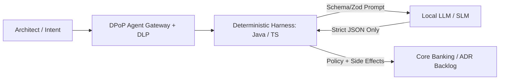

# Suite 1 Architecture Brief — The Deterministic Sandwich (Agent = Model + Harness)

> **Suite 1:** Agentive Enterprise Architecture, Governance & Cloud Controls  
> **Maturity Tier:** `Governed Private Enterprise Baseline` · **Sponsor / Scope:** Enterprise Architecture & AI Governance

*Redacted enterprise architecture summary across EA-Agentive-Platform-v3, X_Bank, and RedBank*

## Context & Architectural Intent

Financial institutions cannot let raw LLMs execute unvalidated core-banking mutations. These private frameworks wrap locally hosted or governed models inside deterministic Java (Spring Boot) and TypeScript harnesses where models emit schema/Zod-validated JSON only and deterministic code enforces every policy and side effect.

## Architecture Highlights

- Five governance agents + seven domain developer agents aligned with TOGAF ADM and BDAT enterprise layering.
- DPoP-authenticated agent gateway paired with W3C Trace Context (traceparent/tracestate) and streaming DLP via Security SLMs.
- Compute-aware routing directing routine classification to fast SLMs and complex synthesis to larger local models, backed by mock-mode offline test suites.

## Guardrails & Compliance

- Regulatory alignment mapped against CBUAE 3/2025 data residency controls and PCI-DSS v4 requirements.
- Public governance anchors verified in COPUR/ai-governance-framework, COPUR/architecture-as-code, COPUR/common-cloud-controls, and COPUR/ai-agent-protocols.

## Architecture Diagram

---
[← Back to Full Catalog](../PROJECTS.md) · [← Back to Profile README](../README.md)
