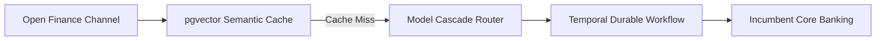

# Suite 3 Architecture Brief — OPF Agentive Open Finance (BaaS) Layer

> **Suite 3:** OPF — Agentive Open Finance (BaaS) Platform  
> **Maturity Tier:** `Public Reference Baseline` · **Sponsor / Scope:** Agentive Open Finance & BaaS Initiative

*Bridging Open Finance channels and incumbent core banking via Temporal, Model Cascades, and pgvector*

## Context & Architectural Intent

OPF acts as an Agentive Translation Layer between Open Finance / BaaS channels and incumbent core-banking constraints. Public V2 reference documentation (OPF-Agentive-Platform) is complemented by private V3/V4 baselines adding regulated architecture backlogs and AI data controls.

## Architecture Highlights

- Temporal-orchestrated stateful agent workflows replacing brittle static state machines.
- Model Cascades (MoE) routing simple intents to low-latency SLMs before invoking foundation models.
- pgvector semantic caching layer designed to bypass redundant LLM inference on recurring intent embeddings.

## Guardrails & Compliance

- Cross-references COPUR/ai-agent-protocols (Google ADK, MCP, A2A, Quarkus, LangChain4j) without duplicating canonical ownership.
- V3/V4 enterprise variants remain in private repositories while V2 codex and diagrams are publicly inspectable.

## Architecture Diagram

---
[← Back to Full Catalog](../PROJECTS.md) · [← Back to Profile README](../README.md)
