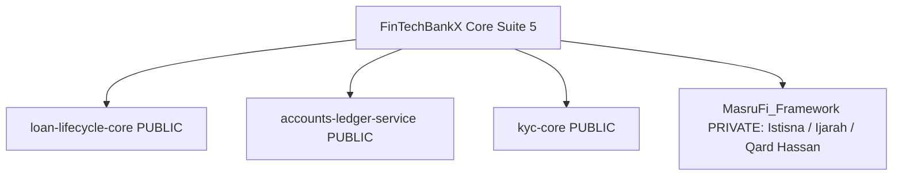

# Suite 5 Architecture Brief — FinTechBankX Core & MasruFi Sharia Finance Engine

> **Suite 5:** FinTechBankX Core Lending, Ledger, KYC & MasruFi  
> **Maturity Tier:** `Public Reference Baseline` · **Sponsor / Scope:** Core Banking, Lending & Islamic Finance

*Bounded-context core banking services paired with private DDD/Hexagonal Islamic finance models*

## Context & Architectural Intent

Suite 5 pairs public core-banking service boundaries (loan-lifecycle-core, accounts-ledger-service, kyc-core) with two private enterprise engines: enterprise-loan-management-system and MasruFi_Framework (Sharia-compliant financing contracts integrated with crypto-banking concepts).

## Architecture Highlights

- Strict Domain-Driven Design and Hexagonal Architecture isolating financial contract invariants from persistence and transport.
- MasruFi_Framework encodes Istisna, Ijarah, and Qard Hassan contract lifecycles alongside tokenized finance primitives.
- Public service modules expose clean domain boundaries for lending, double-entry ledger, and customer KYC.

## Guardrails & Compliance

- MasruFi_Framework and enterprise-loan-management-system are verified PRIVATE repositories; zero private endpoints or code are exposed.
- Public FinTechBankX core services link directly to verified PUBLIC repositories.

## Architecture Diagram

---
[← Back to Full Catalog](../PROJECTS.md) · [← Back to Profile README](../README.md)
