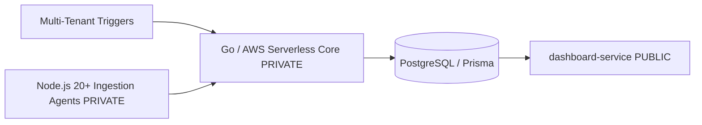

# Suite 10 Architecture Brief — Multi-Tenant Serverless News & Observability

> **Suite 10:** Multi-Tenant Serverless News & Observability Platform  
> **Maturity Tier:** `Governed Private Enterprise Baseline` · **Sponsor / Scope:** Multi-Tenant Serverless SaaS Platform

*Redacted C4 overview of Go/AWS Serverless workflows and the standalone public dashboard microservice*

## Context & Architectural Intent

Decoupled cleanly from EV CAN/telemetry (Suite 9), Suite 10 operates a multi-tenant Go/AWS Serverless workflow platform (private) alongside local-first Node.js 20+ agents and an independently deployable public dashboard microservice (COPUR/dashboard-service).

## Architecture Highlights

- Go/AWS Serverless workflow core governed by Architecture Decision Records (ADR-0021 baseline).
- Idempotent start-run replay guard validating tenant scope and idempotency-key naming before execution.
- Standalone Node.js/Prisma/Docker dashboard-service maintains an independent lifecycle from private ingestion agents.

## Guardrails & Compliance

- Private repositories (daily-ev-news-serverless-go, daily-ev-news-agent, daily-news-agent) remain unlinked; public evidence anchors to dashboard-service and this redacted brief.
- Zero tenant data, API credentials, or internal handles appear in public artifacts.

## Architecture Diagram

---
[← Back to Full Catalog](../PROJECTS.md) · [← Back to Profile README](../README.md)
